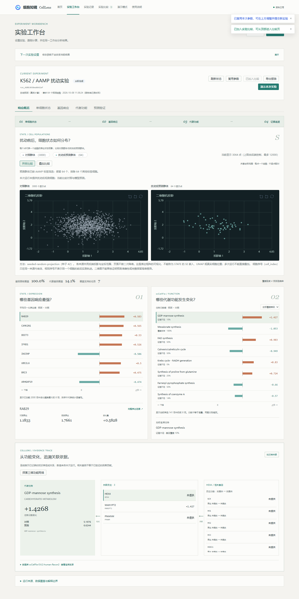

<p align="center">
  
</p>

# 细胞知镜 · CellLens

**单细胞基因扰动预测与代谢功能分析工作台。**

CellLens 将 STATE 的扰动表达预测与 scCellFie 的代谢任务分析整合为 Web 工作流。用户可以选择细胞背景和扰动基因，提交计算，查看单细胞状态、基因响应与代谢功能变化，追溯结果来源并导出分析报告。

也可以登录科研账号，上传自己的表达 H5AD，完成数据质控、PCA、分组表达比较与 scCellFie 代谢分析，保存和下载个人数据及结果。



## 功能

- **扰动预测**：支持 K562、RPE1、Jurkat、HepG2，选择登记的单基因扰动，设置预测细胞数和随机种子。
- **单细胞状态**：在共同对照 PCA 坐标中比较对照、预测与可用观测，按基因或代谢任务着色，查看累积分布。
- **基因响应**：查看平均表达、预测变化和匹配观测，筛选基因并联动单细胞图。
- **代谢功能**：比较任务与反应分数，浏览任务—反应—基因关联、GPR 规则、完整性指标和缺失基因。
- **实验管理**：查看任务进度，检索服务器实验记录，选择多个已完成实验进行比较，按章节解读结果。
- **来源与导出**：记录参数、模型与数据版本、文件哈希；导出 CSV、HTML 报告、关联与完整性 JSON，以及 SVG/PDF/PNG 科研图。
- **用户数据分析**：上传人类 H5AD 的 X 或 layers，声明表达单位和文库范围，查看校验结果、管理数据集并创建 CPU 分析任务；使用完整上传面板分析代谢功能。
- **科研账号**：管理员创建用户，个人上传数据、分析任务及文件下载检查所属账号，支持退出和会话到期。

### 运行模式

| 模式 | 用途 | 所需资产 |
|---|---|---|
| 在线推演 `online` | 执行 STATE 预测及表达、代谢分析 | 对应背景的模型、对照数据和 GPU |
| 结果回放 `precomputed` | 读取并核验保存的真实结果 | 完整回放包及来源记录 |
| 实测对照 `validation` | 执行预测并与匹配观测比较 | 在线资产、观测数据和登记协议 |

可用背景、扰动与模式由资产注册表和服务状态决定。当前支持单基因扰动；预测细胞请求数为 64–4,096。回放沿用保存结果的参数，不重新执行模型。代谢分数表示表达对功能的支持程度，完整性指标描述基因覆盖；结果解读见 [模型与数据](docs/MODEL_AND_DATA.md)。

## 技术栈

| 层次 | 组件 |
|---|---|
| 前端 | Vue 3、TypeScript、Pinia、Vite、ECharts、Three.js |
| 后端 | Python、FastAPI、Pydantic、SQLAlchemy |
| 科学计算 | STATE、scCellFie、AnnData、Scanpy |
| 存储 | MySQL、Alembic 迁移、文件式分析产物 |

## 安装与启动

环境需要 Python 3.11 或 3.12、uv、Node.js/npm 和 MySQL。在线计算还需要兼容当前 PyTorch/CUDA 依赖的 NVIDIA GPU。依赖版本以 `uv.lock` 和 `frontend/package-lock.json` 为准。

源码包含注册表、配置、基因面板和冻结代谢数据库。模型权重、原始 H5AD、真实回放包及历史运行产物需要另行准备。

### 1. 获取源码并安装依赖

以下命令在仓库根目录执行：

```bash
git clone https://github.com/hash-distill/celllens-platform.git
cd celllens-platform
uv sync --locked --python 3.11 --extra model --extra report --group dev
npm --prefix frontend ci
```

### 2. 配置数据库

将 `.env.example` 复制为 `.env`，设置 `CELLLENS_DATABASE_URL`。可以连接已有 MySQL，也可以使用仓库中的数据库容器：

```bash
docker compose up -d mysql
docker compose ps mysql
```

等待数据库状态为 `healthy` 后执行迁移和连接检查：

```bash
uv run --no-sync alembic upgrade head
uv run --no-sync python scripts/check_mysql.py
```

Compose 的默认连接信息与 `.env.example` 一致。更改账户或密码时需同时修改数据库配置与连接 URL。Docker Compose 只启动 MySQL，应用需要单独启动。

### 3. 准备科学资产

用户表达探索无需 STATE 权重或登记的对照数据；上传代谢分析需要下述冻结 scCellFie 数据库与科学依赖。只有预设扰动预测工作流需要准备完整模型资产。

按照 [模型与数据说明](docs/MODEL_AND_DATA.md) 获取匹配版本的模型与数据，并放到注册表指定的位置：

| 内容 | 配置或目录 |
|---|---|
| 模型目录、检查点及配套文件 | `data/registry/models.json` → `models/` |
| 对照与观测 H5AD | `data/registry/datasets.json` → `data/raw/` |
| 模型配置与有序基因面板 | `configs/models/`、`data/registry/state_*_genes.txt` |
| 代谢数据库 | `data/registry/sccellfie/human/` |
| 真实回放包 | `data/demo/{背景}/{扰动}/` |

在线计算资产准备后运行：

```bash
uv run --no-sync python scripts/audit_registry.py
```

只使用结果回放时，需要完整回放包，并在 `.env` 中关闭 `CELLLENS_WORKER_ENABLED` 和 `CELLLENS_GPU_AVAILABLE`。不同运行方式的依赖与资产要求见 [部署文档](docs/DEPLOYMENT.md)。

### 4. 构建并启动

```bash
npm --prefix frontend run build
uv run --no-sync uvicorn backend.app.main:app --host 127.0.0.1 --port 8000
```

打开 [应用首页](http://127.0.0.1:8000/) 或 [API 文档](http://127.0.0.1:8000/docs)。构建后由后端同时提供前端页面与 API。

服务使用单个 Uvicorn 进程。个人数据入口提供账号与归属校验；原有预设实验和历史运行仍是共享科研入口，部署时应使用受控网络。无 GPU 回放与服务器配置见 [部署文档](docs/DEPLOYMENT.md)。

### 5. 启用个人数据分析

执行迁移后创建首个管理员账号（密码通过终端隐藏输入，至少 12 位）：

```bash
uv run --no-sync python scripts/manage_users.py create admin --role admin
```

在 `.env` 设置 `CELLLENS_DATA_WORKER_ENABLED=true`，重启应用，打开“我的数据”。管理员可在页面创建科研用户。CPU 表达与代谢分析不依赖 GPU worker；若只使用用户数据分析，可设置 `CELLLENS_WORKER_ENABLED=false`、`CELLLENS_GPU_AVAILABLE=false`。

数据格式、接口、配额与分组分析说明见[用户数据指南](docs/guide/USER_DATA.md)。首期支持人类 H5AD；自有数据直接驱动 STATE 预测尚未开放，任意细胞背景不能因此视为模型已支持。

## 使用

1. 打开“实验工作台”，选择细胞背景、运行模式和扰动基因。
2. 设置预测细胞数和随机种子，提交实验并查看执行进度。
3. 运行完成后浏览单细胞状态、基因响应和代谢功能；查看关联基因、完整性与来源记录。
4. 在“实验记录”中检索已有运行，加入“实验比较”，或导出本次结果。

详细操作见 [使用指南](docs/guide/USER_GUIDE.md)。

## 开发

完成依赖、数据库和资产配置后，在两个终端分别启动后端与前端：

```bash
# 终端一
uv run --no-sync uvicorn backend.app.main:app --host 127.0.0.1 --port 8000

# 终端二
npm --prefix frontend run dev -- --host 127.0.0.1 --port 5173 --strictPort
```

开发页面为 `http://127.0.0.1:5173`，`/api` 默认代理到后端 8000 端口。Windows PowerShell 可使用 `npm.cmd` 执行 npm 命令。

开发检查：

```bash
uv run --no-sync pytest -q
uv run --no-sync ruff check backend scripts
uv run --no-sync basedpyright
npm --prefix frontend run build
```

## 目录

```text
celllens-platform/
├── backend/          API、计算适配、业务服务、迁移与测试
├── frontend/         页面、图表、功能网络与状态管理
├── configs/          模型、分析与数据划分配置
├── data/registry/    资产注册表、基因面板与冻结数据库
├── scripts/          启动、资产准备与检查工具
├── docs/             使用、部署、接口与技术文档
├── licenses/         第三方许可原文与来源清单
├── ops/              本地数据库配置参考
├── pyproject.toml    Python 依赖与开发配置
└── uv.lock           Python 依赖锁文件
```

## 文档

- [使用指南](docs/guide/USER_GUIDE.md)
- [部署与启动](docs/DEPLOYMENT.md)
- [系统架构](docs/ARCHITECTURE.md)
- [API 说明](docs/API.md)
- [模型与数据](docs/MODEL_AND_DATA.md)
- [前端开发](docs/FRONTEND.md)
- [脚本索引](scripts/README.md)
- [完整文档目录](docs/README.md)

## 许可

项目自有代码与文档采用 [MIT License](LICENSE)。第三方方法、模型、数据库与结果的适用条款见 [NOTICE](NOTICE) 和 [第三方许可说明](docs/THIRD_PARTY_NOTICES.md)；根目录 MIT 不替代这些上游许可。
