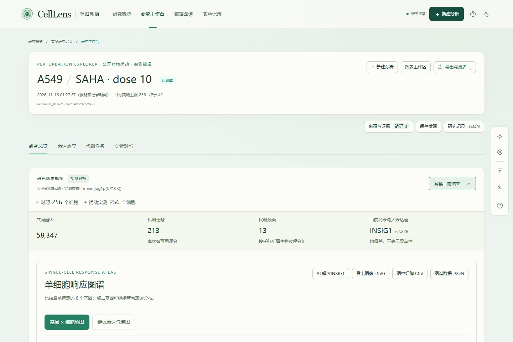
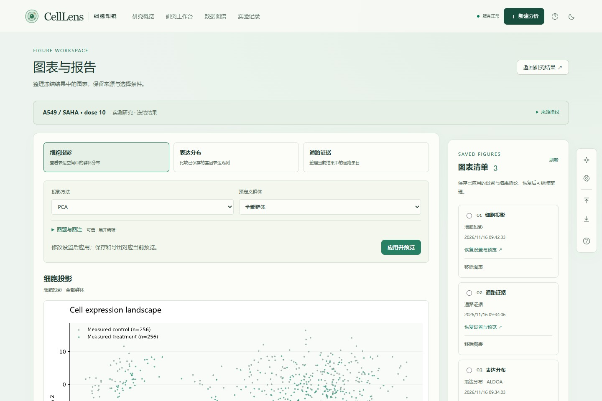
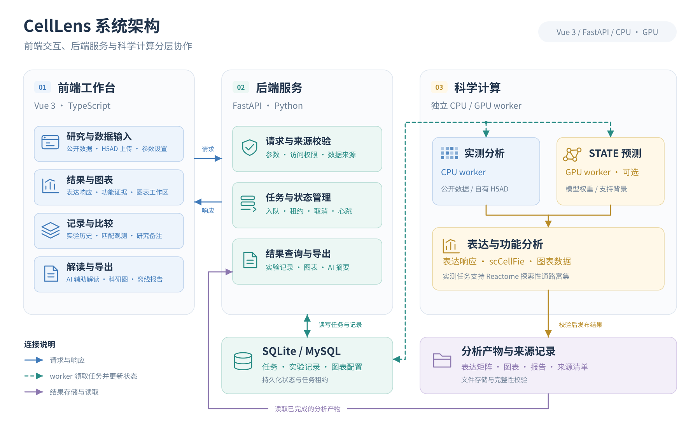

<p align="center">
  
</p>
<h1 align="center">细胞知镜 · CellLens</h1>
<p align="center">单细胞扰动分析与可视化平台</p>
<p align="center">
  <a href="LICENSE"></a>
  
  
  
</p>
<p align="center">
  <a href="#功能特性">功能特性</a> · <a href="#快速开始">快速开始</a> · <a href="docs/使用说明.md">使用说明</a> · <a href="docs/CPU部署.md">部署文档</a> · <a href="#开发">开发</a>
</p>

CellLens 面向单细胞扰动研究，帮助研究者分析基因扰动或药物处理后的表达变化，并查看相关的通路和代谢功能线索。你可以选择公开数据、上传自己的 H5AD 文件，或使用 STATE 模型预测基因扰动响应，再在同一工作台中比较结果、制作图表和导出报告。

实测数据分析可在 CPU 上运行。模型预测需要 NVIDIA GPU、STATE 环境及相应模型权重。


## 功能特性

| 功能 | 说明 |
|---|---|
| 公开数据分析 | 查询基因扰动与药物处理条件，选择对照组和处理组开展实测分析 |
| 自有数据上传 | 在浏览器上传 H5AD，预览数据字段，选择分组、背景和表达尺度 |
| 基因扰动预测 | 使用 STATE 预测支持背景下的单基因扰动响应，记录模型与输入来源 |
| 表达分析 | 查看基因表达差、逐细胞分布、热图、气泡图及已有 PCA/UMAP 投影 |
| 通路与代谢分析 | 查看 Reactome 探索性富集与 scCellFie 任务评分，追查关联基因和反应 |
| 图表工作区 | 调整图表分组、标题和注释，保存图表配置，导出 SVG、PNG、PDF 和数据 CSV |
| 实验记录 | 保存分析结果、参数和研究备注，比较预测与匹配观测，追溯数据来源 |
| 报告导出 | 导出图表、数据、分析包和可离线浏览的 HTML 报告 |
| AI 辅助解读 | 配置模型服务，对所选结果与图表摘要进行问答和解释 |

模型背景包括 K562、Jurkat、RPE1 和 HepG2。具体可用基因、实测覆盖与资源状态可在数据图谱和服务状态页查看。自有 H5AD 支持实测分析，暂不用于 STATE 预测。

## 界面预览

| 研究工作台 | 结果工作台 |
|---|---|
|  |  |

| 数据图谱 | 图表工作台 |
|---|---|
|  |  |

结果截图展示 SciPlex2 的公开 A549 药物处理案例。首页细胞图形为视觉示意。各图说明见[页面截图](docs/screenshots/README.md)。

## 快速开始

### 环境要求

| 依赖 | 用途 |
|---|---|
| Python 3.11 或 3.12 | 运行后端和分析任务 |
| Node.js 与 npm | 安装并构建前端 |
| uv | 安装 Python 依赖 |
| NVIDIA GPU 与兼容驱动（可选） | 运行 STATE 模型预测 |

以下命令适用于 Windows PowerShell，均在项目根目录执行。本地启动默认使用 SQLite，无需另装数据库。Linux 服务部署与 MySQL 配置见[部署文档](docs/CPU部署.md)。

### 安装与启动

获取并解压源码，进入 `celllens-platform` 目录。首次运行：

```powershell
powershell -NoProfile -ExecutionPolicy Bypass -File .\ops\run-local.ps1 -Install -Port 8028
```

脚本会安装依赖、构建前端、初始化数据库，并启动后端和 CPU 分析服务。看到 `CellLens ready` 后，打开 **http://127.0.0.1:8028/**。

以后启动时省略 `-Install`：

```powershell
powershell -NoProfile -ExecutionPolicy Bypass -File .\ops\run-local.ps1 -Port 8028
```

停止服务：

```powershell
powershell -NoProfile -ExecutionPolicy Bypass -File .\ops\stop-local.ps1
```

停止服务会保留数据库、分析结果和日志。数据库位于 `data/runtime/celllens.db`，运行日志位于 `data/runtime/`。如端口被占用，可将 `-Port 8028` 改为空闲端口。

### 准备数据

源码包含资源清单和配置示例，模型权重、原始 H5AD 和历史分析结果需单独准备。启动后可选择以下方式开始分析：

- **自己的数据**：进入研究工作台，选择“实测数据分析 → 自有 H5AD”，上传文件并设置对照组、处理组和表达尺度。
- **公开数据**：在数据图谱中选择已有资源的研究条件。数据准备方法见[资源说明](docs/INFERENCE_RESOURCES.md)。
- **公开药物数据**：运行下面的命令下载并登记 sciPlex2 数据，然后打开 `/datasets`。

```powershell
.\.venv\Scripts\python.exe -m scripts.prepare_sciplex2
```

H5AD 支持 `raw_counts`、`cp10k` 和 `log1p_cp10k` 三种表达尺度。文件要求与操作步骤见[使用说明](docs/使用说明.md)，药物数据的来源和分析方法见[sciPlex2 说明](docs/analysis/sciPlex2.md)。

### 启用 GPU 预测

首次安装预测环境时执行：

```powershell
powershell -NoProfile -ExecutionPolicy Bypass -File .\ops\run-local.ps1 -Install -Gpu -Port 8028
```

已安装预测依赖时省略 `-Install`。启用预测前，还需准备所选背景的模型权重与输入数据，详见[模型与数据](docs/MODEL_AND_DATA.md)。

## 使用流程

1. 在**研究工作台**选择实测分析或基因扰动预测，设置数据与参数。
2. 分析完成后，查看**研究总览、表达响应、功能证据、实验对照**。
3. 进入**图表工作区**调整图表，添加注释并导出。
4. 在**实验记录**中重新打开结果，查看参数、来源和研究备注。

服务与资源状态可在 `/status` 查看，API 文档位于 `/docs`。完整操作说明见[使用说明](docs/使用说明.md)。

## 架构

前端使用 Vue 3 和 TypeScript，后端使用 FastAPI。API 负责接收请求和读取结果，独立的 CPU/GPU worker 执行分析任务；SQLite 或 MySQL 保存任务与记录，文件系统保存分析产物。



部署支持本地使用、私有工作空间和公共只读展示。私有模式采用工作空间认证；公共模式只开放指定的已完成结果。部署配置见[部署文档](docs/CPU部署.md)。

## 开发

```text
backend/     后端服务、数据库迁移与测试
frontend/    Vue 前端、图表组件与前端检查
configs/     分析与数据配置
data/        资源登记与本地数据
ops/         启停脚本与服务部署模板
scripts/     数据准备和维护工具
docs/        使用说明、方法与开发文档
licenses/    第三方许可
```

安装开发依赖后，可以运行以下检查：

```powershell
uv sync --frozen --extra analysis --extra report
npm.cmd --prefix frontend ci

uv run --no-sync pytest -q
uv run --no-sync ruff check backend scripts
uv run --no-sync basedpyright
node --test frontend/scripts/test-*.mjs
npm.cmd --prefix frontend run build
```

使用 GPU 开发环境时，在 `uv sync` 命令中同时保留 `--extra model`。修改前端代码后重新构建，再启动服务。

提交问题时，请附上运行环境、复现步骤和相关日志；涉及数据的问题可提供脱敏后的最小样例。

## 文档

| 文档 | 内容 |
|---|---|
| [使用说明](docs/使用说明.md) | 数据选择、任务提交、结果阅读与图表导出 |
| [部署文档](docs/CPU部署.md) | 本地运行、GPU 配置、Linux 服务与访问控制 |
| [H5AD 接入](docs/H5AD接入.md) | 上传、预检、分组与 API 接入 |
| [模型与数据](docs/MODEL_AND_DATA.md) | 模型、数据来源、资源登记与适用范围 |
| [实测分析方法](docs/MEASURED_ANALYSIS.md) | 数据处理、表达比较与结果解释 |
| [第三方说明](docs/THIRD_PARTY_NOTICES.md) | 依赖、模型和数据的来源与许可 |

## 结果解释

CellLens 用于探索性分析。实测观测、模型预测和表达推断的功能评分在结果中分别标注。

- scCellFie 任务分数反映表达对代谢任务的支持程度，不等于实测代谢通量，也不适合直接比较不同任务的原始分数。
- 表达均值差与探索性通路富集不能代替基于独立生物学重复的统计检验。
- PCA/UMAP 展示表达状态关系，不表示细胞的物理位置、运动或形态。

模型的适用范围与验证限制见[模型支持与泛化证据](docs/GENERALIZATION.md)。

## 许可

项目代码与文档采用 [MIT License](LICENSE)。第三方模型、数据和依赖遵循各自许可证；STATE 模型的非商业使用限制独立适用。详见 [NOTICE](NOTICE) 和[第三方说明](docs/THIRD_PARTY_NOTICES.md)。
