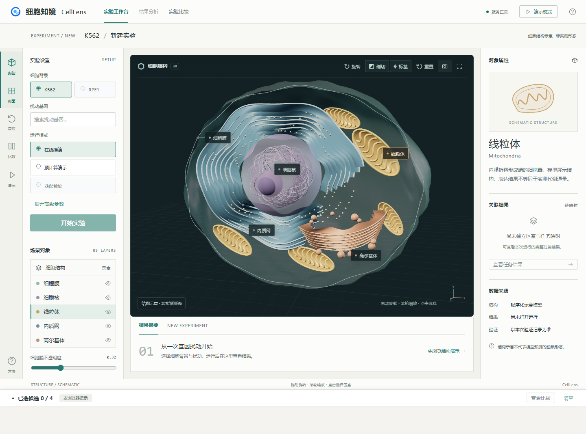

<p align="center">
  
</p>

# 细胞知镜 · CellLens

**面向基因扰动研究的表达预测与代谢功能分析工作台。**

CellLens 使用 STATE 预测扰动后的表达，再通过 scCellFie 分析代谢任务与反应分数，提供运行记录、来源追溯和结果可视化。三维细胞用于结构讲解，当前不预测细胞器形态，也未建立可靠的细胞器与任务映射。

当前版本为 `0.1.0`，属于内部科研原型。K562 在线计算链路已在 Windows 本机实测；正式生物学泛化评价尚未完成。



*2026-10-04 实际页面截图。结构为程序化示意；计算完成不代表实验验证通过。*

## 从这里开始

- [使用指南](docs/guide/USER_GUIDE.md)：参数含义、完成一次运行、阅读结果。
- [STATE 与 scCellFie 模型说明](docs/guide/MODELS.md)：原始任务、输入输出与科学边界。
- [完整文档目录](docs/README.md)：部署、架构、接口、前端和运维。
- [脚本用途](scripts/README.md)：日常运行与资产准备工具。

## 功能与模式

系统支持实验设置与进度、表达与代谢结果、候选比较、CSV/HTML 报告、运行来源记录，以及交互式三维结构和四章演示。

| 模式 | 执行内容 | 当前边界 |
|---|---|---|
| 在线推演 `online` | STATE 推理与表达、代谢分析 | 主要支持登记的 K562 单基因扰动；需就绪的模型、数据与 GPU |
| 预计算演示 `precomputed` | 校验并读取现有包 | 当前 K562/MYC 包为合成样例，不执行模型 |
| 匹配验证 `validation` | 预测与匹配观测比较 | 后端分支与已有指标可查询；协议待确认，前端提交关闭 |
| 前端 Mock | 浏览器内开发样例 | 独立于后端，不是真实运行结果 |

## 快速启动

以下命令在仓库根目录运行。新环境先按 [部署与启动](docs/DEPLOYMENT.md) 准备依赖、`.env`、MySQL、迁移和科学资产；克隆源码不包含全部运行资产。

### 已配置的 Windows 本机

构建前端并启动：

```powershell
powershell -NoProfile -ExecutionPolicy Bypass -File .\scripts\start_system.ps1 -StartLocalMysql
```

已有最新前端构建时：

```powershell
powershell -NoProfile -ExecutionPolicy Bypass -File .\scripts\start_system.ps1 -StartLocalMysql -SkipBuild
```

打开 [工作台](http://127.0.0.1:8000/workbench)。脚本检查并复用已启动的 MySQL；它不代替依赖安装和模型准备。

### 开发时分别启动

终端一：

```bash
uv run --no-sync uvicorn backend.app.main:app --host 127.0.0.1 --port 8000
```

终端二：

```bash
npm --prefix frontend run dev -- --host 127.0.0.1 --port 5173 --strictPort
```

开发页面为 `http://127.0.0.1:5173/workbench`。构建后由后端提供 `frontend/dist`，页面与 API 共用 8000。

## 页面入口

| 页面 | 路由 |
|---|---|
| 工作台 | `/workbench` |
| 运行结果 | `/runs/<run_id>` |
| 候选比较 | `/compare` |
| 本次实验演示 | `/demo?run=<run_id>&step=0` |
| 方法与服务状态 | `/about` |

运行完成后点击“演示本次实验”。当前自动播放按每章 22 秒切换；这是章节讲解，不是连续生理过程模拟。结果缺失时显示空态，不自动补样例。

## 工程目录

```text
celllens-platform/
├── backend/             API、科学计算适配、数据库迁移与测试
├── frontend/            Vue 工作台、Three.js 示意、ECharts 图表
├── configs/             模型、分析与拆分配置
├── data/registry/       注册表、哈希、基因面板与冻结代谢数据库
├── data/raw/            输入表达数据（不纳入 Git）
├── data/demo/           预计算包（不纳入 Git）
├── data/derived/runs/   运行产物（不纳入 Git）
├── models/              模型权重（不纳入 Git）
├── scripts/             启动、检查、资产处理与契约导出
├── docs/                统一文档入口、使用说明与技术参考
│   ├── guide/           使用、模型与演示讲解
│   ├── screenshots/     精选实际页面截图
│   └── verification/    明确日期的历史工程检查记录
├── reports/             新检查产物与日志（不纳入 Git，可清理）
├── ops/                 本机 MySQL 配置参考
├── pyproject.toml       Python 依赖与检查配置
└── uv.lock              Python 依赖锁文件
```

`.venv`、`frontend/node_modules` 是本机已安装依赖；`.mysql-data` 是数据库数据目录。准备重新安装或迁移前需分别核对，不应与普通测试缓存一起清理。

## 开发检查

```bash
uv pip check
uv run --no-sync pytest -q
uv run --no-sync ruff check backend scripts
uv run --no-sync basedpyright
npm --prefix frontend run build
```

浏览器检查需要 Playwright 与 Chromium，具体命令、依赖和输出路径见 [脚本索引](scripts/README.md)。数据库、真实推理与故障处理见 [运行与检查](docs/OPERATIONS.md)。

## 科学与部署边界

- 当前基因差值不是显著性检验；表达投影为固定种子的随机投影。
- 代谢分数不等于通量、浓度或 ATP 产量；覆盖等级不等于预测准确率。
- RPE1 未开放，验证拆分与正式评价协议仍需确认。
- 服务尚无用户认证与权限隔离；worker 与 Web 在同一进程，当前部署使用单个 Uvicorn 进程。
- 候选与最近运行保存在当前浏览器；模型、输入和完整产物不包含在 Git 源码中。

详细解释见 [模型与数据](docs/MODEL_AND_DATA.md)。实际截图与历史检查分别见 [页面截图](docs/screenshots/README.md)、[工程检查记录](docs/verification/2026-10-04/README.md)。

## 许可与变更

仓库尚无项目级 `LICENSE`。上游代码、模型与数据的条款见 [第三方说明](docs/THIRD_PARTY_NOTICES.md)。

接口变更同步 `docs/openapi.json`，部署变更同步部署文档；不要提交凭据、模型权重与完整运行产物。
