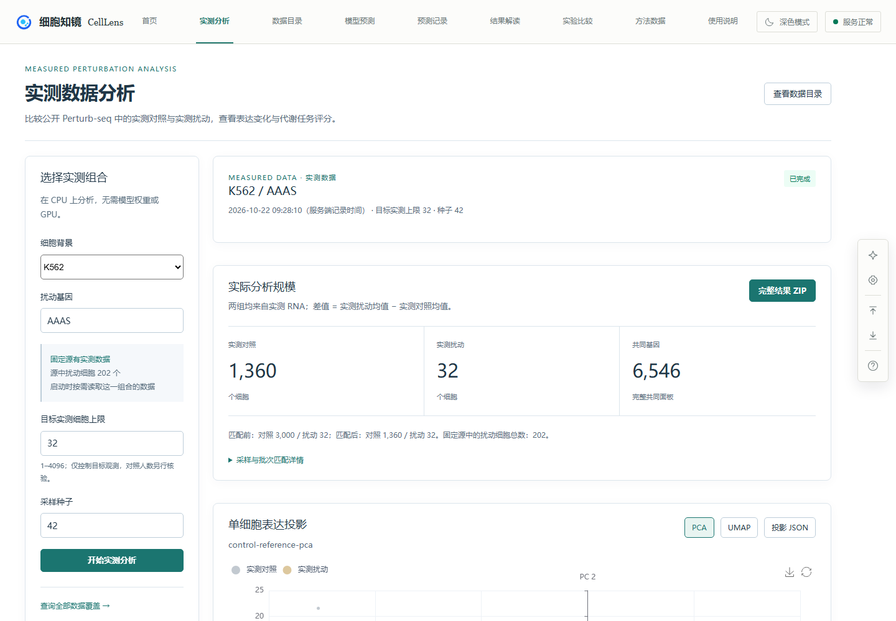
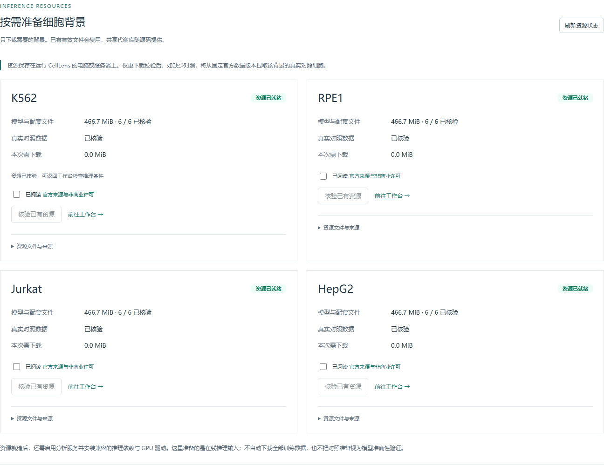
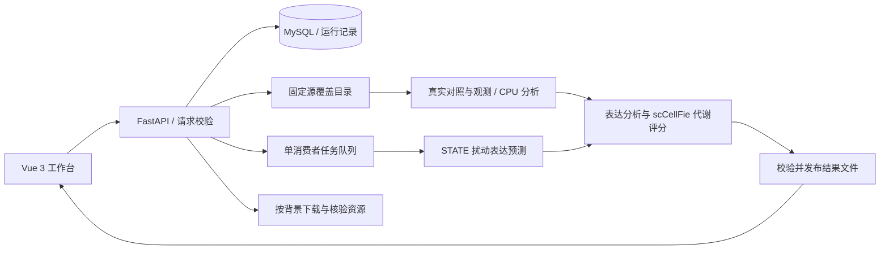

<p align="center">
  
</p>
<h1 align="center">细胞知镜 · CellLens</h1>
<p align="center">面向单细胞基因扰动研究的预测与代谢功能分析工作台</p>
<p align="center">
  <a href="LICENSE"></a>
  
  
  
</p>
<p align="center">
  <a href="#快速开始">快速开始</a> · <a href="#按需准备推理资源">模型下载</a> · <a href="docs/guide/USER_GUIDE.md">使用指南</a> · <a href="docs/DEPLOYMENT.md">部署文档</a> · <a href="docs/README.md">完整文档</a>
</p>


CellLens 是基于 **Vue 3 + FastAPI** 的单细胞扰动研究分析。先查询数据覆盖：**已有实测就直接分析真实对照与扰动细胞**；需要检查模型表现时再运行 STATE 并与实测比较；当前源无实测但模型支持时提供明确标注的探索预测。表达变化、scCellFie 评分、科研图和导出保留各自来源。

当前支持 **K562、RPE1、Jurkat、HepG2** 四个背景。固定公开源有 **5,759 个实测背景／扰动组合**；模型支持 2,023 个非对照目标、共 8,092 个组合，其中 2,333 个在该版本中没有实测记录。**输入受支持不等于泛化已验证**；不宣称任意新基因或新细胞类型可预测。详见[完整范围与泛化证据](docs/GENERALIZATION.md)。



截图读取本次实际完成的 K562 / AAAS 实测分析：按需提取 32 个真实扰动细胞，匹配后 1,360 个真实对照、6,546 个共同基因；没有模型预测群体。

## 功能特性

| 功能 | 可以做什么 |
|---|---|
| 数据覆盖目录 | 查询固定公开源的真实细胞数、本地可用子集、模型支持和上游 test 声明；下载完整 CSV |
| 实测直接分析 | CPU 分析真实对照与目标观测的共同基因、表达变化、PCA/UMAP 及 scCellFie 分数，无需 STATE 权重 |
| 在线扰动预测 | 选择细胞背景、单基因扰动、细胞数与随机种子，提交 STATE 推理 |
| 按需准备资源 | 在连接服务页下载所选背景的权重与配套文件，准备真实对照，查看进度、取消和重试 |
| 单细胞与表达分析 | 查看 PCA / UMAP、基因响应和群体差异；图中每个点代表细胞 |
| 代谢功能分析 | 查看 scCellFie 任务、反应、关联网络及预测基因面板的覆盖限制 |
| AI 科研解读 | 解读实测摘要或预测结果；预测支持科研图与匹配比较，发送前预览摘要 |
| 实测对比 | 有匹配观测时查看表达误差、相关性与不变化基线；无观测时显示不可用原因 |
| 记录与比较 | 统一入口分别查看实测、预测历史及预测结果比较，保留来源身份 |
| 科研导出 | CSV / JSON、分析 ZIP、双语 PDF 报告及 SVG / PDF / PNG 科研图 |

主导航收敛为“研究分析、记录与比较、数据与方法、使用说明”。结果概览先给出关键基因、代谢任务及所选任务的对照/扰动数值，PCA/UMAP 等专业检查按需展开。任务按关联基因覆盖率、再按绝对差值排序，默认显示前 8 项，可展开本分类全部任务；覆盖不等于可靠性或显著性。

**科研边界：**模型预测、实测观测、历史冻结结果和合成演示分别标注。代谢任务分数反映表达对功能的支持程度，不是实测代谢通量；PCA / UMAP 坐标不表示细胞形态或物理位置。当前匹配观测诊断未证明训练排除，不能称为独立留出验证。系统暂不提供任意用户数据上传分析入口。

## 快速开始

下面是 **Windows PowerShell** 的完整启动路径。所有命令在 `celllens-platform` 仓库根目录执行。Linux、远程数据库和进程管理见[部署文档](docs/DEPLOYMENT.md)。

需要 Python 3.11、[uv](https://docs.astral.sh/uv/getting-started/installation/)、Node.js / npm 和 MySQL。若使用下方容器数据库，还需启动 Docker Desktop。推理需要兼容当前 PyTorch 的 NVIDIA GPU 与驱动；**启动页面不要求先下载模型权重。**

### 1. 获取代码与安装依赖

```powershell
git clone https://github.com/hash-distill/celllens-platform.git
cd celllens-platform
uv sync --locked --python 3.11 --extra analysis --extra report
npm.cmd --prefix frontend ci
if (-not (Test-Path -LiteralPath .env)) {
    Copy-Item -LiteralPath .env.example -Destination .env
}
```

以上安装用于实测分析与科研报告。`analysis` 包含 AnnData、scCellFie、范围读取和降维依赖，`report` 提供原有绘图／PDF 能力；这些依赖与模型权重是两回事。需要 STATE 预测时改用 `uv sync --locked --python 3.11 --extra analysis --extra model --extra report`，并准备 GPU。预测环境锁定 `arc-state==0.11.1`、`torch==2.14.0`，PyTorch 来自 CUDA 13.2 索引。再次同步时保留所需 extras。

只做实测分析或没有兼容 GPU 时，在 `.env` 中将 `CELLLENS_WORKER_ENABLED` 和 `CELLLENS_GPU_AVAILABLE` 都改为 `false`。实测任务仍可执行；这两个开关控制预测入口。源码不附带历史实验记录，缺少的实测子集会在明确提交后按需读取。

### 2. 启动 MySQL（二选一）

**新环境：使用仓库提供的 Docker 数据库。**

```powershell
docker compose up -d mysql
docker compose ps mysql
```

等待 `celllens-mysql` 显示 `healthy`。模板端口为 **宿主机 `3307` → 容器 `3306`**；`.env.example` 的本地连接与其对应。模板账户仅用于本地开发，公开部署时同步修改 Compose 和 `.env` 中的凭据。数据库数据保存在命名卷中。

**已有本机 MySQL：启动原项目实例即可，无需 Docker。**

已有按本项目配置的本机数据库时，可使用：

```powershell
powershell -NoProfile -ExecutionPolicy Bypass -File .\scripts\start_mysql.ps1
```

其他电脑使用本机 MySQL 时，将已初始化的 `mysqld.exe` 和数据目录传给脚本，或使用数据库自身的服务管理方式；详见[本机数据库配置](docs/DEPLOYMENT.md#本机-mysql)。已有或远程实例还需将实际连接写入 `.env`。**不要让本机实例和容器同时争用 3307，也不要把另一个 3306 实例当成项目数据库。**

### 3. 启动应用

```powershell
powershell -NoProfile -ExecutionPolicy Bypass -File .\scripts\start_system.ps1 -ApiPort 8001
```

脚本依次检查端口、连接 MySQL、执行 Alembic 迁移、核验表结构、构建前端，再启动应用。未变化的前端会复用构建；数据库必须先启动。使用本机项目 MySQL 时，也可加 `-StartLocalMysql` 合并启动步骤。

| 入口 | 地址 |
|---|---|
| 实测分析 | <http://127.0.0.1:8001/measured> |
| 数据覆盖目录 | <http://127.0.0.1:8001/data-catalog> |
| 模型预测工作台 | <http://127.0.0.1:8001/workbench> |
| 记录与比较 | <http://127.0.0.1:8001/records> |
| 连接服务 / 资源准备 | <http://127.0.0.1:8001/status#inference-resources> |
| API 文档 | <http://127.0.0.1:8001/docs> |
| 健康检查 | <http://127.0.0.1:8001/api/v1/health> |

本文统一显式使用 **8001**。脚本默认端口仍是 8000；需要更换端口时修改 `-ApiPort`，浏览器地址也随之修改。终端保持运行，按 `Ctrl+C` 停止应用。

### 4. 先查覆盖，再选择分析方式

打开“数据目录”，搜索例如 **K562 / ALDOA**，点击“直接分析实测”。设置目标观测上限，提交后查看实际匹配人数、共同基因、表达差异和投影；完整 CSV／ZIP／HTML 下载位于实测结果，历史统一从“记录与比较”进入。已有有效本地输入优先复用，缺少时只提取相应真实细胞，不生成替代观测。完整说明见[实测分析](docs/MEASURED_ANALYSIS.md)。

“本源有实测”与“已下载”分别显示。没有源记录且模型支持时，可选择探索预测；它不表示该组合在其他研究中未测，也不表示模型已经可靠泛化。已有实测时仍可显式预测，再进入原有“预测与实测”评估。

### 5. 需要预测时准备所需背景

打开“连接服务”，找到“按需准备细胞背景”，选择例如 **RPE1**，阅读官方来源与许可后勾选确认，点击 **下载并准备**。准备完成后返回工作台，确认该背景显示在线可用，再提交实验。

无需先手工下载四套权重，也无需先准备完整 atlas。资源卡片可在模型文件缺失时正常使用。若资源已准备但工作台仍不可用，按页面提示检查 GPU、worker、Python 依赖与共享资产。

## 按需准备推理资源



| 背景 | 模型与配套文件 | 真实对照 |
|---|---:|---|
| K562 | 约 467 MiB / 6 个文件 | 已有合法对照复用；缺失时按背景提取 |
| RPE1 | 约 467 MiB / 6 个文件 | 同上 |
| Jurkat | 约 467 MiB / 6 个文件 | 同上 |
| HepG2 | 约 467 MiB / 6 个文件 | 同上 |

点击哪个背景，就只下载该背景的 checkpoint、上游配置、变量维度和三类映射文件。源码已包含基因面板、应用模型配置、拆分配置与冻结 scCellFie 数据库，四个背景共享这些配套能力。

- **下载位置：**运行后端的电脑或服务器项目目录。远程访问时，文件保存在服务器上。
- **来源与校验：**权重固定为官方 [ST-HVG-Replogle](https://huggingface.co/arcinstitute/ST-HVG-Replogle/tree/bb6a9562cbbf1fd152df14cc53b4cc7517c77175) 版本；每个文件验证大小与 SHA-256 后才启用。有效文件直接复用，临时文件不算就绪。
- **真实对照：**从固定 [State-Replogle-Filtered](https://huggingface.co/datasets/arcinstitute/State-Replogle-Filtered/tree/d790193bb2c93726541a75ca3fa873a92ed44da5) 版本范围读取所选背景最多 1,024 个非靶向细胞，种子为 42；会读取共享元数据，但不整包下载约 30 GB 的 atlas。
- **中断处理：**同一项目一次准备一个背景。可取消、重试，权重支持范围续传；服务中断后任务显示可重试，对照提取重新执行。上游不支持续传时安全重新下载该文件。
- **历史保留：**已有有效对照不覆盖；新提取的对照登记新版本，保留原 dataset ID 与文件供旧实验追溯。
- **磁盘空间：**下载前检查至少两份所选模型大小的空闲空间，另需为 Python 环境、对照及实验结果预留空间。

资源准备不安装驱动或 Python 依赖，也不自动下载实测诊断集或全部训练数据。**资源就绪表示输入文件通过检查；工作台的在线入口还检查资产与 worker/GPU 启用开关。实际驱动及依赖需按部署文档核验；这些均不等于模型准确性验证。**完整契约与实现见[资源管理说明](docs/INFERENCE_RESOURCES.md)。

## 开发与配置

### 开发模式

数据库与 Python 依赖准备好后运行：

```powershell
powershell -NoProfile -ExecutionPolicy Bypass -File .\scripts\start_system.ps1 -Mode Development -ApiPort 8001 -FrontendPort 5173
```

访问 <http://127.0.0.1:5173/workbench>。脚本启动 Vite，并将 API 代理到所选后端端口；前端支持热更新。构建后运行由 FastAPI 同源提供前端，无需单独启动 Vite。

### 主要配置

配置保存在根目录 `.env`，首次从 `.env.example` 复制；已有配置不要覆盖。

| 配置 | 用途 |
|---|---|
| `CELLLENS_DATABASE_URL` | MySQL 实际连接；本地模板使用 `127.0.0.1:3307/celllens` |
| `CELLLENS_WORKER_ENABLED` | 是否执行新预测；CPU 实测分析独立运行 |
| `CELLLENS_GPU_AVAILABLE` | 允许 GPU 在线入口；实际 GPU 状态见服务页，依赖需另行检查 |
| `CELLLENS_STATE_EXECUTABLE` | STATE 命令，默认 `state` |
| `CELLLENS_CREATE_DATABASE_SCHEMA` | 保持 `false`，由 Alembic 管理表结构 |
| `CELLLENS_ALLOW_SYNTHETIC_RESULTS` | 正式运行保持 `false` |

系统设置页支持多组命名 AI 连接、获取并搜索模型列表、手动填写模型，以及通用 JSON / `.env` 文件或粘贴导入。可设置推理强度、Claude 思考模式、输出预算和上下文窗口；发送前显示摘要与输入预算估算，超限提示调整。Key 按连接仅保留于当前标签页会话，不写入实验结果，导出配置不含密钥。使用外部模型会发送当前选择的摘要；模型目录获取与文本生成测试分别执行，真实可用性取决于服务和账号，参见 [AI 解读配置](docs/guide/ASSISTANT_SETTINGS.md)。

进程环境变量优先于 `.env`。Windows 启动脚本会拒绝终端遗留的 worker/GPU 覆盖，按提示清除后重试，或使用新终端。服务器、反向代理、无 GPU 模式与手动启动见[部署文档](docs/DEPLOYMENT.md)。当前 Compose **只管理数据库**，尚无完整应用 Docker 镜像。

### 检查命令

```powershell
uv sync --locked --python 3.11 --extra analysis --extra model --extra report --group dev
uv run --no-sync pytest backend/tests -q
uv run --no-sync ruff check backend/app scripts
uv run --no-sync basedpyright
npm.cmd --prefix frontend run typecheck
npm.cmd --prefix frontend run build
```

数据库可单独检查：`uv run --no-sync python scripts/check_mysql.py`。`scripts/audit_registry.py` 审计整个登记目录，未下载的可选背景会被报告为缺失；只使用某个背景时，以页面中的该背景就绪条件为准。历史测试与本次验证范围见[验收记录](docs/README.md#截图与检查记录)，不把单元测试或构建通过当作独立科研验证。

## 技术架构



| 层次 | 技术 |
|---|---|
| 页面与状态 | Vue 3、TypeScript、Vue Router、Pinia、Vite 6 |
| 图表与科研导出 | ECharts、Three.js、Matplotlib、ReportLab |
| API 与数据访问 | FastAPI、Pydantic、SQLAlchemy、Alembic、MySQL |
| 科学计算 | STATE、scCellFie、AnnData、Scanpy、NumPy、pandas |
| 任务与产物 | 单消费者队列、数据库锁与租约心跳、文件 SHA-256、原子发布 |

直接实测分析使用输入文件的完整共同基因面板，人数按共同批次筛选后记录；已有输入面板可能本身较窄，实际基因数以结果为准。模型预测使用各背景 2,000 个有序基因。表达均值差为 mean(log1p(CP10K)) 的差，不是显著性；代谢评分前恢复线性 CP10K。大型文件保存在文件系统，MySQL 的六张业务表分别保存预测与实测历史（另有迁移版本表）。匹配实测比较独立准备，不改写原预测产物。详细方法见[模型与数据](docs/MODEL_AND_DATA.md)。

## 目录结构

```text
celllens-platform/
├── backend/app/          API、任务编排、模型适配与资源管理
├── backend/tests/        后端回归测试
├── frontend/             Vue 页面、图表与构建脚本
├── configs/              模型、分析与拆分配置
├── data/registry/        资产登记、基因面板与冻结代谢库
├── models/               页面下载的模型文件（不随 Git 分发）
├── data/raw/             输入数据（不随 Git 分发）
├── data/derived/         下载状态与运行产物（不随 Git 分发）
├── scripts/              启动、数据准备与检查工具
├── docs/                 使用、部署、方法与验收文档
├── licenses/             第三方许可副本
├── .env.example          本地配置模板
├── docker-compose.yml    MySQL 数据库配置
└── pyproject.toml        Python 依赖，版本由 uv.lock 锁定
```

源码不包含本机 `.env`、安装依赖、完整模型、原始 H5AD 或历史运行产物。备份或迁移实验时，需同时保留数据库、登记输入与对应的文件产物，包括 `data/derived/runs/` 和 `data/derived/measured/`；详见[备份与迁移](docs/OPERATIONS.md#备份迁移与清理)。

## 常见问题

| 问题 | 处理 |
|---|---|
| MySQL `2003` / `WinError 10061`，启动直接退出 | 先启动 `.env` 指向的数据库。默认项目地址为 `127.0.0.1:3307`；只启动 Uvicorn 不会启动 MySQL |
| 8000 被占用或出现 `[PORT_IN_USE]` | 用 `-ApiPort 8001` 或其他空闲端口。检查包含 Listen / Bound / Established 的占用信息；客户端绑定端口也可能阻止启动 |
| 下载失败或网络中断 | 检查能否访问 Hugging Face 官方源，点击重试；已有有效文件复用，失败文件不会冒充已就绪 |
| 资源已就绪，但不能提交实验 | 检查 GPU、worker、STATE 与 Python 依赖，阅读工作台给出的具体原因 |
| 对照提取失败 | 确认已安装 `analysis` / `report`（预测环境可同时保留 `model`）及网络可达；缺少依赖时不会生成假对照 |
| 页面 503，提示缺少前端构建 | 执行 `npm.cmd --prefix frontend run build`，或移除启动脚本的 `-SkipBuild` |
| 新部署看不到旧实验 | 新库没有历史记录；迁移时同时复制原数据库和 `data/derived/runs/` 等对应产物 |
| 没有 GPU 能否分析 | 关闭 `.env` 中 worker/GPU 两项，安装 analysis 依赖后可直接分析实测；新 STATE 推理仍需 GPU |

更多处理步骤见[运行与检查](docs/OPERATIONS.md)。共享服务器需要额外的访问控制与目标环境验收；当前没有多用户权限隔离能力，任务执行随单个 Web 进程启动。

## 文档与来源

- [使用指南](docs/guide/USER_GUIDE.md) · [模型与数据](docs/MODEL_AND_DATA.md) · [资源下载](docs/INFERENCE_RESOURCES.md)
- [实测直接分析](docs/MEASURED_ANALYSIS.md) · [模型泛化证据与完整候选名单](docs/GENERALIZATION.md)
- [部署与启动](docs/DEPLOYMENT.md) · [API](docs/API.md) · [维护说明](docs/MAINTENANCE.md)
- [第三方许可与引用](docs/THIRD_PARTY_NOTICES.md) · [完整文档目录](docs/README.md)

感谢 [STATE / Arc Institute](https://github.com/ArcInstitute/state) 与 [scCellFie](https://github.com/earmingol/scCellFie) 提供上游方法。README 的信息组织参考了 [RuoYi-FastAPI](https://github.com/insistence/RuoYi-FastAPI) 与 [vue-fastapi-admin](https://github.com/baizunxian/vue-fastapi-admin)，功能和启动命令以本仓库实现为准。

## 许可

CellLens 自有代码与文档采用 [MIT License](LICENSE)。STATE 源码、模型、数据和输出受其上游条款约束，其中模型有非商业使用限制；scCellFie 等依赖也各自保留许可。**本项目 MIT 不覆盖第三方模型和数据。**详见 [NOTICE](NOTICE) 与[第三方说明](docs/THIRD_PARTY_NOTICES.md)。
