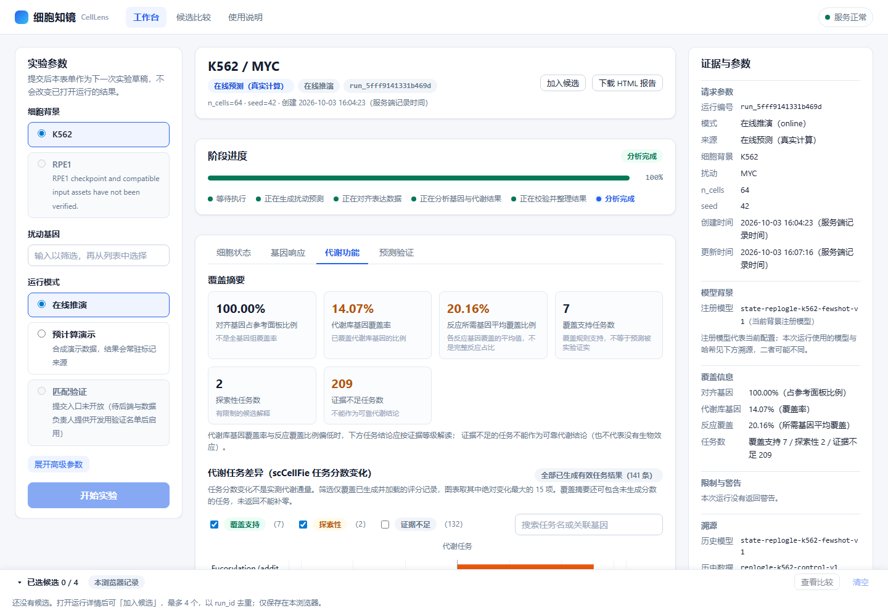
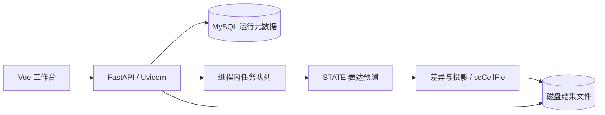

# 细胞知镜 · CellLens

**单细胞扰动预测与代谢分析工作台。**

CellLens 将 STATE 表达预测、scCellFie 代谢任务分析和可追溯的运行记录整合在一个系统中。用户选择细胞背景与目标基因，提交分析后可以查看表达变化、二维投影、代谢任务、反应分数和结果报告。

当前版本为 `0.1.0`，定位为内部科研原型。K562 在线计算与前后端链路已在 Windows 本机验证；正式生物学泛化评估尚未完成。



*历史实测页面：K562 / MYC 在线运行的代谢结果与证据信息。页面运行完成不代表预测已获得实验验证。*

## 导航

- [主要功能](#主要功能)
- [架构与技术栈](#架构与技术栈)
- [环境要求](#环境要求)
- [快速开始](#快速开始)
- [配置与数据](#配置与数据)
- [目录结构](#目录结构)
- [开发与检查](#开发与检查)
- [文档](#文档)
- [当前限制与后续工作](#当前限制与后续工作)
- [贡献与许可](#贡献与许可)

## 主要功能

- **扰动分析**：支持已登记的 K562 单基因扰动，STATE 生成预测表达，scCellFie 计算代谢任务与反应分数。
- **运行管理**：展示执行阶段，记录错误与警告；MySQL 保存运行状态、执行租约、事件和结果缓存。
- **结果工作台**：查看投影、基因差异、代谢覆盖与任务结果；长表支持搜索、排序和分页。
- **候选比较**：比较最多四个保存在当前浏览器中的运行，区分真实 API 与 Mock 来源。
- **导出与追溯**：下载基因 CSV 和 HTML 报告，查询本次运行记录中的模型、数据与 SHA-256 指纹。
- **无 GPU 演示**：通过后端预计算模式使用合成样例；前端也有独立的 Mock 开关，两者都明确标注来源。

| 模式 | 执行内容 | 当前状态 |
|---|---|---|
| `online` | STATE 推理与转录/代谢分析 | K562 链路已实测；需要 GPU 和已核验资产 |
| `precomputed` | 校验并读取现有预计算包 | 可生成 K562/MYC 合成包，不执行模型推理 |
| `validation` | 在线预测与匹配观测比较 | 后端分支及已有指标查询可用；协议待确认，前端提交关闭 |
| 前端 Mock | 浏览器内的接口样例 | 独立开发功能，不写入真实运行数据库 |

## 架构与技术栈



| 层次 | 技术与职责 |
|---|---|
| 前端 | Vue 3、TypeScript、Vite 6、Pinia、Vue Router、ECharts |
| 后端 | FastAPI、Pydantic、Uvicorn；统一查询与任务提交接口 |
| 数据库 | MySQL、SQLAlchemy、PyMySQL、Alembic；元数据持久化与迁移 |
| 科学计算 | STATE / arc-state、PyTorch、AnnData、Scanpy、scCellFie |
| 依赖与检查 | uv / `uv.lock`、npm / `package-lock.json`、pytest、Ruff、basedpyright |

开发时，Vite 在 `5173` 提供页面并代理 `/api` 到后端 `8000`。构建后，FastAPI 直接提供 `frontend/dist`，页面与 API 共用 `8000`，不需要额外运行 Vite。PowerShell 仅用于可选的 Windows 一键脚本。

完整执行过程与存储设计见 [系统架构](docs/ARCHITECTURE.md)。

## 环境要求

| 组件 | 要求 |
|---|---|
| Python | `>=3.11,<3.13`；当前本机使用 3.11 |
| uv | 安装依赖与运行 Python 命令；使用仓库锁文件 |
| Node.js / npm | 安装和构建前端；本机已验证 Node.js 24.19.0 / npm 11.13.0，其他版本需符合 [Vite 6 的要求](https://v6.vite.dev/guide/) |
| MySQL | 本机独立实例已验证 9.7.2；Compose 配置使用 8.4，容器启动尚未在本机验收 |
| GPU 与科学资产 | 仅在线计算需要；锁文件中的 PyTorch 使用 CUDA 13.2 索引，需核对驱动兼容性与模型显存需求 |
| Docker Compose | 可选，仅用于启动 MySQL；仓库尚无完整应用镜像 |

Git 仓库不包含 `.env`、模型权重、原始 H5AD、演示包和运行产物。**克隆源码后，还需要按所选模式准备相应资产。**

## 快速开始

详细的新环境准备、无 GPU 演示和服务器部署见 [部署与启动](docs/DEPLOYMENT.md)。以下命令均在仓库根目录执行。

### 已配置的 Windows 本机

首次构建，或前端代码修改后：

```powershell
powershell -NoProfile -ExecutionPolicy Bypass -File .\scripts\start_system.ps1 -StartLocalMysql
```

已有最新前端构建时，日常启动：

```powershell
powershell -NoProfile -ExecutionPolicy Bypass -File .\scripts\start_system.ps1 -StartLocalMysql -SkipBuild
```

脚本启动或复用独立 MySQL，检查数据库、迁移表结构，并启动后端；默认会构建前端。它不代替 Python 依赖安装或模型数据准备。全新空库必须先手动迁移，详见部署文档。保持终端运行，Ctrl+C 停止网页与 API，MySQL 继续独立运行。

### 直接启动前后端

FastAPI 和 Vue 不要求使用 PowerShell。依赖、`.env`、数据库及迁移准备完成后，可以分别运行标准命令。

终端一：启动后端。

```bash
uv run --no-sync uvicorn backend.app.main:app --host 127.0.0.1 --port 8000
```

终端二：启动开发前端。

```bash
npm --prefix frontend run dev -- --host 127.0.0.1 --port 5173 --strictPort
```

打开 `http://127.0.0.1:5173/workbench`。后端默认代理目标为 `127.0.0.1:8000`。

### 构建后运行完整网页

数据库已启动并迁移后：

```bash
npm --prefix frontend run build
uv run --no-sync uvicorn backend.app.main:app --host 127.0.0.1 --port 8000
```

构建前须安装前端依赖 `npm --prefix frontend ci`。构建完成后只保留后端进程，不运行 `npm run dev` 或 `vite preview`。

| 地址 | 用途 |
|---|---|
| [工作台](http://127.0.0.1:8000/workbench) | 构建后的完整系统 |
| [Swagger UI](http://127.0.0.1:8000/docs) | 请求调试与实时接口说明 |
| [健康检查](http://127.0.0.1:8000/api/v1/health) | 服务与数据库状态，需要检查响应字段 |
| [模式目录](http://127.0.0.1:8000/api/v1/catalog/contexts) | 各细胞系的模式可用状态 |

Windows PowerShell 若拦截 `npm.ps1`，将命令中的 `npm` 改为 `npm.cmd` 即可。

## 配置与数据

后端读取仓库根目录的 `.env`，字段定义见 `backend/app/config.py`。新环境从 `.env.example` 创建配置，已有配置不要覆盖。

| 配置项 | 用途 |
|---|---|
| `CELLLENS_DATABASE_URL` | MySQL 连接地址、账户与数据库 |
| `CELLLENS_WORKER_ENABLED` | 是否启动分析任务消费者 |
| `CELLLENS_GPU_AVAILABLE` | 是否允许 GPU 路径；该开关不自动检测硬件 |
| `CELLLENS_STATE_EXECUTABLE` | STATE 命令入口，默认 `state` |
| `CELLLENS_CREATE_DATABASE_SCHEMA` | 保持 `false`，由 Alembic 管理表结构 |
| `CELLLENS_JOB_LEASE_SECONDS` | 执行租约时长，默认 7200 秒 |

前端默认 `VITE_API_BASE=/api`；开发代理目标可在 `frontend/.env.local` 设置 `CELLLENS_API_PROXY_TARGET`。来源设置、Mock 与代理详见 [前端文档](docs/FRONTEND.md)。

MySQL 存储运行元数据；模型、表达矩阵、CSV 和报告存储在磁盘。只备份数据库不能恢复完整科学结果，迁移机器时需同时保存注册资产与结果目录。

## 目录结构

```text
celllens-platform/
├── backend/app/          API、运行管理、模型适配与科学分析
├── backend/tests/        后端测试
├── frontend/             Vue 工作台、构建入口与 npm 锁文件
├── configs/              模型配置、数据拆分及分析配置
├── data/registry/         资产清单、SHA-256、基因面板与代谢数据库
├── data/raw/              原始输入 H5AD，不纳入 Git
├── data/demo/             预计算包，不纳入 Git
├── data/derived/runs/     运行产物，不纳入 Git
├── models/               模型权重，不纳入 Git
├── scripts/              资产处理、审计、启动与回归检查
├── ops/                  本机 MySQL 配置参考
├── docs/                 架构、部署、接口及科学说明
├── docker-compose.yml    可选 MySQL 服务
├── pyproject.toml        Python 依赖与检查配置
└── uv.lock               Python 依赖锁文件
```

## 开发与检查

完整在线开发环境安装：

```bash
uv sync --locked --python 3.11 --extra model --extra report --group dev
npm --prefix frontend ci
```

仅开发 API 或预计算模式时可使用 `uv sync --locked --python 3.11 --group dev`，并关闭 worker/GPU。切换依赖集合可能移除未选中的额外依赖，已有在线环境应保留 `model`、`report` 两组。

```bash
uv pip check
uv run --no-sync pytest -q
uv run --no-sync ruff check backend scripts
uv run --no-sync basedpyright
npm --prefix frontend run build
```

数据库、资产审计、真实推理与浏览器检查见 [运行与检查](docs/OPERATIONS.md)。

2026-10-04 联调记录：38 项后端测试、9 项浏览器回归及前端构建通过；K562/MYC、64 细胞、seed=42 的新在线运行实际完成，`cache_hit=false`。这些是历史工程验收记录，不代表任何机器克隆后都已就绪，也不代替生物学评估。

## 文档

| 文档 | 内容 |
|---|---|
| [部署与启动](docs/DEPLOYMENT.md) | 新环境、数据库、演示、手动启动、Windows 脚本与服务器部署 |
| [运行与检查](docs/OPERATIONS.md) | 健康检查、验收、日常维护及常见错误 |
| [系统架构](docs/ARCHITECTURE.md) | 模块职责、任务执行、数据库与产物结构 |
| [接口说明](docs/API.md) | 请求参数、状态、结果语义及错误码 |
| [OpenAPI](docs/openapi.json) | 仓库接口快照；服务 `/openapi.json` 为实时契约 |
| [模型与数据](docs/MODEL_AND_DATA.md) | 资产来源、计算方法、覆盖规则与验证边界 |
| [前端文档](docs/FRONTEND.md) | 页面、状态管理、请求、来源标识与代理 |
| [第三方说明](docs/THIRD_PARTY_NOTICES.md) | 代码、模型和数据的许可记录 |

## 当前限制与后续工作

- RPE1 模型与输入数据尚未核验，当前禁用。
- 验证拆分记录存在一致性问题，开发/校准名单未确认；验证提交保持关闭。
- 当前代谢任务分数反映表达支持程度，不能当作实测代谢通量；覆盖等级也不等于预测准确率。
- 基因—反应—任务的可靠映射尚未补齐，真实任务的 `determinant_genes` 仍为空。
- 候选与最近运行保存在当前浏览器，没有跨用户共享的运行列表。
- 尚无用户认证、权限隔离和完整应用容器部署；当前服务用于受控的内部环境。
- worker 与 Web 服务在同一进程；当前部署使用一个 Uvicorn 进程，独立任务服务与多实例部署留待后续设计。

后续工作优先补齐验证协议与匹配基线，再完善科学证据映射、访问控制及服务器验收。

## 贡献与许可

修改前先阅读架构、接口与数据说明。提交变更时说明行为变化和验证结果，运行相关检查；接口变化需更新 `docs/openapi.json`，部署参数变化需同步部署文档。模型、原始数据、凭据及运行产物不提交到 Git。

仓库目前没有项目级 `LICENSE` 文件，不应将其视为已采用 MIT 等开源许可。STATE、scCellFie 和 Replogle 数据各自遵循上游条款，使用或再分发前阅读 [第三方说明](docs/THIRD_PARTY_NOTICES.md)。
