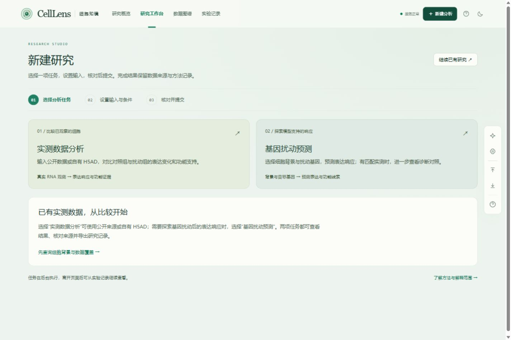
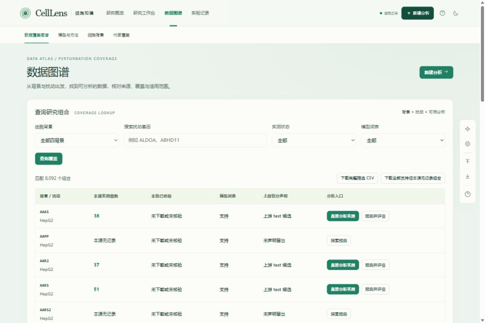
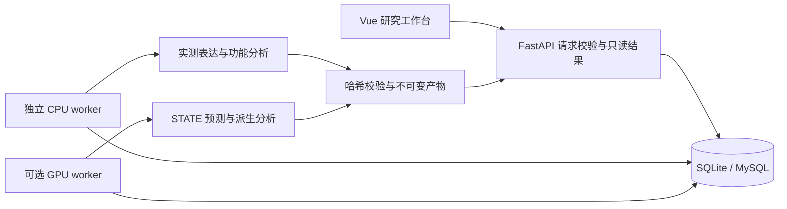

<p align="center">
  
</p>
<h1 align="center">细胞知镜 · CellLens</h1>
<p align="center">从表达响应到可追溯的功能证据</p>
<p align="center">
  <a href="LICENSE"></a>
  
  
  
</p>
<p align="center">
  <a href="docs/使用说明.md">使用说明</a> · <a href="docs/演示流程.md">演示流程</a> · <a href="docs/CPU部署.md">CPU 部署</a> · <a href="docs/交付说明.md">交付说明</a>
</p>

**CellLens 是面向单细胞基因扰动研究的分析与结果解读平台。** 它将公开实测数据、自有 H5AD 分析和 STATE 模型推演接入同一工作台，帮助研究者核对表达响应、表达推断的代谢任务评分及其来源。实测分析可在 CPU 上独立运行；模型推演需要相应权重、真实输入、STATE 与 GPU 就绪。


首页视觉为概念示意；结果页中的数值来自具体记录，不能由首页图示推断细胞形态或生物学结论。

## 页面与研究流程

四个全局入口为 **研究概览、研究工作台、数据图谱、实验记录**。工作台提供 **实测数据分析** 与 **基因扰动预测** 两项任务；公开数据和自有 H5AD 是实测任务的两种来源。完成后进入四个结果视图。

| 结果视图 | 用途 |
|---|---|
| 研究总览 | 核对数据来源、细胞背景、目标基因、组别人数、覆盖与可用模块 |
| 表达响应 | 查看基因表达差、已有真实派生投影和同一基因的组间分布 |
| 功能证据 | 按覆盖、分类与名称检索任务；实测任务可追查关联反应、GPR 和基因证据 |
| 实验对照 | 查看匹配群体、批次权重敏感性和覆盖分层；缺少观测时明确说明不可用 |

代谢任务的原始评分不能作为跨任务的统一强弱尺度。任务浏览按覆盖与元数据组织；基因表达差仍可按绝对值排序。结构导航是阅读辅助，PCA/UMAP 表示表达状态，均不代表真实空间位置、细胞运动或形态预测。

| 研究工作台 | 结果工作台 |
|---|---|
|  |  |



截图范围见[页面截图](docs/screenshots/README.md)。当前模型背景包括 K562、Jurkat、RPE1、HepG2；可选目标和真实覆盖以目录及当前资产校验为准。自有数据可以使用自己的单一背景标签，只开放实测与功能分析。

## 快速开始

本地轻量启动使用 **SQLite、独立 API 和 CPU worker**。准备 Python 3.11/3.12、Node.js 与 uv，在独立项目副本中执行：

```powershell
powershell -NoProfile -ExecutionPolicy Bypass -File .\ops\run-local.ps1 -Install -Port 8028
```

首次安装根据锁文件安装 CPU 分析依赖、构建前端并迁移本副本的 `data/runtime/celllens.db`。已经安装时省略 `-Install`：

```powershell
powershell -NoProfile -ExecutionPolicy Bypass -File .\ops\run-local.ps1 -Port 8028
```

脚本检查端口、数据库与 CPU worker 心跳，通过后再报告就绪。打开 <http://127.0.0.1:8028>；工作台位于 `/research`，目录位于 `/data-catalog`，记录位于 `/records`，服务状态位于 `/status`。停止本副本服务：

```powershell
powershell -NoProfile -ExecutionPolicy Bypass -File .\ops\stop-local.ps1
```

停止脚本核对工作区、PID、进程创建时间和模块命令，保留数据库、结果与日志。若 `.venv` 是共享环境的链接，`-Install` 会拒绝修改它；可复用已安装环境启动，或为新副本建立专用环境。

源码包不含模型权重、原始数据和历史结果。空安装会显示资源尚未准备，完成科学分析还需按[CPU 部署](docs/CPU部署.md)与[资源说明](docs/INFERENCE_RESOURCES.md)准备适用资产。

### 可选 GPU 推演

已有完整环境时追加 `-Gpu`，启动独立 GPU worker：

```powershell
powershell -NoProfile -ExecutionPolicy Bypass -File .\ops\run-local.ps1 -Gpu -Port 8028
```

全新专用环境可使用 `-Install -Gpu` 安装模型依赖。预测启动要求 CUDA、STATE 与 worker 心跳通过真实探针，具体背景仍需权重和输入校验。CPU 模式不要求安装模型依赖，也不会生成合成预测替代缺失资源。

### 自有 H5AD

管理员在本地或私有模式配置允许根目录，用户在工作台提供根目录下单个 `.h5ad` 的相对路径，完成预检后提交。当前不是任意文件浏览器，也不提供浏览器上传或自有数据 STATE 推演。

- 明确选择 `raw_counts`、`cp10k` 或 `log1p_cp10k`；原始计数按完整输入面板计算每个细胞的分母，再裁剪分析基因。
- 指定组别列、对照值、目标值与背景；基因标识需唯一，数值不得含 NaN/Inf，两个组均需有细胞。
- 受文件、细胞数、基因数及矩阵大小上限约束；现有 `cell_line` 列需与所选单一背景一致。

具体字段、限制与配置见[使用说明](docs/使用说明.md)和[CPU 部署](docs/CPU部署.md)。导入后的预检清单、选中人数与结果来源均保留，不能将表达尺度猜测为已确认事实。

## 架构与部署



API 负责校验、入队与读取；worker 通过租约认领任务，按 attempt 隔离暂存文件。API 重启不终止独立 worker；中断任务按租约恢复，完成产物经校验后原子发布。来源清单、研究发现与导出包绑定具体记录，公共导出剔除私人发现与本机输入路径。

| 模式 | 范围 |
|---|---|
| 本地 | 仅回环访问，SQLite 轻量启动，适合单机使用 |
| 私有工作空间 | 工作空间令牌或会话认证；仍是单工作空间，不提供多人数据隔离 |
| 公共只读 | 只开放白名单内的已完成冻结结果；禁用计算、导入、私人发现和外部解读 |

`/api/v1/ready` 返回 HTTP 200 表示数据库和浏览入口可用；CPU 与预测能力分别由未过期的 worker 心跳和实际依赖/设备探针判断，仍需核对具体数据与模型资产。

**新部署以 [CPU 部署](docs/CPU部署.md)为准。** MySQL 仍可用于兼容既有环境；旧[部署参考](docs/DEPLOYMENT.md)保留 MySQL、Compose 和手动配置说明，其旧启动方式不能代替独立 worker 部署。Linux systemd 模板已提供，目标服务器、HTTPS 与反向代理配置仍需现场验收。

## 已验证的范围

本机已完成真实 K562 / ALDOA CPU 分析、Jurkat / ALDOA 新 GPU 推演、API 独立重启、worker 中断恢复、CPU/GPU 取消，以及受控 H5AD 导入。正式服务停止并重启后 CPU/GPU 能力恢复，研究发现保留；公共访问与导出边界也已验收。导入验收使用真实公开数据的子集，**不是新开展的生物实验**。历史模型案例通过哈希核验恢复，恢复记录不计为新推理。

本轮评审改进完成后，后端 **538 项功能回归**、前端 **60 项检查**通过；全项目 Python 类型检查、Ruff、前端类型检查与 808 模块生产构建通过。实际完成一条新 GPU 预测、两条新 CPU 实测分析，并核验结果、来源和导出。390 / 900 / 1440 / 1920 像素宽度完成浏览器检查，138 个已有产物哈希不变。详细范围、截图与限制见[评审改进](docs/评审改进.md)和[本轮验收](docs/verification/judge-review/)。此前的中断恢复、访问边界和 Windows 启停证据保留在[初轮验收](docs/verification/national-refactor/)。

这些结果验证实现与运行链路，不构成模型独立科学验证。尚未完成 Linux 现场部署、远程 HTTPS 验收、多用户隔离或移动设备实机验证；也未开展新的留出实验、科研消融和研究者试用。

## 科研解释边界

- 实测、模型预测和表达推断的功能评分分别标注；scCellFie 任务评分不等于代谢通量。
- 表达均值差为 `mean(log1p(CP10K))` 的组间差，不是 log2FC，也不自动代表统计显著性。
- 功能任务分类来自匹配版本的冻结知识库；缺失信息保持未知，不能推断细胞器定位。
- 缺失实测对照、资源或模块会明确显示不可用；历史产物保持原样，读取时不补造数值。
- 研究发现与导出支持复核和追溯，不能替代独立实验验证或因果结论。

## 文档与交付

- [使用说明](docs/使用说明.md) · [演示流程](docs/演示流程.md) · [CPU 部署](docs/CPU部署.md)
- [交付说明](docs/交付说明.md) · [重构进度](docs/重构进度.md) · [页面截图](docs/screenshots/README.md)
- [模型与数据](docs/MODEL_AND_DATA.md) · [实测方法](docs/MEASURED_ANALYSIS.md) · [资源下载](docs/INFERENCE_RESOURCES.md)
- [旧 MySQL 部署参考](docs/DEPLOYMENT.md) · [维护参考](docs/OPERATIONS.md) · [第三方说明](docs/THIRD_PARTY_NOTICES.md)

交付源码包含前后端、依赖锁文件、数据库迁移、启动脚本与部署模板。**不包含 `.env`、权重、原始 H5AD、历史运行数据库、完整结果产物或已安装依赖环境。** 复现指定结果需要其数据库记录、冻结输入登记与完整产物，不能仅复制截图。`scripts/import_verified_runs.py` 用于核验并恢复已完成的真实历史预测，恢复不触发新推理。

GitHub 仓库：[hash-distill/celllens-platform](https://github.com/hash-distill/celllens-platform)，访问以仓库实际授权为准。

## 许可

CellLens 自有代码与文档采用 [MIT License](LICENSE)。第三方模型、数据与软件各自遵循上游条款；项目 MIT 不覆盖第三方资产，STATE 模型的非商业限制也不会因本项目许可证而解除。详见 [NOTICE](NOTICE) 与[第三方说明](docs/THIRD_PARTY_NOTICES.md)。
