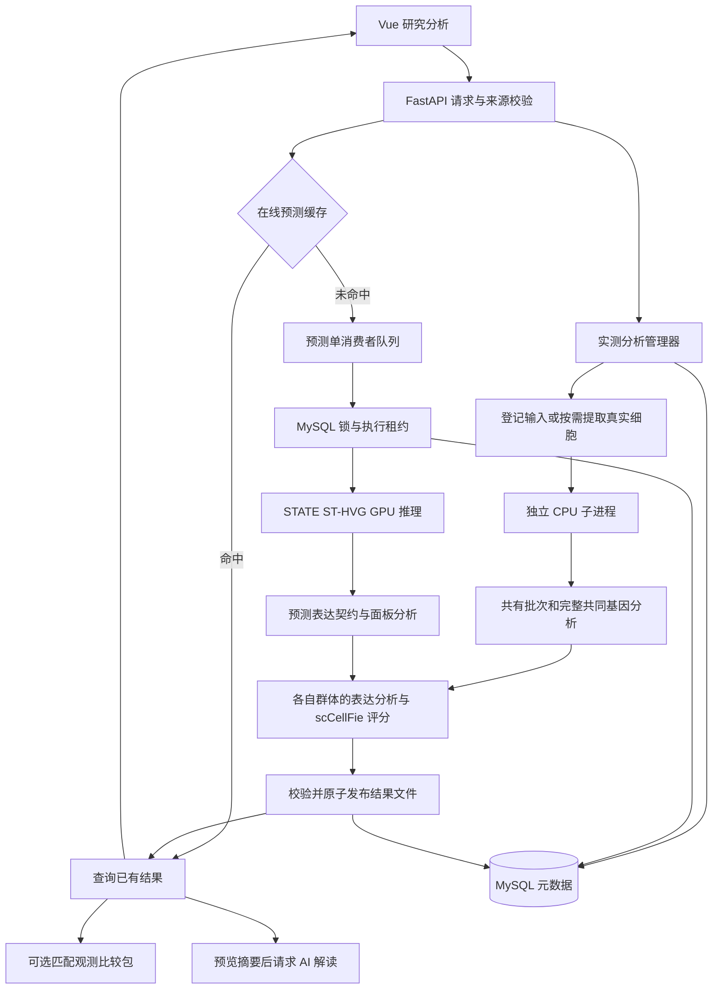

# 系统架构

更新日期：2026-10-22。CellLens 将实测分析与模型预测分为两条计算链：前者在 CPU 上分析真实对照和扰动观测，后者调用 STATE 生成预测。两者共享表达解释、scCellFie 评分、结果呈现和来源追溯规则，但不混用群体、面板或结果身份。

## 页面与数据流

主导航为“研究分析、记录与比较、数据与方法、使用说明”。研究分析分别提供 `/measured` 实测任务和 `/workbench` 预测任务；`/records` 汇集实测历史、预测记录与比较；`/data-catalog` 和 `/methods/*` 提供范围与方法；`/about` 提供帮助。预测详情以 `/runs/:runId` 标识，实测详情以 `/measured/:analysisId` 标识。旧 `/demo?run=...` 保留跳转兼容。

生产前端由 FastAPI 同源提供；开发环境由 Vite 代理 `/api`。服务状态、资源下载和 AI 提供商设置使用辅助入口。

## 两条计算链

### 实测直接分析

`POST /api/v1/measured/analyses` 校验背景、目标和真实细胞上限，优先复用有效输入；缺少本地子集时从固定官方源按需读取。`measured_jobs.py` 管理任务与 CPU 子进程，`measured_worker.py` 执行分析及发布。预测 worker/GPU 开关关闭时，实测分析仍可独立执行。

分析保留对照与扰动共有批次，记录筛选前后人数，使用本次输入完整共同基因面板。请求上限不保证取得同样多的细胞，不复制观测补齐数量。输出包括表达均值差、PCA/UMAP、可用代谢评分、HTML 报告和带哈希的 manifest；代谢不可用时保留原因。历史写入 `measured_analyses`，文件写入 `data/derived/measured/<analysis_id>/`。

### 在线预测

`POST /api/v1/runs` 只接受新建 `online` 运行，检查参数、登记资产和预测开关。请求、资产、配置及代码指纹一致且已完成时可复用缓存；`cache_hit=true` 不代表本次重新推理。未命中任务由进程内单消费者执行，MySQL 锁和租约约束领取，心跳记录执行仍存活；它们不判断科学质量。

STATE 输出按注册表达槽和有序面板读取，当前 ST-HVG 使用 `obsm['X_hvg']` 的 2,000 个预测基因，不能将原始 `.X` 当成更宽预测。表达契约、身份适配、共同面板和冻结阈值核对后，计算表达、投影及代谢结果。产物先写 attempt 临时目录，校验后发布到 `data/derived/runs/<run_id>/` 并登记缓存。

有匹配观测时可准备独立比较包，不改写原预测。比较的共同子集、面板和单位应与完整实测分析区分。历史 `validation`、冻结结果及合成记录保留读取兼容，不作为新任务创建选项。

## 模块与存储

| 位置 | 职责 |
|---|---|
| `frontend/src/` | 页面、请求状态、结果概览、图表、历史和比较 |
| `backend/app/main.py`、`container.py`、`config.py` | 服务组装、配置与生命周期 |
| `backend/app/api/`、`schemas.py` | API 请求、来源身份与响应契约 |
| `backend/app/core/registry.py` | 登记资产、工程内路径和哈希核验 |
| `backend/app/core/storage.py`、`job_queue.py`、`cache.py` | 预测状态、租约、恢复与缓存 |
| `backend/app/services/measured_*.py` | 实测输入、CPU 任务、持久历史、结果和比较 |
| `backend/app/services/scientific_analysis.py`、`pipeline.py` | 预测科学分析、阶段编排与发布 |
| `backend/app/services/task_trace.py` | 冻结任务—反应—基因关联与数值来源 |
| `backend/app/engines/` | STATE 与 scCellFie 适配 |
| `backend/app/db/` | SQLAlchemy 模型与 Alembic 迁移 |

MySQL 当前包含六张业务表及迁移版本表，实际结构以模型与迁移为准：

| 表 | 内容 |
|---|---|
| `runs` | 预测及历史兼容运行的参数、状态、进度、警告 |
| `run_attempts` | 预测执行次数、worker、租约、心跳与错误 |
| `run_events` | 预测状态转换 |
| `run_artifacts` | 预测产物路径、SHA-256、大小和 MIME |
| `run_cache` | 已完成预测缓存 |
| `measured_analyses` | 实测请求、状态、进度、摘要及 manifest 身份 |
| `alembic_version` | 数据库迁移版本 |

大型矩阵、图表数据与报告保存在磁盘。预测目录包含预测 H5AD、命令日志、表达/任务/反应表、投影、表达契约、关联、摘要和 manifest；具体产物以该次清单为准。实测目录保存本次分析输入或其登记引用、表格、投影、摘要、报告和 manifest。资源下载状态、比较包和历史冻结包也必须随迁移保全，详见[运行与检查](OPERATIONS.md)。

## 结果与解释边界

结果概览先呈现关键基因和任务数值，专业 PCA/UMAP 检查按需展开。代谢任务按关联覆盖率、再按绝对差值排序，默认显示前 8 项，可展开本分类全部条目；该排序仅表示输入完整性，不是显著性、敏感性检验或可靠性认证。关联来自冻结知识库，不是因果归因；完整 GPR 与缺失成员保留在追溯或导出中。

AI 实测解读接收概要、基因、代谢、覆盖和后续建议所需的服务端摘要；科研图和预测比较解读仍属于运行结果。密钥不写入数据库或分析产物。预览内容和来源需与本次结果一致，生成文本不改变原始科学结果。

预测状态中的 `validating` 是结果整理与校验阶段，不代表独立实验验证。服务启动、文件哈希、任务完成与科学准确性是不同证据。当前未证明 checkpoint 对诊断目标的训练排除，也未提供多用户权限隔离；共享部署需要单独的访问控制和目标环境验收。
