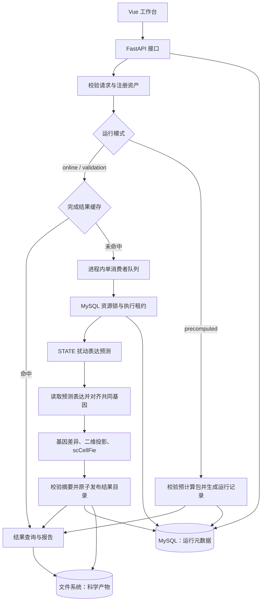

# 系统架构

CellLens 分为三个层次：HTTP 接口接收请求，任务管线执行模型与科学计算，MySQL 和文件系统保存过程及产物。Vue 前端通过公开接口访问这些能力，生产构建由 FastAPI 提供；开发环境由 Vite 代理 /api。

## 一次分析如何流转



1. `POST /api/v1/runs` 校验细胞系、扰动、细胞数及种子。在线和验证模式还检查模型/数据哈希、worker 与 GPU 开关。
2. 相同请求及资产、配置、后端代码指纹命中已完成缓存时，直接返回已有运行编号。预计算模式独立处理，每次生成新记录。
3. 新在线任务进入进程内队列。启动 worker 时重新提交可恢复任务；MySQL 执行租约避免重复领取同一个运行。
4. 管线调用 STATE，检查输出 H5AD，再读取模型实际写入的预测表达。当前 K562 预测位于 `obsm['X_hvg']`，不能把原始 `.X` 当作预测。
5. 对齐对照、预测和可选观测的共同基因，计算差异与投影；使用冻结 scCellFie 数据库计算代谢任务和反应分数。
6. 生成摘要、报告与清单。在线/验证结果先写临时目录，校验后原子改名，再登记产物、完成运行并建立缓存。

## 模块与代码位置

| 层次 | 位置 | 职责 |
|---|---|---|
| 前端 | `frontend/src/` | 页面、Pinia 状态、统一请求层、图表及本机记录 |
| 应用入口 | `backend/app/main.py`、`container.py`、`config.py` | 配置、组件组装、worker 生命周期、health/ready |
| HTTP 与契约 | `backend/app/api/`、`schemas.py` | catalog、运行与结果接口、严格请求与响应结构 |
| 资产管理 | `backend/app/core/registry.py` | 注册表、工程内路径限制、文件哈希验证 |
| 运行管理 | `backend/app/core/storage.py`、`job_queue.py`、`cache.py` | 状态机、租约、心跳、恢复、串行调度与缓存 |
| 数据库 | `backend/app/db/` | SQLAlchemy 表定义及 Alembic 迁移 |
| 模型适配 | `backend/app/engines/` | STATE 子进程、H5AD 契约、scCellFie 与差异评价 |
| 科学分析 | `backend/app/services/scientific_analysis.py` | 共同基因、表达差异、投影、代谢覆盖及验证指标 |
| 总体编排 | `backend/app/services/pipeline.py` | 阶段转换、结果发布、报告与失败记录 |

GPU 路径通过 `state_gpu_runner.py` 适配 STATE 的 `tx infer` 入口；推理命令及输出日志随运行保存。worker 属于当前 Web 进程，尚未拆成独立服务。

## 数据如何保存

MySQL 保存元数据，大型表达矩阵和结果表留在磁盘。

| 表 | 内容 |
|---|---|
| `runs` | 请求、状态、进度、时间和错误 |
| `run_attempts` | 每次执行的 worker、租约、心跳与结果 |
| `run_events` | 状态转换记录 |
| `run_artifacts` | 产物路径、SHA-256、大小与 MIME |
| `run_cache` | 缓存键与已完成运行的对应关系 |
| `alembic_version` | 数据库迁移版本 |

表结构以 `backend/app/db/models.py` 为准。每个运行可有多个 attempt，即重试执行记录。进程内单消费者负责串行执行，跨进程还通过名为 `celllens:a6000` 的 MySQL 锁互斥；该名称是历史资源标识，不表示必须使用 A6000。

在线/验证结果实际结构如下，代谢和观测相关文件按成功情况生成：

```text
data/derived/runs/
├── <run_id>.attempt-<n>.partial/   临时目录；失败时可保留 failure.json
└── <run_id>/
    ├── predicted.h5ad
    ├── predicted.command.json / predicted.perturbations.tsv
    ├── predicted.stdout.log / predicted.stderr.log
    ├── gene_deltas.csv
    ├── projection.json
    ├── metabolic_coverage.csv     覆盖计算成功时
    ├── metabolic_task_scores.csv  代谢计算成功时
    ├── reaction_scores.csv        代谢计算成功时
    ├── validation_metrics.json    匹配观测及代谢计算成功时
    ├── summary.json
    ├── report.html
    └── manifest.json
```

预计算结果来自 `data/demo/<cell_line>/<perturbation>/`，不执行推理链路，也不保证拥有所有产物。API 的读取范围见 [接口说明](API.md)。

## 完成、失败与降级

状态顺序为 `queued → state_running → adapting → metabolic_running → validating → completed`，异常可进入 `failed`。这里 `validating` 表示结果整理与校验阶段；在线任务也会经过它，不能据此判断做了观测验证。

模型或表达契约失败会使任务失败。已捕获的代谢数据库、覆盖或表达问题会留下转录结果，并写入代谢不可用警告；未捕获异常仍会使整个任务失败。只有成功完成的在线/验证运行进入缓存。

当前可查询运行 manifest 中的历史模型、数据与哈希，以及已有验证指标。尚无用户登录、权限隔离或公开运行列表；验证协议与基因—反应—任务映射仍需补齐，服务按内部科研使用范围使用。
