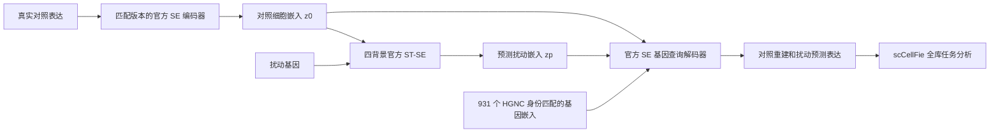

# 代谢库基因与全部任务完整覆盖的可行性分析

日期：2026-10-09。范围：读取冻结数据库、模型配置/基因词表、上游特征元数据和官方代码；没有加载新模型权重执行预测，没有修改现有预测、数据库或模型登记。

以上为制定方案时的分析范围。随后实施的 HGNC 适配、四背景真实 ST-SE 预测、931 基因查询及兼容性实测，记录在 [2026-10-09 推进记录](verification/2026-10-09-se-full-coverage.md)；下文元数据分析不应替代该执行记录。

## 结论

最值得先验证的完整输出路线是 **官方 SE 编码器 + ST-SE 扰动嵌入预测 + 官方 SE 按基因解码器**。经过 HGNC 身份核验，官方 SE-600M 的蛋白嵌入词表对本项目全部 931 个代谢基因都有唯一匹配，具备按基因查询的条件。尚未验证这一组合的实际预测效果，尤其必须确认 ST-SE 的输入嵌入由哪个 SE 检查点生成；维度相同不是版本兼容的证明。

直接换成官方 Replogle full 模型可增加输出范围，但其已训练的表达解码头只输出 6546 个共同基因，不足以覆盖整个代谢库。若 SE 查询解码无法通过版本/尺度/效果验证，则训练覆盖所有代谢基因的新表达输出头。

## 全覆盖的准确含义

设冻结 GPR 数据库全部基因为 D，某任务各反应关联基因的并集为 D_t，实际送入分析的完整基因集合为 P。若 D ⊆ P，则每个 D_t ⊆ P，官方数据集完整性可以达到全部任务完整覆盖。

当前 D 有 931 个基因、218 项任务、787 项反应。已用官方 `compute_dataset_completeness` 验证包含 D 的目标基因面板返回：931/931 基因、218/218 任务、787/787 反应。这个验证只检查基因名集合，不生成表达值，也不是新预测结果。[官方 API](https://sccellfie.readthedocs.io/en/latest/api/index.html#reports) 明确数据集完整性只检查 `var_names`。

数据集完整性 100% 不要求每个基因在每个细胞都表达，也不代表 218 项任务均被激活、预测准确或得到实验证实。原始测量中真实的零计数可以保留；没有测量或没有模型预测的基因不得仅为了覆盖率补零、复制对照或填均值。官方细胞级完整性会另外考虑零表达，不能和数据集完整性混为一谈。

## 已核实的模型和词表

| 方案 | 实际词表 | 代谢库覆盖 | 任务 all 完整覆盖 | 验证范围 |
|---|---:|---:|---:|---|
| 当前 ST-HVG | 2000 | 131/931 | 7/218 | 当前真实预测报告 |
| 官方 ST-X-full / ST-SE-full 的固定表达头 | 6546 | 512/931 | 23/218 | 官方配置、var_dims 与官方完整性 API；未运行新权重 |
| 上一行使用 HGNC 身份适配 | 6546 | 526/931 | 23/218 | 名称/身份映射与官方完整性 API；未实施生产适配 |
| SE-600M 可查询基因嵌入 | 19790 | 931/931 身份可匹配 | 尚未产生完整预测 | 只读取嵌入名称和形状元数据，不读取张量存储 |
| 覆盖全部 D 的目标输出面板 | 至少包含 D | 931/931 | 218/218 | 基因集合可行性验证，非预测 |

原先常见的 `ST-HVG-Replogle`、`ST-SE-Replogle` 的 fewshot/zeroshot 四背景配置都为 `output_space=gene`。此外确有两套独立的官方发布：

- [st-x-replogle-full](https://huggingface.co/arcinstitute/st-x-replogle-full/tree/48ad5f70215ab4c58caa5a68e77d837601d29d35)：四背景，`embed_key=null`，`output_space=all`，输入/表达输出各 6546。
- [st-se-replogle-full](https://huggingface.co/arcinstitute/st-se-replogle-full/tree/d1441f5587ace12c46247b3703c7d25f24f8abb6)：四背景，`embed_key=X_state`，`output_space=all`，嵌入输入/输出 2058，表达头 6546。
- [SE-600M](https://huggingface.co/arcinstitute/SE-600M/tree/5a9a80f44f7ce32ce57059933ef0d735d7c10ce5)：2048 维细胞空间，加数据集嵌入的 ST-SE 接口需进一步验证；蛋白嵌入词表 19790 项，每项 5120 维。

“all” 指训练数据使用的全部基因，不保证包括任何外部代谢库的所有基因。官方作者也区分 [gene/HVG 和 all/完整训练转录组](https://github.com/ArcInstitute/state/issues/225)。文件夹名的 `0.99` 对应配置中的下采样参数，不代表模型准确率。

## 先做好基因身份适配

冻结反应表同时保存 HGNC ID GPR 和符号 GPR。本次逐条核验两个规则的逻辑结构、基因位置及 ID 一致性，全部 931 个数据库符号能映射至唯一 HGNC 身份。数据和词表的名称适配优先使用这些稳定 ID；历史符号仅在唯一映射时使用。

使用 [HGNC 官方完整集](https://www.genenames.org/download/) 的快照 SHA-256：`8bf6f686e640dbc864a346484626953621b0500d900d26cd085a35c2782d725d`。

- `ADSS` ↔ `ADSS2`、`MARCH6` ↔ `MARCHF6`、`ZADH2` ↔ `PTGR3` 等都是身份适配，不是补充新的数值。
- 数据库 `COX1` 明确对应 `HGNC:7419` / `MT-CO1`；不能仅凭歧义别名猜测成其他基因。
- 同理 `COX2` 为 `HGNC:7421` / `MT-CO2`，`ND1` 为 `HGNC:7455` / `MT-ND1`。
- 仅符号匹配 SE 词表为 919/931；数据库身份匹配为 930/931；再规范化词表中的历史名称（最后一个 `ZADH2`），931/931 均存在唯一嵌入键，无空匹配、无多匹配。

保留原模型输出顺序和基因词表，把 HGNC 对应关系作为可追溯适配层。冻结数据库不在本次分析中改写。如果未来选择统一数据库符号，则 GPR、任务/反应基因矩阵和阈值标识必须同步迁移、重新冻结版本，不能只改一份基因名单。

## 优先验证的官方 SE 解码路线

[官方代码](https://github.com/ArcInstitute/state/blob/main/src/state/emb/inference.py) 提供 `decode_from_adata(adata, genes, emb_key, read_depth, batch_size)`，把细胞嵌入与目标基因嵌入组合后交给预训练解码器。因此这条路线产生模型推断值，和人工填补不同；SE 二维投影本身不能补出基因表达。

具体接入前必须完成：

1. 确认已发布 ST-SE 使用的 SE 编码检查点和预处理。2058/2048+数据集嵌入的形状匹配只证明维度可对接；仍需查明嵌入生成来源，不混用不同 SE epoch/版本。已公开的 SE 文件清单与配置可读，但本次未确认 ST-SE 输入嵌入的完整检查点来源。
2. 用同一编码器处理真实对照，让 ST-SE 输出扰动嵌入。读取真实预测的 `obsm`，核验扰动标签、细胞群体、尺寸、有限值和检查点身份。
3. 按保存的唯一匹配表查询全部 931 个基因。禁止官方底层对缺失嵌入的零向量回退；任何查询缺失都应明确失败。
4. 对照和扰动使用相同 SE 解码器、基因顺序与 read-depth 设置，核验原始解码返回值的尺度和符号。函数中的变量名不能当作“原始 UMI”证明；必须核对预训练目标及实际数值后再与 scCellFie 阈值对接。
5. 在目前只实测覆盖部分基因的对照数据上，全 931 基因的对照输出应标为“模型重建对照”。保留实测对照另做重建误差验证，不把重建值说成实测证据。同一解码链的差值可减少编码/解码基线差异造成的伪扰动信号，但仍需真实扰动验证。
6. 应用层分别登记输入嵌入位置与输出表达位置。现有 `embed_key` 同时用于取预测表达的路径只适配当前 HVG 模型；SE 的 `X_state` 是嵌入，不能按基因表达送入 scCellFie。保存新的 931 基因表达矩阵及独立来源记录，保留原始嵌入用于投影。

这条路线可能复用官方已训练参数而不重新训练 ST。但词表完整不等于预测可靠；只有通过兼容性和留出扰动验证后才能作为正式全覆盖预测模式。

## 若需要训练新的输出头

当前原始符号口径：`2000 HVG ∪ 931 代谢基因` 为 2800 个基因，缺 800 个。统一 HGNC 身份后，2000 HVG 和 931 代谢基因重叠 138 个，目标为 **2793 个基因**。完整代谢分析本身只需 931 个目标；保留 HVG 便于原表达工作台、训练和前后模型比较。

可以继续用 2000 HVG 或 SE 嵌入作为 ST 输入，训练输出覆盖该目标面板的解码头；先评估冻结 ST 主体训练解码头，再按留出集效果决定是否微调主体。这是项目拟实施方案，不是已经复现的官方结果。官方训练代码支持更改输出空间后重建解码头，但新参数必须得到表达监督，不能只在现有推理配置把 gene 改成 all。[训练代码](https://github.com/ArcInstitute/state/blob/main/src/state/_cli/_tx/_train.py)

训练前需解决真实监督数据：当前四背景控制文件的 6546 列都只覆盖 512 个代谢基因。进一步读取 [官方 Replogle-Nadig-Preprint 数据](https://huggingface.co/datasets/arcinstitute/Replogle-Nadig-Preprint/tree/833d2be9f604dd656ebaddf875d9ad3fbf5dda0d) 的特征元数据，未作名称适配时：

| 背景 | 文件矩阵特征数 | 代谢库符号精确匹配 | 缺失 |
|---|---:|---:|---:|
| K562 | 8563 | 582 | 349 |
| RPE1 | 8749 | 604 | 327 |
| Jurkat | 8882 | 597 | 334 |
| HepG2 | 9624 | 663 | 268 |

这四份特征的代谢基因并集为 719、交集为 516，仍不等于全库。文件名带 raw 也不证明其保存了完整未过滤基因矩阵。需进一步获取原实验未过滤计数矩阵、匹配参考注释，必要时从原始测序重新量化。若有其他背景训练数据，使用可追溯的测量掩码；缺测基因不得作为表达 0 参与损失。外部组织的表达不能证明其在 K562 等背景的扰动响应。没有全基因监督时必须保留模型外推的标记，不能声称全基因均有实测验证。

## 验收条件和建议顺序

先实现 HGNC 适配、固定官方版本和 SE 输入来源核验；优先实测 SE 查询解码路线。官方固定 full 表达头可作为扩大覆盖的基线。如果 SE 路线不能保证匹配版本、尺度或扰动效果，则恢复完整监督数据并训练 2793 基因输出头。

验收分开进行：

- 覆盖：四背景各自的正式表达输出都包含全部 931 个代谢身份；官方报告为 931/931、218/218、787/787，缺失清单为空。
- 来源：全部表达列都来自登记模型实际输出或明确标记的模型重建；输入、编码器、ST、解码器、HGNC 映射、尺度、群体选择和文件哈希可追溯。
- 质量：在留出扰动上比较表达差值、差异基因和任务分数，与“不变化”、简单背景均值及原 HVG 模型作基线比较。对低表达/缺监督基因单独报告。对照重建验证和工程测试不能代替扰动预测验证。

本次未测新链路的 GPU 时间、显存或泛化效果，不据元数据估算训练耗时。全覆盖的输出空间已经明确；实际效果需执行上述验证。

## 本机分析证据

`reports/metabolic-full-coverage-2026-10-09/` 不纳入 Git，包含：

- `analysis.json`：冻结数据库哈希、当前四背景面板、目标集合的官方完整性检查。
- `full-model-inventory.json`：八个官方 full 背景模型的 revision、配置/var_dims 哈希、输入/输出维度和基因列表。
- `original-source-inventory.json`：仅范围读取四份上游 H5AD 特征元数据的结果，不读取表达矩阵。
- `alias-inventory.json`、`db-gene-hgnc-identities.json`、`db-gene-to-se-embedding-keys.json`：官方 HGNC 名称/ID 对应和全部 SE 查询键。
- `se-gene-vocabulary.json`：只读取 SE 蛋白嵌入名称及张量形状，未读取张量存储或加载编码/解码权重。
- `full-model-mapped-official-summary.json`：名称适配后的官方集合级检查，明确非预测。
- 原始和规范化目标基因表、各背景缺失清单、全部任务缺失基因 CSV，以及本次只读分析脚本。
