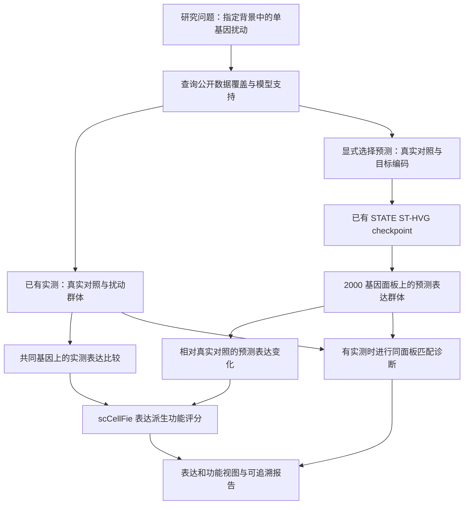

# 细胞知镜：生物领域国赛评审视角审查

审查日期：2026-10-22。审查对象为本机当前工作树，不只限于 Git 已提交版本。本文是研究分析与整改建议，不表示已经实施产品改造或删除文件。

## 结论与审查范围

细胞知镜已经具备有真实模型、真实公开数据、表达与代谢分析、结果追溯和导出的软件基础。主要问题是产品承诺大于目前的验证范围，近期新增能力尚未形成统一的研究任务：实测分析、探索预测、功能可视化和 AI 解读各自存在，但没有围绕一个清晰的用户决策组织起来。

从懂生物学的评审角度，当前最能成立的定位是：**面向使用公开 Perturb-seq 数据的生命科学研究者，提供单基因扰动响应的实测分析、模型探索、功能解释与预测核对工作台。** “虚拟细胞”可以作为研究方向，但当前实现属于转录表达状态层面的条件响应预测，不能扩展为完整细胞数字孪生、形态模拟或已验证的实验替代。

建议把核心研究问题固定为：**在指定细胞背景中，某个基因受到扰动后，哪些表达和代谢相关功能值得关注，哪些结论得到观测支持，哪些仍需验证？** 产品最终交付应是有依据的研究判断与下一步验证清单，而不只是产生图表。

本次完成：

- 阅读当前模型注册、推理入口、表达处理、scCellFie、实测分析、比较、AI 上下文和前端入口代码；核查当前及历史文档。
- 读取保存的比较与实测产物；对 5 份比较的 CSV 独立重算变化 Pearson 与相对不变化基线的 MSE；核对这些比较及 3 份实测分析共 95 个清单登记输出，SHA-256 全部匹配；5 份比较的原运行 manifest 哈希也匹配。
- 核查四背景预测面板、目录组合计数、代谢覆盖和 essential 集合；查看已保存的实测页面与交互原型截图。
- 查阅赛事官方规则、STATE 官方介绍、scCellFie 官方文档和相关评测研究。Context7 返回的 scCellFie 文档只有概述，因此具体科学边界还结合本地计算实现与原始研究。

本次没有运行新预测，没有从 H5AD 全量重算表达均值，没有验证 checkpoint 训练排除，没有调用外部大模型，也没有重跑完整工程测试。8001 浏览器及 HTTP 连接均被拒绝，本机检查未见 8000/8001/5173 监听；因此页面判断来自当前源码和留存截图，不能称为本轮实时端到端验收。历史文档中的“服务已启动”是当时状态。

复核脚本：[audit.py](../evidence/reviewer-audit-2026-10-22/audit.py)。本次输出与源文件哈希：[audit.json](../evidence/reviewer-audit-2026-10-22/audit.json)。输出文件一致性和指标复算只证明保存产物的内部一致性，不等于生物学有效性。

## 1. 系统到底预测什么，服务谁

### 1.1 当前真实计算链路

当前四个启用的模型均为 ST-HVG-Replogle，预测槽为 `X_hvg`。`StateRunInput` 接收细胞背景、目标扰动、真实对照路径、预测样本数和随机种子；`StateCliEngine` 通过 STATE 的推理入口调用已有 checkpoint。当前默认链路没有先执行 SE 再输出全转录组。

可把模型任务理解为：由真实参考群体的表达、细胞背景和干预条件，估计扰动后群体的表达分布。不是追踪同一个细胞未来的真实命运，也不是根据一张细胞图片预测形态。输入对照和输出记录并无逐细胞生物学配对。

之后系统做的是三件不同的事：

1. **预测**：STATE 生成表达数值。
2. **派生解释**：scCellFie 按表达和冻结知识库计算代谢任务支持分数。
3. **核对**：有真实扰动观测时比较预测与观测，并计算基线与误差。

大语言模型不承担表达预测；3D 或细胞轮廓图不承担生物学模拟。STATE 官方将任务描述为给定起始转录组和扰动预测 RNA 响应，SE 是可选模块；这与本地 ST-HVG 链路的表述一致，但官方其他模型的能力不能自动算作本项目能力。[STATE 官方介绍](https://arcinstitute.org/news/virtual-cell-model-state)

### 1.2 当前支持范围必须拆开讲

| 项目 | 当前核查结果 | 正确含义 |
|---|---|---|
| 细胞背景 | K562、RPE1、Jurkat、HepG2 | 四个已登记背景，不是任意组织或患者细胞 |
| 扰动输入 | 2,023 个非对照目标 | 模型有编码入口，不代表全部预测准确 |
| 背景／目标组合 | 8,092 | 输入组合数，不是验证样本数 |
| 固定源有实测 | 5,759 个组合 | 该公开版本存在观测，不保证独立于训练 |
| 模型支持但本源无记录 | 2,333 个组合 | 可以探索；不代表全球未知或官方留出测试 |
| 预测输出 | 每背景 2,000 基因 | 输出面板与输入目标词表是不同集合 |
| 本地三个实测案例 | 6,546 共同基因 | 不受 HVG 截断，但也不是全部人类转录组 |
| 未提供的条件 | 词表外基因、新背景、组合、药物、剂量、时间 | 不能靠自由文本和页面按钮补出这些能力 |

**一个具体的概念漏洞：ALDOA、AAAS、AHCY 都可以作为目标输入，但都不在当前四份 2,000 基因输出面板内。** 因而“预测 ALDOA 扰动的下游表达响应”可以成立，“系统预测出 ALDOA 自身表达下降”则不能从该预测面板得出。预测 H5AD 中保留的输入 `.X` 也不能充当缺失的预测表达。目标观测中的敲低情况可以单独检查，但不能把实测敲低量当成模型预测量。

来源：`data/registry/models.json`、四份 `state_*_genes.txt`、`backend/app/engines/state_engine.py`、`backend/app/services/scientific_analysis.py`；范围说明见 [GENERALIZATION](../GENERALIZATION.md)。

### 1.3 真实用户与目标

第一用户建议明确为：**需要复查公开扰动数据、具备基础生物学知识但不愿反复拼接 Python 分析脚本的研究生或实验研究者。** 计算生物学研究者可作为结果复核与导出用户；教学属于第二场景。

典型任务：研究者关心某背景中一个目标的扰动，查询真实观测，检查表达变化和可解释任务，再决定是否进行模型探索及进一步实验。最终得到一份带来源、效应方向、覆盖和未解决问题的分析材料。

当前不宜将主要用户定义为临床医生、药物研发决策者、任意自有单细胞数据的分析用户。系统没有相应临床证据、药物条件输入，也没有任意上传分析入口。不要把 RPE1 简化为“正常人体”，或把一个肿瘤来源细胞系等同于患者肿瘤。

实测优先是合理的数据使用策略；已有实测时预测仍有独立作用——评价模型或比较模型响应。但应让用户明白自己是在“分析已有证据”还是“检验模型”，而不是要求所有用户为一个已经测到的答案重新跑模型。

## 2. 结果是否有研究与下游价值

### 2.1 当前能成立的价值，以及还未证明的价值

| 使用方式 | 当前判断 | 要补的证据 |
|---|---|---|
| 浏览并复核公开扰动观测 | 有实际价值 | 与原始数据一致、来源明确、合理批次和单位 |
| 把表达、任务、关联及报告放在一起 | 有软件价值 | 实际用户完成任务的耗时、错误率和反馈 |
| 找到候选响应或不一致案例 | 有探索价值 | 原始效应、覆盖、批次稳定性和替代解释 |
| 按预测可靠地排序未测候选目标 | 当前证据不足 | 独立多目标评测、简单基线、排序效用 |
| 发现新的生物机制 | 尚未建立 | 独立实验、干预和机制证据，不能只靠知识库连线 |
| 替代实验、预测疗效或通量 | 当前不支持 | 对应终点的测量与专门验证 |

算法集成不是天然低价值。软件创新赛允许功能、体验和架构创新，但必须说明对真实任务有什么改善；“接了两个模型和一个聊天框”本身不足以证明差异化。[赛事官方说明与评分](https://www.aicomp.cn/tracks/tracks-2/3792.html)

### 2.2 保存指标揭示的实际预测能力

以下 Pearson 比较的是群体表达变化向量，不是绝对表达相关；MSE 比值为“预测误差／不变化预测误差”，小于 1 才优于该基线。本轮从保存的全 2,000 行 CSV 独立复算，与相应 JSON 一致。

| 背景／目标 | 保存运行 | 变化 Pearson | MSE／不变化 MSE | 本案例结论 |
|---|---|---:|---:|---|
| K562／ALDOA | `run_47d09620968f48cf` | 0.438 | 0.798 | 优于不变化基线 |
| RPE1／ALDOA | `run_aef55809479e4c21` | 0.894 | 0.209 | 本组明显优于该基线 |
| Jurkat／ALDOA | `run_34737097754841fd` | 0.498 | 0.861 | 优于该基线 |
| HepG2／ALDOA | `run_41504106326f404d` | 0.263 | 1.553 | 劣于不变化基线 |
| K562／ALDOA，交互原型用例 | `run_ed570bb58ec74739` | 0.332 | 1.017 | 略劣于不变化基线 |

这不是新做的五次实验，也不是五个独立验证目标：五行只有一个目标 ALDOA，K562 两行的运行与群体也不同。不要把它们平均成“总体准确率”，不能只挑 RPE1 的好结果。原型中预测50、实测61的群体与第一行不是同一案例，不能把第一行更好的指标配给原型图。

所有核查比较仍为 `training_exclusion_verified=false`、`held_out_validation=false`。2026-10-15 文档还记录了 Jurkat／ABHD11 的失败案例，但其原运行 `run_469edf3453324f66` 在本轮预期比较路径不存在；该数值只能标作历史记录，不能声称已在当前路径复核。磁盘上同指标的多份结果也不自动构成独立重复，数据库当前可见记录需另查。

“不变化”只是最低限度基线。近期评测研究指出，共同扰动效应和数据偏差可以抬高常用指标；2026 年的后续研究也强调校准指标下深度模型可能优于基线。因此不能推断所有深度模型无用，也不能由一例高相关推出泛化成功。应补充训练集构造的均值／线性基线、扰动特异性与多指标评价。[Systema](https://www.nature.com/articles/s41587-025-02777-8)、[校准指标研究](https://www.nature.com/articles/s41587-026-03307-w)

### 2.3 最薄弱的一环：表达面板能否支撑代谢解释

| 面板与来源 | 本轮核查的代谢库基因覆盖 | 全部关联基因齐全的任务 |
|---|---:|---:|
| 旧未适配符号口径的 HVG 记录 | 131／931 | 7／218 |
| 已做身份适配的 HVG 比较案例 | 138／931，约14.8% | 7／218 |
| 当前保存的6,546基因实测案例 | 526／931，约56.5% | 23／218 |

不能再不加版本地把 131／931 称为所有当前结果。138 与131的差异涉及基因身份适配，不是模型新预测出了7个基因。实测路径面板更宽也没有达到完整代谢覆盖。

这不表示只有7项可以计算或其余全部无意义：不同任务有不同 GPR 结构和替代酶；“全关联基因齐全”是保守的输入完整性标准。反过来，可计算141项任务、或实测计算186项任务，也不证明它们都可靠。应按具体任务和缺失结构验证，不能只展示大数字。

更容易误读的是 essential 口径。当前报告中218项任务有**192项的 `n_genes_essential=0`**，代码明确说明空集合完整性返回1。HVG 报告的199项 essential 完整，不能被说成199项功能得到充分覆盖或验证。这里的 essential 是特定规则下单基因消融的计算定义，不是实验测得的细胞必需基因。

scCellFie 使用转录表达及反应、酶和编码基因的先验关系，推断任务支持。RNA、蛋白丰度、酶活性、底物供应和真实代谢通量不能互相替代。将预测 RNA 再送入它还会叠加模型误差与面板缺失影响。[scCellFie 原始研究](https://pmc.ncbi.nlm.nih.gov/articles/PMC12132331/)

建议优先做一个成本较低且很有解释力的面板消融：对同一批实测细胞，分别使用完整可用共同面板和截断到模型2,000基因的面板，冻结相同阈值、尺度与群体，比较任务方向、排序及差值。这样能把“面板截断造成的信息损失”与“STATE预测误差”分开。两者都仍是表达派生评分，不能把较宽面板当成通量真值。

### 2.4 批次、显著性与伪重复

代码只保留共有 `gem_group`，再按原细胞频率合并求均值。两组共有批次不意味着两组批次构成相同；细胞周期、应激、活性和扰动效率等仍可能影响差值。应增加按批次分层的方向稳定性检查和质量信息；存在可核实独立重复时，再按实验设计使用重复级模型或 pseudobulk。没有重复标识时维持描述性结论，不把细胞数当重复数。

实测分析当前输出的是均值差，不是 log2 fold change 或显著差异。预测比较另有细胞级 Wilcoxon/BH 诊断，但合成预测记录的数量、抽样与依赖关系会影响这些统计量；增加预测记录数不等于增加实验信息或置信度。

## 3. 能否把细胞状态讲清楚，如何可视化

当前已有表达和代谢任务空间的 PCA／UMAP、指标着色、分布统计、基因和任务表，以及关联追溯，具备专业检查能力。主要不足是用户进入后需要自行从大点云、多标签页和多张表中拼出结论。

**表达状态并不等于细胞全部状态，代谢状态也不覆盖所有功能。** 如果产品只将代谢任务画在细胞轮廓中，应称“代谢相关功能概览”；不要暗示已经覆盖细胞周期、应激、凋亡、信号和形态。其他维度需要对应的特征、方法与验证，建议作为明确的后续扩展。

建议按用户阅读顺序组织四层视图：

| 层次 | 回答的问题 | 建议呈现 |
|---|---|---|
| 研究结论概览 | 当前最值得关注什么？ | 研究条件、3–5条可核查变化、是否有实测及基线结果 |
| 功能概览 | 哪些代谢相关功能变化？ | 可点击模块图或细胞轮廓示意，联动具体任务，显示覆盖 |
| 数值证据 | 变化有多大、群体是否一致？ | 同任务三组点图／箱线／ECDF、基因热图或差值图 |
| 专业检查 | 群体异质性、异常和批次如何？ | PCA／UMAP、批次着色、抽样及过滤参数 |

已有 `frontend/public/assets/virtual-response-preview-20261022/` 原型，使用保存的 K562／ALDOA 真实预测与匹配观测，具有8个功能模块和任务—反应—基因联动。这是可复用的交互方向，但仍是独立静态快照原型，未正式绑定任意 `run_id`／`analysis_id`。后续状态（同日实施）：正式结果页已接入按运行／实测记录动态读取的功能概览；旧设计草案退出当前仓库，见[当前实施计划](../plans/2026-10-22-current-product-refinement.md)。独立静态目录已备份，删除被环境策略阻止，仍不是生产能力入口。

正式化时优先处理以下问题：

1. 复用共享组件，实测模式只显示对照／实测，预测模式才出现预测。选择对象与研究条件始终可见。
2. 功能图用颜色表达具体任务的增减，缺失用纹理／灰色。上升下降计数仅是方向汇总；不要画成“整体活性”或将不同任务分数相加。
3. 默认强调可解释、覆盖足够且通过面板敏感性检查的任务；其余保留探索入口。保留低覆盖结果以便复核，而不是删除不利证据。
4. 原型当前环图按接近数值零的阈值区分增减，不能称为显著变化或有效响应比例；重要变化的筛选应有预先定义的实际效应标准和适用的不确定性评估。
5. 三组必须使用同一比较子集、基因面板与单位；明确完整实测6,546基因分析与模型比较2,000基因分析不同。图上选中的数值要能点回原表。
6. 图形位置明确为示意，不让线粒体大小、细胞核形态、膜运动暗示没有测量的损伤、ATP产量或轨迹。几何模型复杂度不是科研真实性。
7. 不同运行各自拟合的UMAP不能直接叠加；需要共同参考投影或回到统一指标。预测与观测重叠也不是独立准确性证明。

当前 `predictionTrace()` 只留下有非零变化的反应和基因，并清空显示用 `gene_rule`。这可降低噪声，但也可能隐藏稳定的必要成员与替代酶，从而让用户误以为眼前链路就是完整机制。建议默认突出变化成员，同时允许展开完整 GPR 和缺失名单；不要把经过显示过滤的链路当作机制归因。

## 4. AI 应该解读什么，当前能否帮助用户

当前 AI 接口只接受 `source_kind="run"`；实测独立分析没有接入。它接收最多前20项基因和任务、来源、覆盖、可用比较摘要；图表解读附带当前指标分布和方法参数，不发送图像、坐标或逐细胞矩阵。系统提示词已经约束不编造通量、显著性、因果和文献，这是正确基础。

但有三个实际缺口：

- 产品首推实测分析，而 AI 仍绑定预测，最常见入口与辅助解释脱节。
- Top20摘要不足以回答任意指定基因、完整通路或全局机制问题；提示词不能使缺失信息自动出现。
- 留存验收使用受控模拟回复，证明界面、协议和上下文传递，不证明真实大模型的科学解读质量。本轮也没有真实外部模型评测。

建议把 AI 定义为**有数据依据的结果讲解助手**，提供五类稳定输出：

| 输出 | 应包含什么 | 实现要求 |
|---|---|---|
| 这次看什么 | 背景、目标、群体、尺度、预测／实测身份 | 服务端生成事实卡 |
| 变化是什么 | 指定指标三组数值、方向、分布和批次范围 | 每个数值绑定具体表或字段 |
| 能怎么解释 | 与知识库关联一致的解释、替代解释 | 区分数据结论、知识关联和待验证假设 |
| 不能推出什么 | 缺失基因、无观测、未核实训练排除、基线不足 | 根据当前结果自动生成，不仅固定免责声明 |
| 下一步做什么 | 最小可执行的验证或补数据建议及其目的 | 不虚构实验已完成或改善比例 |

例如原型使用的 ALDOA 案例，应优先提醒“本次整体表达误差没有优于不变化基线；部分任务方向可探索，但不足以证明可靠的代谢重编程”。不能只根据糖代谢名称写出“成功揭示糖酵解受抑制”的漂亮故事。

先由程序负责数值、单位、排序与缺失判断，再由语言模型组织表达。引用应能定位到结果行；模型如果加入文献解释，需要经过可核查检索并提供原文来源，当前结果摘要不构成文献知识库。不要承诺 AI 看到了未发送的点云形状。

验收建议：建立15–20个固定问题，包含无实测、低覆盖、目标不在输出面板、预测差于基线、无关提问和恶意诱导等情况；由有相关背景的人检查数值正确、来源正确、因果措辞及建议适当性。记录事实错误率、无法回答时的处理和读图任务完成情况。它们是拟议验收，不是已有结果。

## 5. 哪些应该精简、归档或保留

应删减的是重复入口、过度承诺与过时当前说明。失败案例、科学限制、来源和许可恰恰是可信度的一部分，不能为了减少追问而隐藏。

### 5.1 产品入口

当前主导航有首页、实测分析、数据目录、模型预测、预测记录、结果解读、实验比较、方法数据、使用说明九项。结果详情又通过 `/demo` 承载真实保存运行；路由名本身不改变来源，但增加维护和讲述的混淆。

建议收敛为四个主要入口：“研究工作台、历史与比较、数据与方法、使用帮助”。实测／预测是工作台里明确不同的分析任务，记录保留来源类型；历史兼容链接继续跳转，不必立刻破坏旧 URL。模型下载、服务状态与提供商设置放辅助入口。

表达概览、基因页、代谢页中重复出现的投影、变化列表和追溯视图，可共享组件并由选中对象联动；保留全量导出与专业检查。删除“换个页面重复看相同表”的冗余，不删除能验证结论的数据。

### 5.2 具体文件与处置建议

| 路径／对象 | 本轮发现 | 建议处置 |
|---|---|---|
| `docs/ARCHITECTURE.md` | 仍描绘新建online/validation/precomputed三路；未呈现实测CPU链和measured_analyses；末尾称无公开运行列表、映射待补，而当前代码已有列表/追溯 | P0重写为现行两条计算链，历史模式仅写兼容说明 |
| `docs/OPERATIONS.md` | 仍以预测/回放为主，六表与备份目录遗漏新增实测结果；默认8000与README显式8001需解释 | P0补实测运行、迁移、备份和参数化端口，区分默认值与本机示例 |
| 外层 `参赛资料/参赛材料清单.md` | 仍写“全基因扰动预测”、三模式、已退休DEMO_SCRIPT、方案未开始及旧测试数 | P0更新项目状态与链接；保留官方规则原文和日期 |
| 外层 `CellLens_PPT大纲与制作说明.md` | 10月21日稿总体谨慎，但主线尚未吸收实测优先及其与预测的关系 | 修改相关页面输入输出与演示流程，不能只换测试数量 |
| `docs/METABOLIC_FULL_COVERAGE_PLAN.md` | 已注明历史和后续推进；仍列于技术索引，容易被误读为生产方案 | 归入研究档案，附最终状态；不是全部删除 |
| `docs/plans/2026-10-22-virtual-cell-positioning-proposal.md` | 已明确用户澄清后不作为实施范围 | 标为已取消／已替代提案，退出当前功能导航 |
| `docs/plans/2026-10-22-interactive-cell-view-design.md` 及静态原型 | 当前有价值，但只覆盖固定运行快照 | 保留为设计原型；正式化后原型归档，不冒充动态能力 |
| `docs/guide/MODELS.md` 与 `FUNCTION_WORKSPACE.md` | 前者概述有功能网络，后者说明原节点图从该界面移除 | 对齐具体入口和显示范围，区分表格关联、完整导出与节点网络 |
| `docs/verification/`、`docs/evidence/`、`reports/` | 包含不同年代计数、服务状态、运行ID与原始诊断 | 保留日期证据；建立“当前版本验收索引”，不要批量改旧证据 |
| SE相关研究脚本与产物 | 当前默认四模型仍为ST-HVG；SE已有研究与失败/校准历史 | 从生产说明分离，保留复现实验；查清import/调用后再决定物理搬移 |
| `core/precomputed.py`、旧模式枚举、历史读取逻辑 | 新建入口拒绝旧模式，但历史记录兼容仍使用 | 不因入口停用就直接删除；先列依赖、备份、补兼容验收 |
| 外层 `项目资料/历史方案/`、`项目资料/待清理/`、`.celllens-cleanup-20261020/` | 已明确隔离历史/归档，不代表当前运行依赖 | 排除提交包和日常导航；确认保全清单后再评估释放空间 |
| 外层 `细胞知镜_软件创新赛道材料/02_AI加软件创新_提交内容清单.docx` | 留存README将其标为旧占用副本，正式版本移至参赛资料 | 先核对当前内容与正式副本哈希，再归档，不能假定完全相同 |
| `celllens-review-*`、技术方案修订中的多轮render/save-diagnostic/qa-deps | 存在临时审查与渲染目录 | 移出交付包；保留最终源文件、审查证据和必要恢复点后清理 |

这些是审查发现与清理候选，本轮没有移动、删除或改写现有文件。文件较老不意味着无价值；已明确标为历史的记录不属于“错误当前说明”。真正优先处理的是仍从当前入口链接出去、却陈述旧行为的文档。

### 5.3 对外表述的直接替换

| 容易被追问的说法 | 建议口径 |
|---|---|
| 完整虚拟细胞／细胞数字孪生 | 指定背景的单基因扰动表达响应计算表示 |
| 全基因预测 | 2,000基因面板预测；实测路径使用本次完整共同面板 |
| 精确预测细胞状态 | 提供模型探索，并报告匹配观测诊断与适用边界 |
| 代谢活性/通量变化X% | scCellFie表达派生任务分数及相对对照差值 |
| 发现驱动基因或因果通路 | 展示变化基因与知识库反应/任务的关联 |
| 完整覆盖199项任务 | 明确all/essential定义、空集合和基因覆盖，避免单一宣传数字 |
| 高置信度预测 | 展示观测支持、基线表现、面板完整性；未校准不称概率置信度 |
| AI自动发现机制 | AI辅助阅读已核验结果，提出待检验解释 |
| 预测更多细胞提高准确率 | 增加预测记录数，效果与稳定性须单独评估 |
| 可直接服务药物研发和临床 | 当前用于公开基因扰动研究探索；药物/临床属于后续适配方向 |

## 6. 最值得补的创新与验证

差异化应集中在“帮助用户判断哪些结果值得相信、值得继续研究”。scPerturb 已提供整理后的扰动数据及分布比较方法，scCellFie 已提供代谢分析，STATE 已提供预测；因此不能把数据浏览、UMAP和上游算法本身写为自研创新。[scPerturb](https://www.nature.com/articles/s41592-023-02144-y)

建议形成三个可验证的软件贡献：

1. **统一研究对象。** 实测、预测和比较绑定明确背景、目标、群体与面板，用户一次选择即可沿同一对象读图、追溯和导出。
2. **将解释条件纳入工作流。** 任务覆盖、面板敏感性、批次与基线结果直接决定推荐展示与解释措辞，而不只是页脚警告。
3. **可追溯解释。** 图形、AI数值、任务关联与导出引用同一结果行，用户可复核，不靠自由生成机制故事。

当前已有这些贡献的部分基础，但“面板敏感性驱动展示”和“实测AI解读”尚未实现。申报时需把已有能力和拟议创新分开。

验证优先级建议如下；数量是建议的小规模起点，不是充分样本量或国赛硬性要求。

| 优先级 | 工作 | 验收结果 |
|---|---|---|
| P0 | 固定一句话定位与统一来源术语，修正文档冲突 | 当前README、架构、操作指南、PPT主线一致 |
| P0 | 将案例与实际run_id绑定；明确目标不在输出面板、覆盖口径与基线失败 | 每个展示数值可回到同一批次的产物 |
| P0 | 跑通部署环境的公开数据分析→可视化→报告，以及一个明确标注的预测比较 | 当前版本现场运行证据；不是历史截图 |
| P1 | 同一实测群体的6,546／2,000面板消融与按批次稳定性分析 | 明确哪些任务可解释，哪些对面板敏感 |
| P1 | 预先冻结多目标集合，例如每背景20–50个，包含强弱效应与不同功能类别 | 全案例报告、缺失统计、多个基线和扰动特异性评价 |
| P1 | 核查checkpoint训练绑定关系；不足则保持匹配诊断标签 | 训练排除证据明确，不能靠配置test标签自动升级 |
| P1 | 功能原型接入真实分析ID，统一实测与预测结果组件 | 每个模块联动真实表格；动态切换无来源串用 |
| P1 | 接入实测AI摘要并开展固定问题人工评价 | 数值/来源/边界正确，缺数据会明确回答不足 |
| P1 | 邀请3–5位目标用户完成相同研究任务，与现有脚本流程比较 | 有记录的耗时、错误和理解情况，不虚构提升比例 |
| P2 | 确有需求后扩大输出面板、模型或支持上传 | 新模型必须重新验证；不是更改配置即可完成 |

统计分析必须避免把测试目标用于调模型、选面板、调阈值和挑案例。均值/线性基线只从训练部分构造，不能偷用目标观测。多种子可评估采样稳定性，不能替代生物学重复或校准概率。

如果无法短期取得可信训练排除证明，应诚实以公开数据分析和模型诊断作为本届主要交付，同时把独立泛化评测列为未完成研究工作。不能通过更换模型名称或删除失败用例解决证据缺口。

## 7. 评审最可能追问的问题

| 问题 | 当前可以怎样回答 |
|---|---|
| 你们的虚拟细胞在哪里？ | 指定条件下的表达状态计算表示；参考来自实测，扰动后状态由模型生成，功能为表达派生分析 |
| 已经有实测，为什么还要预测？ | 分析已有证据与检验预测能力是两个任务；无实测时只提供受限探索 |
| 你们自己创新了什么？ | 提供可复核的分析与解释流程；STATE/scCellFie归属上游，尚未证明自研预测算法改进 |
| 模型到底准不准？ | 展示同一协议下的实际指标及失败案例；当前尚无独立留出泛化结论 |
| ALDOA的变化怎么看？ | 该模型面板不输出ALDOA自身，只能看面板内下游响应；实测敲低另行检查 |
| 代谢是测出来的吗？ | RNA是测量或预测；任务分数由表达和知识库推断，不是测得通量 |
| 细胞为什么变色或变形？ | 颜色映射已记录的指标；几何为示意，不应由当前数据生成结构损伤结论 |
| AI说的话可信在哪里？ | 数值与来源绑定且可复核；生物解释仍需人工审查，目前实际模型质量验收未完成 |
| 用户用了能节省多少时间？ | 当前没有已核查的量化收益，需要真实任务计时；不填虚构比例 |

最终建议是把展示主线收敛为：**一个明确研究问题 → 一组来源清楚的数据 → 一项可理解的响应 → 一次诚实的模型核对 → 一个有依据的下一步。** 完整细胞模拟的愿景可以保留，但本届作品应由这条已能验证的链路支撑。
