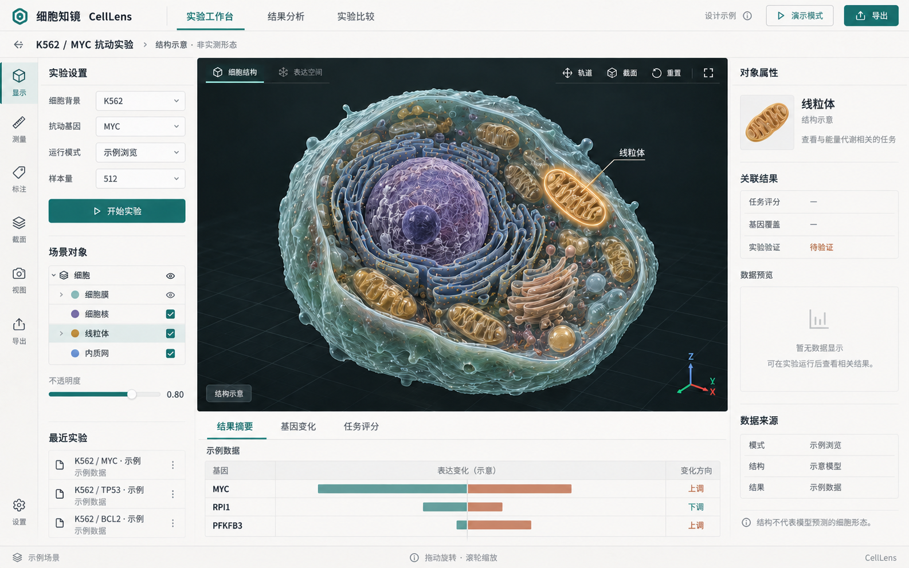
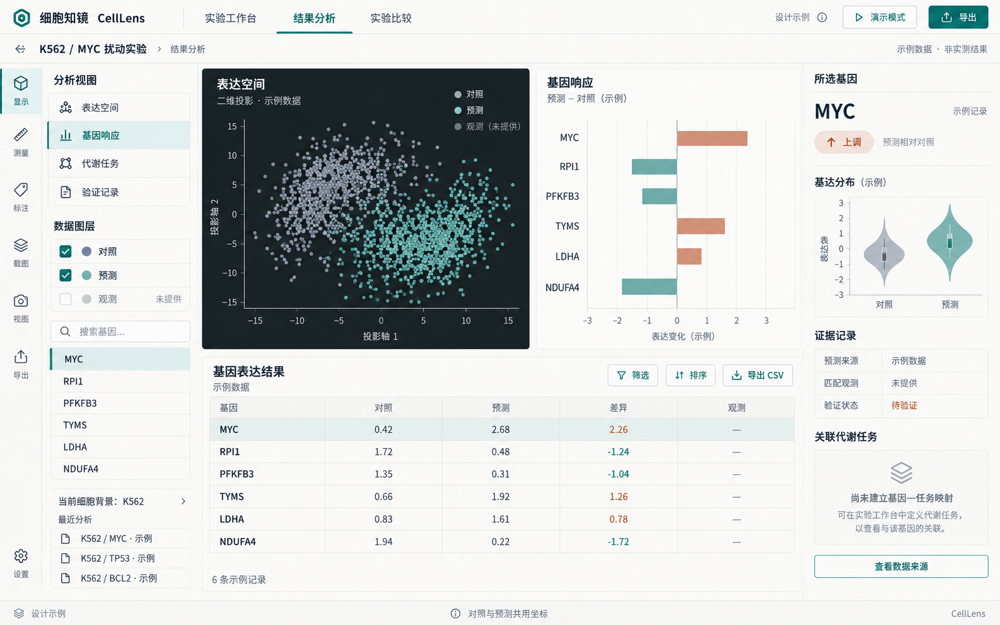
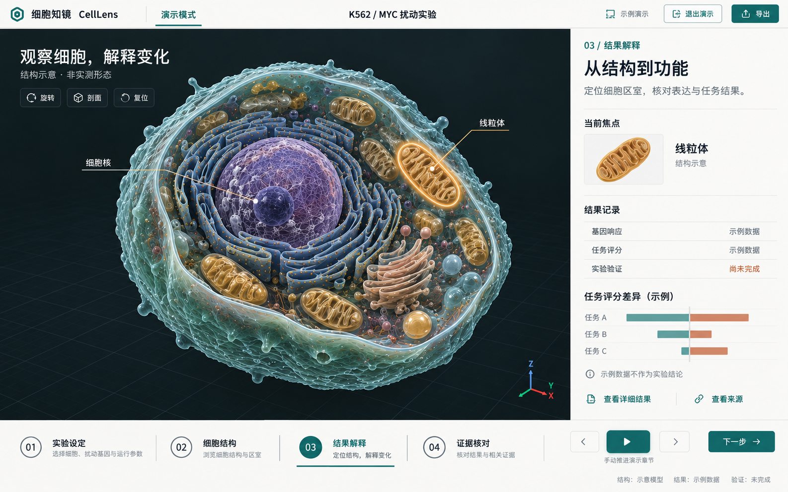

# CellLens 页面与演示设计包

日期：2026-10-04。视觉方向：浅色科研工作台＋深色三维视窗。

| 文件 | 用途 |
|---|---|
| [DESIGN.md](DESIGN.md) | 全站布局、视觉规范、交互、接口边界与验收 |
| [DEMO_SCRIPT.md](DEMO_SCRIPT.md) | 90 秒答辩分镜与讲稿 |
| [01-workbench.png](01-workbench.png) | 实验设置＋三维细胞＋对象检查器 |
| [02-analysis.png](02-analysis.png) | 表达空间＋基因差异＋明细联动 |
| [03-presentation.png](03-presentation.png) | 四章答辩演示布局 |
| [IMAGE_PROMPTS.md](IMAGE_PROMPTS.md) | 内置 image_gen 的完整生成与修订提示词 |

下方三张图是高保真设计效果图，图中数值为排版示例。网站源码已于 2026-10-04 完成对应改造；实际运行效果请查看 [actual/README.md](actual/README.md)，与效果图分开保存。实现保留已有 logo，三维细胞为可交互程序化结构示意，不是形态预测。

关键新增：可交互三维细胞、停靠面板、对象检查器、结果联动、可暂停的章节演示。当前二维 API 保留；三维表达投影需要独立后端扩展。具体取舍以 DESIGN.md 为准。

效果图：

