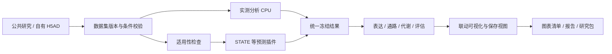

# 科研工作台升级方案

本方案基于当前源码、运行中的目录接口和官方项目资料完成。本文是下一阶段的设计与实施依据；新增数据源、分析插件和图表工作区尚未接入正式系统。

## 1. 建议的产品方向

将 CellLens 定位为“单细胞扰动研究与可视化工作台”：研究者选择真实数据或导入自有数据，完成群体比较、表达与通路解读，整理图表并导出可复核的研究包。STATE 是可选的预测引擎，scCellFie 是代谢分析插件，二者不再决定整个产品的入口和数据范围。

| 路线 | 收益 | 成本与局限 | 建议 |
| --- | --- | --- | --- |
| 扩充 STATE 权重、更多预测模型 | 保持 AI 预测叙事 | 需要匹配训练数据、权重、特征和独立评测；不会自动改善可视化与交付 | 后续研究，不作为当前主线 |
| 多数据源扰动研究 + 联动可视化 + 统一导出 | 扩展真实研究场景；CPU 可完成主要流程；复用现有实现 | 需要拆开数据来源与模型能力，并统一结果契约 | 推荐 |
| 完整多组学/空间/4D 数字细胞平台 | 展示空间大 | 数据、算法、交互和科学验证同时扩张，超出当前人手 | 暂不纳入国赛核心版本 |

成熟度的衡量应是：新用户能够独立完成一次研究、读懂图表、保存选择并导出一致的结果，发生错误时知道如何恢复。模型名称和数据总量只是辅助信息。

项目的原创工作应落在跨来源数据契约、研究条件校验、可恢复的图表选择、功能证据追溯和一致的科研交付上。答辩时明确哪些方法来自上游、哪些工程和交互由团队完成；不把软件整合包装成新基础模型。评估同时报告任务完成率、导出一致性、失败恢复和适用范围，而不仅是模型相关性。

## 2. 截图中的问题与当前真实基础

本轮实际读取 `/api/v1/data-catalog?limit=1`，记录保存在 [当前目录核查.json](当前目录核查.json)。

| 当前项目 | 实际口径 |
| --- | --- |
| 8,092 个组合 | 四种背景 × 2,023 个目标基因的查询空间；不能解释为实测实验数量 |
| 5,759 个组合 | 当前固定来源登记有实测细胞的背景—目标组合 |
| 2,333 个组合 | 模型词表支持，但当前固定来源没有记录 |
| 4 个组合 | 已登记并通过当前本地文件校验的扰动组合，不等于全部可分析公共数据数量 |
| 643,413 个细胞 | 四种背景的固定来源元数据总量，包含对照；不是当前本地缓存量、分析量或独立样本数 |

代码依据：`backend/app/services/perturbation_catalog.py` 的 `query_pairs` 明确将背景与目标集合展开；`source_status`、`local_verified` 和 `model_supported` 是不同维度。当前页面同时突出三种维度和训练划分，用户会误以为“没有下载＝没有数据”，也容易把词表支持当成预测已经验证。

建议保留来源核查能力，但把它变成详情抽屉/高级筛选。页面默认展示真实存在的研究条件，预测条件在独立模式中选择；不再生成大量空组合充当主数据表。

现有实现值得复用：

- `measured_analysis.py` 已支持独立于 STATE 的实测分析，并使用完整共同基因面板，不应误称所有分析都被限制为 2,000 基因。
- 公开实测请求仍引用四种背景的 `Cell` 枚举；固定来源、目标名称归一化及输入分组仍围绕基因扰动，需要扩展为通用数据集和条件契约。
- 已有 CPU/GPU 独立 worker、来源哈希、冻结结果、受控 H5AD 导入和研究笔记。
- `CellStateTab.vue` 已有 SVG/PDF/PNG/JSON 单图导出；`export_bundle.py` 已有分析包、H5AD、网络包、排序包和可用时的 PDF。不能重新把这些当作“从零新增”。
- 预测与实测结果的导出入口、格式及图表操作尚需统一；缺少面向研究者的多图整理、保存视图和统一导出配置。
- `ResearchCanvas.vue` 当前主要是 PCA/UMAP 群体浏览与 Three.js 结构示意；不是全套细胞群体选择、基因表达着色和多图联动工作区。
- 当前导入上限包括 20,000 细胞、60,000 基因、1,200 万矩阵元素和 256 MiB 解压预算；矩阵分析存在转为 dense 的路径。不能仅凭 H5AD 文件小于几百 MB 就认为可直接处理完整数据集。

## 3. 新版页面结构

保留现有浅绿色、深绿色强调色和简洁页头。全局仍围绕四个入口组织：研究概览、研究工作台、数据图谱、实验记录。图表整理作为结果工作区的一部分，不再增加一排全局导航。

### 3.1 数据图谱：以数据集与研究条件为中心

默认页面结构：

1. 搜索条：基因、药物、细胞背景或研究名称。
2. 精选数据集卡片：研究主题、扰动类型、真实背景、可用分析；显示已登记的数据版本。
3. 条件矩阵：行是细胞背景，列是研究/条件类别；颜色表示实际细胞量或数据状态，图例明确说明。未收录状态使用独立标记，不画成零表达。
4. 条件列表：每页 10 条；列为“研究条件、背景、实测细胞、可用分析、操作”。药物条件同时展示剂量与时间。
5. 来源详情：抽屉显示版本、下载状态、校验状态、论文、许可、训练划分和具体支持范围。

主操作按实际能力决定：已准备可分析、需要准备数据、只读已完成结果。仅元数据可检索时显示“查看来源/准备数据”，不显示“立即分析”。准备动作有进度、取消和失败重试。

模型预测单独筛选“选择预测引擎 → 适用背景 → 支持条件”；预测词表不再与实测清单拼成一个所谓覆盖总数。用户主动查询未收录条件时，说明当前来源无记录，并提供适用的自有数据入口。

总览统计分为“已接入数据”“可检索外部来源”“已准备案例”，不把三种状态合并计数。来自同一实验的原始版、过滤版及 scPerturb 整理版建立别名/父子关系，避免重复计数。

### 3.2 结果工作区：一张主图带动研究

借鉴 CELLxGENE 的左右筛选与中央嵌入图，以及 Vitessce 的多视图共享选择；保持现有 Vue 技术栈。CELLxGENE 官方教程展示了细胞选择、基因着色及群体比较，Vitessce 用 view config 和共享协调状态连接多个图。[CELLxGENE](https://cellxgene.cziscience.com/docs/04__Analyze%20Public%20Data/4_1__Hosted%20Tutorials)、[Vitessce](https://vitessce.io/docs/)

桌面布局建议：

```text
研究名称 / 数据集 / 条件 / 保存状态                保存视图   导出
────────────────────────────────────────────────────────────
群体与条件        主视图：细胞表达状态             当前选择
对照、处理        PCA / UMAP / 表达着色            基因与表达分布
批次、重复        框选、图例、恢复视图             通路与关联证据
剂量、时间        选择范围始终可见                 加入图表清单
────────────────────────────────────────────────────────────
表达响应  |  通路与调控  |  代谢功能  |  模型评估  |  图表与报告
```

- 默认一张大主图，按任务展开第二张图；避免把 UMAP、细胞动画、热图、表格同时挤进首屏。
- 基因搜索后联动点图着色、分布图与相关通路；通路点击后高亮贡献基因。
- 群体选择保存稳定的细胞 ID、数据版本和选择规则；“当前选择”“完整群体”“绘图抽样”清楚分开。
- 描述性分布随选择更新；正式统计重算由用户显式触发并产生新结果，不能把探索性圈选后的 p 值包装为预先定义的检验。
- 添加紧凑的“已选 × 个细胞 / 已核实生物学重复 × 个 / 图中显示 × 个点”；独立性未核实时显示“重复信息未核实”，不能按 sample_id 去重自动认定独立重复。图形不能用绘图抽样量冒充全数据量。
- 支持保存视图、恢复视图、加入图表清单、全屏、复制图注、数据下载。用统一工具栏替代每页不同的按钮。
- 深色界面用于屏幕阅读，科研图默认白底导出；组别颜色保持一致，升降变化采用清楚且可区分的发散配色。
- 窄屏把筛选和详情收进抽屉；1440、1920、390 像素检查不遮挡、不横向溢出。

### 3.3 虚拟细胞：结构导航与真实证据联动

保留 Three.js 结构示意作为可选的功能导航。首次展示以真实表达图为主，结构图不占据结果页的大半空间。

点击结构 → 查看有明确知识注释的功能条目 → 查看本次数据支持的基因/通路 → 加入图表。显式注释不足时保持未关联，不因为名称含“能量”就自动映射到线粒体。

没有显微图像或真实空间坐标时，不把结构图称为形态重建，不做“预测后细胞变形”的伪测量。剂量和时间滑块只切换实际存在的观测条件；没有时间序列时不生成连续生物过程动画。以后接入真实成像或空间数据，再新增相应视图。

## 4. 数据扩展：先增加真实研究类型

优先接入 scPerturb 的小规模人类 RNA 扰动数据，而不是镜像整个数据库。官方 scPerturb v1.4 Zenodo 记录提供标准化 H5AD；下表大小是压缩下载量，不能作为运行内存估计。[官方数据记录](https://zenodo.org/records/13350497)

| 优先级 | 候选文件 | 下载量 | 新增价值 | 接入前验收 |
| --- | --- | ---: | --- | --- |
| P0 | PapalexiSatija2021_eccite_arrayed_RNA.h5ad | 52.3 MB | THP-1 新背景，验证独立于 STATE 的实测 RNA 分析 | 核对 arrayed 与 pooled 实验、刺激条件、对照、guide/target 与表达槽位 |
| P0 | SrivatsanTrapnell2020_sciplex2.h5ad | 145.2 MB | 药物、剂量条件，扩展当前只围绕基因扰动的流程 | 以实际 obs 核对背景、药物、剂量、单位和时间；不得送入现有基因预测模型 |
| P1 | TianKampmann2019_day7neuron.h5ad | 268.9 MB | 神经元研究背景，展示通用实测分析能力 | 稀疏处理、输入预算、组别与重复信息；不承诺 STATE 能预测 |
| 回归样例 | AdamsonWeissman2016_GSM2406675_10X001.h5ad | 34.6 MB | K562 小型导入/导出验证，新增研究来源 | 不计为新增细胞背景；核对原研究与既有数据是否重叠 |

首批两个 RNA 文件合计约 197.5 MB。THP-1 配对蛋白文件另约 0.55 MB，可作为后续增强；必须先核对细胞条码、处理组和 RNA/蛋白匹配关系，不列为首版必做的多组学承诺。

接入顺序是 sciPlex2 必交付，THP-1 RNA 通过预检且核心验收完成后增加；两份是优先候选，不同时作为国赛核心版硬承诺。加上已有真实案例和自有 H5AD，形成可讲清的使用场景。官方注释表登记 THP-1 arrayed RNA 为 8,984 个细胞、10 个非对照扰动标签；sciPlex2 为 24,262 个细胞、4 种药物。注释表与下载记录版本不同，尚未实读 v1.4 矩阵核对 n_obs，这些数值只能用于接入规划，不能直接成为新版上线统计。[官方注释表](https://github.com/sanderlab/scPerturb/blob/master/website/datavzrd/scperturb_dataset_info_datavzrd_annotated.csv)

sciPlex2 原研究包含药物、剂量和重复设计，但对应元数据的物种栏包含人和鼠，必须检查并筛选实际目标群体。THP-1 的扰动标签数不自动等于靶基因数。新增数据提升实测分析范围，不自动扩大 STATE 预测能力。

其他来源的定位：

- scPerturb / PerturBase：精选扰动研究的候选目录；下载后按原研究、版本和矩阵逐项验收。PerturBase 本轮未验证稳定可依赖的公共 API，首阶段只做来源引用，不承诺自动全库接入。[PerturBase 原论文](https://academic.oup.com/nar/article/53/D1/D1099/7815638)
- CELLxGENE：细胞类型/组织背景和参考表达探索；不能把普通组织图谱当成扰动标签数据。[官方说明](https://cellxgene.cziscience.com/docs/01__CellxGene)
- PerturbAtlas：作为 bulk 扰动签名或外部证据候选，不能与单细胞数据混为一体。[原论文](https://pmc.ncbi.nlm.nih.gov/articles/PMC11701677/)
- Reactome / GO：功能知识来源，扩展解释范围，不增加实测数据数量。

### 通用数据契约

引入独立于模型的 Dataset、DatasetVersion 和 Contrast。最小字段：研究标识、来源 URL/DOI、文件摘要、许可、物种、背景、扰动类型、条件、对照、剂量及单位、时间及单位、样本/重复/批次、表达槽位及尺度、基因标识、细胞数、样本数、生物学重复数及版本；供者数仅在适用且已核验时提供。

同一背景同一药物不同剂量不能折叠成一行。原数据标签保留；CRISPR 非靶向对照、DMSO、未处理和基线时间点有明确 control_type，不一律改名为 non-targeting。分析适配器消费组别契约，不依赖固定 `obs.gene`。

每份数据独立提供可用模块：表达浏览、描述性比较、正式差异分析、通路评分、代谢评分、预测、匹配评估。新数据不必支持所有模块才能进入系统，但不可用原因必须与实际输入一致。

## 5. 分析扩展：表达、通路、调控、代谢分层

| 层次 | 推荐新增或改进 | 输入前提 | 输出 |
| --- | --- | --- | --- |
| 表达 | QC、群体分布、基因着色、点图/热图、明确的效应量 | 验证表达尺度、基因与条件映射 | 可复核表达图和表 |
| 差异 | 有合格生物学重复时按样本做 pseudobulk；设计矩阵检查批次混杂 | 原始计数、独立重复及可估计的设计 | log2FC、统计量、校正 p 值和适用范围 |
| 通路 | 核心版冻结 Reactome 人类基因集，采用 ORA；GO 后续增加 | 固定的选集规则与实际输入背景 | 通路点图、成员基因、映射率与富集 FDR |
| 调控 | PROGENy / CollecTRI 等作为可选分析插件 | 足够的真实可用基因；适用物种和资源版本 | 活性推断与其覆盖证据 |
| 代谢 | 保留 scCellFie，复用完整实测面板 | 合格映射和数据库 | 现有任务、反应与 GPR 追溯 |

核心通路方法固定为 Reactome 过度代表分析（ORA）：背景 U 为本次 QC 后可检测、可比较且成功映射的完整基因集合；在 U 上分别按正向和负向表达差选择各方向最多全背景 5% 的候选基因，不补入方向不符的基因。5% 是可记录、可调整的探索配置，不是显著性阈值。只测试与 U 相交后有 5–500 个成员的通路，计算超几何右尾概率，对两方向全部测试条目统一做 BH 校正；完整测试集、选集、背景、命中数与筛选参数随结果导出。零候选时输出“没有可用选集”，不补造结果。该配置属于本项目设计，不声称复刻 Reactome 在线服务默认设置。ORA 与多重检验的参考说明见 [Reactome 分析文档](https://reactome.org/userguide/analysis)。

结果名称为“表达变化候选的通路富集”，FDR 表示给定选集模型下的富集多重检验结果，不代表处理效应或因果机制已经通过独立实验验证。使用受控计数例子与等价单侧 Fisher 检验核对结果，并复核 BH 与背景；Reactome 在线结果仅在输入和背景相同时才可比较。后续有合格重复和正式差异统计时，增加预定义阈值的选集模式。

没有独立重复或只有归一化表达时，仍允许描述性比较、探索性排序和覆盖浏览，不伪造正式差异显著性。不能给现有 mean(log1p(CP10K)) 差直接贴 log2FC 标签。富集背景必须是本次实际可检测、经过过滤与映射的基因；不能把预测的 2,000 基因面板无条件对照全基因组。

decoupler 官方文档提供基于表达/差异统计量的活性推断与 pseudobulk 流程，可作为候选分析实现。[官方项目](https://github.com/scverse/decoupler)

兼容性注意：当前 decoupler 主线 2.3.1 要求 Python >=3.12；现有平台按 Python 3.11 工作环境配置。优先使用隔离的分析 worker，固定版本与依赖；不修改共享虚拟环境。不要为了兼容而盲目降级：官方更新记录包含 ORA/GSEA 等修复，应按选用方法核对修复范围并复验。[版本声明](https://github.com/scverse/decoupler/blob/main/pyproject.toml)、[发布说明](https://github.com/scverse/decoupler/releases)

国赛核心版只要求“表达 + 一套通路分析 + 现有代谢”，TF 活性作为通过验证后才发布的增强项。跨研究比较先分研究展示效应方向，不直接拼接不同研究的 UMAP 或混合未经校正的表达值。

## 6. 模型从平台中心改为可替换插件

保留现有 STATE，新增统一适用性声明：物种、背景、扰动类型、基因面板、尺度、训练/测试来源、权重版本、资源需求、许可、验证状态。模块不满足条件时不调用。

优先补齐评估而不是一次接入多个大模型：

- 无变化基线：预测响应为零/对照均值，正确标注为参考基线。
- 训练集均值或线性基线：必须有可核验训练集合，不能使用本次待评估实测数据拟合。
- 在相同基因集合、尺度与实测群体上报告变化量误差、方向一致性、相关性及其适用条件；近零方差时相关性记为不可定义。
- 区分回放匹配和真正留出评估。已知上游 test 候选标签不自动证明当前 checkpoint 未见过该数据。

Systema 的研究说明，常见指标可能受系统性变化影响，复杂预测模型需要与简单基线和扰动特异指标比较。[原论文](https://www.nature.com/articles/s41587-025-02777-8)

后续候选：GEARS 面向基因/组合扰动，CPA 面向药物、剂量和组合条件。但接入代码不等于获得可用模型；两者均需匹配数据、训练/检查点与验证。当前不把 GEARS、CPA 或 scGPT 作为仅有名称的下拉框选项。[GEARS](https://github.com/snap-stanford/GEARS)、[CPA](https://github.com/theislab/cpa)

## 7. 图表与报告：从下载按钮升级为完整交付

借鉴 Reactome 的“层级—图形—详情”联动及图形导出入口。[官方教程](https://www.ebi.ac.uk/training/online/courses/reactome-exploring-biological-pathways/understanding-the-pathway-browser/)

### 统一图表清单

任一已完成图表可“加入图表清单”。每张图保存：结果版本、群体选择 ID、基因/通路 ID、显示范围、坐标与色轴范围、排序、图例、尺寸、配色、方法版本和图注。修改只生成新视图版本，不改原始分析结果。

导出面板在下载前预览内容，明确“当前筛选”或“完整数据”。如果图表显示的是抽样，导出数据默认不偷偷缩减到抽样；需要显式选择并保留抽样记录。

| 交付物 | 复用基础 | 新增验收要求 |
| --- | --- | --- |
| 单图 PNG / SVG / PDF | 已有部分单图接口 | 首批统一投影、群体表达分布、通路点图三类；其余沿用已有导出；白底、中文字体、图例、单位和图注；PNG 支持指定尺寸/分辨率 |
| 结构图/超大点云 | 已有 Three.js / 图形组件 | 如含光栅层须明示；不能把包裹 PNG 的 SVG 宣称为可编辑矢量图 |
| CSV / TSV | 已有多类 CSV | 完整/筛选区分；排序与单位一致；空值与真实零区分；防公式解释 |
| H5AD / 网络 / RNK | 已有预测交换包 | 逐步补齐实测路径；文件类型按本次真实产物启用；不伪造 counts |
| PDF 研究报告 | 已有报告 | 统一封面摘要、研究问题、数据方法、所选图、结论和局限；避免正文出现密集调试字段 |
| 离线 HTML 报告 | 已有实测静态 HTML | 补齐所选图表、图注和离线资源编排；本地打开不依赖公网，私有细胞信息需明确导出范围 |
| 完整研究包 ZIP | 已有 manifest / hash | 图、表、配置、来源、版本、方法、引用及文件摘要一致；外部读取回归 |
| PPTX | 后续增强 | 优先带可选中文文本的排版图版；不承诺所有图完全可编辑 |

导出必须继承工作空间权限。只读展示可提供经审核的公共图表包，不应因为有导出按钮就暴露私有原始矩阵、路径、密钥或私人笔记。

AI 解读继续绑定本次结果，回答后可跳回对应图表/数据；提供“结果摘要、重点差异、验证建议”任务按钮和可编辑报告草稿。没有外部模型连接时仍能使用确定性的图表与方法摘要，不生成伪装成模型回复的文本。

## 8. 技术实现与性能

保留 Vue + ECharts + FastAPI + 独立 worker，不整体迁移 React。Vitessce 的主要嵌入组件是 React；先借鉴其联动设计，需要空间/多模态能力时再做隔离原型，不为一个图形引入第二套全站应用。[官方集成说明](https://vitessce.io/docs/platforms/)



必要的工程改动：

1. 数据接入从 `perturbation_catalog.py` 单固定来源拆为 provider registry；旧来源做第一个适配器，不删除既有 manifest。
2. `measured.py` / `controlled_import.py` 增加新版本请求契约，保留旧运行和接口兼容，不全局放开预测的四背景枚举。
3. 通用 group mapping 支持药物对照；新矩阵保持稀疏，按需读取，去除“所有数据先 densify”的默认假设。
4. 统一结果模块与能力清单，前端按模块展示，旧结果缺少新模块时显示未计算，不在打开页面时偷偷重算。
5. 图表共享 SelectionState / FigureSpec；同一结果版本和选择生成一致的图与表。缓存键包含数据、选择、方法及版本。
6. API 只负责查询与排队；本地分析机运行 CPU/GPU，低预算服务器优先承载只读案例和结果。跨机器 runner 并非当前已实现能力，需要单独验收。
7. 目录服务端分页，不一次把未来全部条件传入浏览器。图表抽样只影响绘制，完整计算范围另行标示；下载在后台生成并提供进度。

性能目标是待验收指标，不是本轮实测承诺：预计算案例首屏 P95 <3 秒；同结果切视图 <300ms；图表导出在参考样例上 <10 秒。按明确硬件、网络、样本量测量，首次科学计算单独报告，超过阈值转为后台任务。

## 9. 实施顺序与范围控制

按 1–2 人与现有电脑规划。以下为估算而非工期保证；若国赛仍在 12 月 3–5 日，从当前 11 月 16 日算约剩 17–19 天，应优先可验收闭环。

| 阶段 | 交付 | 估算人日 | 完成条件 |
| --- | --- | ---: | --- |
| A | 数据目录重排、默认真实条件、来源抽屉、10 条/页 | 2–3 | 不再用空组合主导页面；查询/导出/按钮状态一致 |
| B | Dataset/Contrast 契约、一个新药物数据集、稀疏处理 | 4–6 | 真实矩阵预检、一次新实测分析、旧案例不变 |
| C | 三类图的统一操作、预定义群体联动、保存视图、导出预览 | 4–6 | 所见选择可恢复，图表和 CSV 对得上 |
| D | 冻结 Reactome ORA、覆盖说明、报告模板 | 3–5 | 与选定官方参考实现一致；不合格输入不出伪统计 |
| E | 部署和演示回归、离线备份、错误恢复 | 2–3 | 全流程和目标机器验收 |

上述估算仅覆盖一个新来源、三类图、预定义群体选择与单次研究的图表清单；不含任意圈选后的全矩阵重算、复杂拖拽图版编辑或所有图形全面重写。界面草图中的任意框选、完整视图版本管理和第二数据集属于增强项。合计约 15–23 人日；单人不应同时承担新模型训练、三种新数据集、TF 推断和 PPTX。两人可以并行完成数据/科学后端与图表/导出前端，但契约和最终集成由一人负责。

核心版：现有真实案例 + 1 个新药物数据集 + 表达/一种通路/代谢 + 联动图表 + 图表清单与标准研究包。首批接入目标还包括 THP-1 RNA，可在药物数据完成后用同一契约接入；若只有一人且时间不足，保留为下一批，不影响核心版交付。增强版再加入任意圈选联动、复杂图版编辑、配对蛋白、神经元数据、调控活性、模型比较和 PPTX。

## 10. 评委能看到的闭环与验收

演示目标：三到五分钟完成“选择一个研究 → 看真实响应 → 选基因/通路 → 保存图表 → 导出研究包”，而不是逐页介绍技术名词。

建议准备三条故事，但结论必须由运行结果决定：

- 现有基因扰动：对照、实测、预测之间哪些响应一致、哪些不一致？
- 新药物数据：不同真实剂量/处理条件的表达分布与通路支持有何变化？没有剂量序列的样本不强行做曲线。
- 自有数据：如何确认输入、复用分析并获得与公开数据相同格式的交付？

发布验收清单：

- 至少一份新增来源矩阵真实导入，明确总量/分析量/显示量；分组和尺度核对通过。
- 旧结果、来源摘要和已有导出不被新契约改写。
- 图表筛选、排序、图注、文件名与下载表保持一致；H5AD 重新读取、PDF 渲染和 ZIP 校验通过。
- 无生物重复、缺 counts、零方差、低覆盖、无通路匹配均有明确且正常的结果状态。
- 取消、重试、断网、刷新、worker 重启、导出失败可恢复；演示案例不依赖临时公网下载。
- 目标部署机器、字体、浏览器、只读权限和离线报告实际验证；不是仅在开发电脑上能打开。
- 三名不熟悉项目的试用者能在少量说明下完成一条流程，记录卡点并修正；此项尚未执行。

## 11. 研究边界

本轮完成了运行目录统计核查、源码能力检查和官方资料调研；没有新建预测、没有改变现有数据、没有安装新增依赖，也没有把候选数据源声称为已接入。上面的时间、性能和新增功能均为实施目标。

所有外部资源需固定版本并保留引用。scPerturb v1.4 记录级许可为 CC-BY-4.0，原研究条件应一并核对；Reactome、OmniPath 子资源、模型权重和生成结果的条款分别登记，项目自己的 MIT 不覆盖这些资产。STATE 权重和输出有上游非商业条款。[STATE 官方许可](https://github.com/ArcInstitute/state/blob/main/MODEL_LICENSE.md)、[Reactome 许可](https://reactome.org/license)
