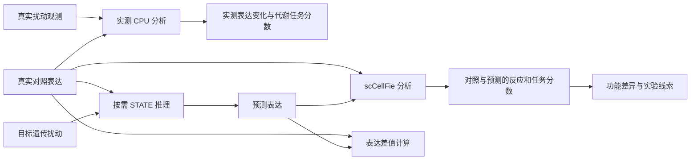

# STATE 与 scCellFie：原始问题、任务、输出及项目中的作用

更新日期：2026-10-22

适用项目：CellLens（细胞知镜）

本文用于理解系统的科学计算链路，以及准备项目介绍与答辩。原始方法的能力依据官方资料；本项目的接入情况依据当前注册表、配置和后端源码，两者分别说明。

**STATE 预测“扰动后基因表达怎样变化”，scCellFie 推断“这份表达数据支持哪些代谢功能”。当前系统优先直接分析真实对照和扰动观测，按需串联 STATE 预测与 scCellFie 评分，并展示表达变化、功能关联和匹配比较。PCA／UMAP 的点云表示特征分布，不表示细胞形态、细胞器结构或真实三维位置。**

## 1. 为什么需要这两个方法

细胞研究中有两个相连的问题。

首先，实验条件的组合很多。不同细胞背景、不同基因干预、不同药物条件都可能产生不同响应，逐一测量需要大量资源。研究人员希望利用已有扰动实验，预测尚未测量条件下的细胞响应。这是 STATE 所针对的问题。[1]

其次，单细胞 RNA 测序提供的是大量基因的表达数值。研究人员还需要知道：这些表达意味着哪些代谢功能较活跃，不同细胞或条件的功能有什么差别？scCellFie 将表达数据与已有代谢知识联系起来，为每个细胞或空间位置计算代谢功能分数。[3][4]

| 对比项 | STATE | scCellFie |
|---|---|---|
| 主要问题 | 给定扰动后，表达状态会怎样改变？ | 给定表达数据，支持怎样的代谢功能？ |
| 方法定位 | 学习扰动响应的机器学习模型 | 基于表达与代谢知识的功能推断框架 |
| 主要输入 | 起始表达、目标扰动及模型需要的背景信息 | 表达数据、物种对应的知识库与阈值 |
| 核心输出 | 预测表达或状态表示 | 反应分数与代谢任务分数 |
| 本项目用途 | 生成 K562、RPE1、Jurkat、HepG2 指定遗传扰动的面板表达预测 | 分别比较实测或预测与对照的表达派生任务分数 |

## 2. STATE 的原始任务与输出

### 2.1 它预测什么

STATE 研究的是细胞对扰动的响应。扰动是人为施加的干预，例如改变某个基因的功能，或者施加药物、细胞因子。[1]

一个典型问题是：

> 已知某类细胞的起始表达状态，施加指定的基因扰动后，其表达谱预计是什么样？

表达谱可以理解为一张数值表：每行对应一份细胞表达记录，每列对应一个基因。模型从已有实验数据中学习扰动前后状态的关系，再预测给定条件下的响应。

原始 STATE 的研究范围包含多种扰动和细胞背景，但**具体 checkpoint 能支持哪些背景与扰动，取决于它的训练数据、特征空间和配置**。不能将整个方法的研究范围直接当作本项目已经支持的功能。[1][2]

### 2.2 SE 与 ST 分别是什么

STATE 包含两个模块：[1][2]

| 模块 | 全称 | 作用 | 输出的含义 |
|---|---|---|---|
| SE | State Embedding | 将表达数据编码为状态向量 | 便于计算的细胞状态表示 |
| ST | State Transition | 预测给定扰动引起的状态变化 | 预测的扰动后状态，可在基因表达空间工作 |

SE 是可选模块。ST 并不要求所有应用都先使用 SE；本项目当前使用的是选定基因面板上的表达预测。

这里的“状态空间”是数学上的特征空间。例如，表达相近的细胞可以在这种空间中接近。其坐标不是细胞器在细胞中的物理位置，也不能直接转换成细胞的三维结构。

### 2.3 当前项目中的输入和输出

本项目按 K562、RPE1、Jurkat、HepG2 分别登记官方 ST-HVG fewshot 模型，均为遗传扰动、基因空间输出，每背景面板包含 2,000 个有序基因。以下以 K562 配置为例，全部背景以注册表为准：

- [模型配置](../../configs/models/state-replogle-k562.yaml)
- [模型注册表](../../data/registry/models.json)
- [项目模型与数据说明](../MODEL_AND_DATA.md)

在线运行使用已登记的模型权重、兼容的对照表达数据、目标扰动、细胞数量参数和随机种子，调用 STATE 推理。一次在线推演属于推理，不意味着重新训练了模型。

当前原始结果保存为 `predicted.h5ad`。这是表达数据容器，不是图片或三维模型。预测矩阵位于 `obsm['X_hvg']`，后端按注册面板映射基因；不能把容器中保留的原始 `.X` 误当成预测表达。

如果一次输出包含 64 份表达记录，其核心矩阵可理解为 **64 × 2,000**：64 行预测表达谱、2,000 列基因数值。这些记录不是 64 个新测量的真实细胞，也不表示跟踪了同一个细胞的 64 个时间点。

前端表达差值遵循 `expression-cp10k-v2` 契约：当前输入和预测已是逐细胞 `log1p(CP10K)`，直接计算各来源的 `mean(log1p(CP10K))` 后作差，不重复按截断面板归一化或取 log。实测路径同样保留输入尺度。变化最大的基因列表是均值差摘要，**不是显著性检验的差异表达基因名单，也不是 log2 fold change**。

## 3. scCellFie 的原始任务与输出

### 3.1 它解决什么问题

scCellFie 面向单细胞和空间转录组中的代谢功能分析，继承并扩展了 CellFie 的思想，支持较大规模数据和后续的功能比较。[3]

它回答的问题是：

> 根据这份表达数据与已知代谢网络，该细胞或空间位置对哪些代谢功能具有较强的表达支持？

scCellFie 可以直接分析真实测得的表达数据，并不依赖 STATE。将它用于 STATE 的预测表达，是本项目采用的组合方式。

### 3.2 什么是“代谢任务”

代谢任务不是软件执行任务，而是一项具体的生化功能：一组反应共同完成从指定底物到目标产物的转换。例如，某种氨基酸的合成可以是一项任务。[4]

其推断过程可以概括为：

**基因表达 → 基因分数 → 反应分数 → 代谢任务分数。**

代谢知识库提供基因、酶和反应的关联，以及完成任务所需的反应集合。表达阈值参与评分，使表达信息能够转化为功能层面的数值。[4]

### 3.3 输出是什么

| 输出 | 数据形式 | 可以回答的问题 |
|---|---|---|
| 基因分数 | 细胞 × 相关基因 | 哪些基因在评分中提供了表达支持？ |
| 反应分数 | 细胞 × 反应 | 哪些反应具有较高的表达支持？ |
| 代谢任务分数 | 细胞 × 任务 | 哪些功能具有较高的表达支持？ |
| determinant genes | 各反应、各细胞的评分相关基因信息 | 哪些基因参与决定了该反应的分数？ |

这些是官方输出层面的信息，具体存放于结果对象中的基因评分、反应评分、任务评分及 `Rxn-Max-Genes` 等字段。[5]

**分数不是实测代谢通量，也不是代谢物浓度、ATP 产量或细胞器形态。** 在当前项目中，不能把一个任务分数的差值直接解释为“代谢速率增加了多少百分比”。

### 3.4 当前项目怎样使用它

项目使用冻结的人类代谢数据库与同一套表达阈值，分别处理对照、预测或实测表达。评分前将 `log1p(CP10K)` 通过 `expm1` 恢复线性 CP10K，避免再次按 2,000 基因面板归一化；关闭跨来源细胞平滑。实测直接分析不依赖 STATE，采用本次输入的完整共同基因。

主要保存：

- `metabolic_task_scores.csv`：逐细胞任务分数及来源。
- `reaction_scores.csv`：预测分析的逐细胞反应分数及来源。
- `metabolic_coverage.csv`：任务所需基因的覆盖情况。

预测摘要由逐细胞分数按来源汇总；实测分析还保存群体汇总表 `tasks.csv`、`reactions.csv`。具体文件以该次 manifest 为准。预测任务摘要的差值定义为：

`任务差值 = 预测组任务分数均值 − 对照组任务分数均值`

保存的预测摘要选取绝对变化最大的 20 项；实测差值为观测均值减对照均值。正负仅代表方向，是否值得研究还要看覆盖、群体、基线和验证。页面结果概览的覆盖优先排序与保存摘要的变化排序是不同展示规则。

官方方法提供的解释信息不等于已完成机制归因。当前 `determinant_genes` 不用于驱动解释；任务—反应—基因关联来自冻结知识库，可检查完整 GPR 与缺失成员，但不能称因果贡献。

## 4. 两者在 CellLens 中如何连接

以选择 K562 和一个已登记目标基因为例，系统先生成预测表达，再比较基因表达变化，并将对照与预测表达转成代谢分数，展示任务变化和覆盖信息。研究人员由此可以提出候选解释，并决定后续测量哪些基因或功能。

该链路包含两个环节：**表达响应是模型预测，代谢功能是依据表达进行的推断。** 两者都需要合理的数据与评价支持。

## 5. 怎样理解结果的可信程度

### 5.1 功能推断不能独立验证表达预测

将 STATE 的输出送入 scCellFie，能够增加功能解释，但不能证明 STATE 预测正确。输入表达有误，功能分析也可能受影响。

评价 STATE 应使用匹配的真实扰动表达，在明确的数据划分和评价协议下比较预测与观测；如果继续评价代谢分数，两侧还应采用一致的处理规则。工程链路能运行与生物学预测准确，是不同的验收目标。

### 5.2 2,000 个基因面板会限制代谢覆盖

当前 STATE 只输出选定面板，部分代谢任务所需的基因没有覆盖。ALDOA 虽是可选扰动目标，却不在当前输出面板中，不能从预测直接读取 ALDOA 自身变化；其敲低需在实测输入中另行检查。正式界面优先提供 scCellFie 官方连续完整性指标，包括完整覆盖的任务/反应、影响加权完整性、全部关联与 essential 基因范围以及缺失基因清单；详见 [模型与数据](../MODEL_AND_DATA.md)。

下面的项目覆盖分档保留用于历史产物和 API 兼容：

| 历史项目等级 | 兼容规则 | 实际含义 |
|---|---|---|
| supported | 覆盖比例 ≥ 80% | 通过当前基因覆盖门槛 |
| exploratory | 60% ≤ 覆盖比例 < 80% | 覆盖有限，适合探索性解释 |
| insufficient | 覆盖比例 < 60% | 覆盖不足，需要谨慎解释 |

这些是项目定义的覆盖等级，**不是 scCellFie 原生的实验验证等级，也不是统计置信度**。`supported` 不等于“已被实验验证”；缺失基因也不能自动解释为生物学上不表达。

正式解释分数前，还应核对表达尺度、预处理方式与冻结阈值的兼容性。文件可读取、数值非负及程序运行成功，都不足以单独证明这种科学兼容性。

## 6. 这些输出与状态分布及功能网络的关系

目前这条模型链路没有直接提供：

- 细胞与细胞器的三维几何坐标、形状或尺寸预测。
- 线粒体数量、膜形变或细胞器运动轨迹。
- 干预后每一秒的连续生理状态。

因此，在线推演完成后，不能只根据表达和任务分数就让线粒体膨胀、细胞核变形，并将其介绍为模型预测的真实过程。

“代谢功能”的任务追溯仍可展开三维功能网络；它是关联布局，与“功能前后对比”的逐细胞图不同。

当前产品分别依据逐细胞表达与代谢任务分数，展示扰动前后的表达／代谢状态分布，并通过任务详情、关联列表与完整导出追溯任务—反应—基因关系。状态分布图中每点代表一个细胞，关联来自冻结知识库；坐标均不是物理位置。点云形状不是细胞外形，不按相同序号连接为前后轨迹。细胞器结构示意已从产品中移除。

2026-10-22 更新：研究分析提供实测与预测两种任务；概览先呈现关键变化与任务数值，PCA/UMAP 按需展开。记录与比较统一进入，预测结果使用 `/runs/:runId`，实测使用 `/measured/:analysisId`。任务关联的可见范围与完整导出见[代谢功能说明](FUNCTION_WORKSPACE.md)。

## 7. 项目介绍与答辩表述

可使用以下表述：

> CellLens 是一个面向单细胞基因扰动研究的分析工作台。优先分析公开实测数据，按需使用 STATE 生成指定背景与目标的表达预测，并通过 scCellFie 分析表达派生的代谢任务支持分数。结果、覆盖、匹配观测比较和来源可复查，为后续实验提供待验证线索；当前不承担细胞形态预测。

介绍时应分别说明：使用了什么上游方法、本项目实现了什么、已经完成哪些验证，以及哪些结果仍属于待实验检验的预测。

## 8. 资料与代码依据

### 官方资料

1. [Arc Institute：STATE 原始发布与 SE/ST 介绍](https://arcinstitute.org/news/virtual-cell-model-state)
2. [STATE 官方代码仓库与任务说明](https://github.com/ArcInstitute/state)；[论文入口](https://www.biorxiv.org/content/10.1101/2025.06.26.661135v2)
3. [scCellFie 官方介绍](https://sccellfie.readthedocs.io/en/latest/)
4. [Atlas-scale metabolic activities inferred from single-cell and spatial transcriptomics](https://pmc.ncbi.nlm.nih.gov/articles/PMC12132331/)；[论文 DOI](https://doi.org/10.1101/2025.05.09.653038)
5. [scCellFie 官方教程：结果输出与分析](https://sccellfie.readthedocs.io/en/latest/notebooks/extended_quick_start.html#export-results)

### 本项目实现

- [STATE 推理适配](../../backend/app/engines/state_engine.py)
- [scCellFie 接入](../../backend/app/engines/metabolic_engine.py)
- [表达差异、覆盖、任务摘要与评价](../../backend/app/services/scientific_analysis.py)
- [模型与数据说明](../MODEL_AND_DATA.md)

本文记录上述日期的接入情况；模型、面板、数据库或评价协议变更后，应同步更新。
