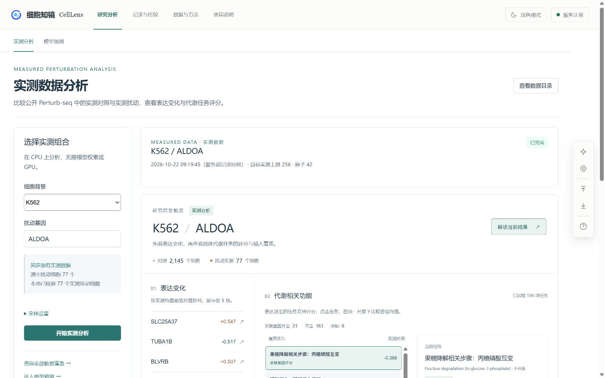

# 剩余清理、手动重启与复查

## 当前状态

本轮重新请求删除 8 个目录，以及停止现有后台后重启，均被执行环境策略在命令运行前拒绝；不是 Windows 文件占用或应用报错。没有改用其他手段绕过。8 个目录仍存在，8001 仍由原进程 25504 提供服务。不要把这个历史 PID 直接用于以后停止进程。

导航已改为品牌右侧靠左紧凑排列，右侧只保留主题和服务状态，不再把四项主菜单平铺占满整栏。前端已重新构建并通过浏览器核验，因此刷新即可看到；后端最后的匹配比较 AI 上下文等修改仍待重启。

## 1. 手动清理目录

请在资源管理器中删除以下 **8 个指定目录**，普通删除即可，不需要清空回收站。不要删除其父目录，也不要扩大到模型、数据、数据库或整个 assets。

外层 `D:\全球校园人工智能精英大赛` 中：

- `.tmp_extract`
- `.tmp_mysql_check`
- `.review-2026-10-19`
- `.celllens-cleanup-20261020`
- `.frontend-integration-backup-20261020_231120`

仓库 `D:\全球校园人工智能精英大赛\celllens-platform` 中：

- `celllens-review-pdf-vtawrhqt`
- `celllens-review-u09pbrxh`
- `frontend\public\assets\virtual-response-preview-20261022`

备份在 `C:\Users\zhs14\AppData\Local\Temp\celllens-refinement-before-20261022-202509`：`obsolete-files.zip`、`obsolete-manifest.json`。本轮逐文件复查 8 个目录的 4,559 文件，仅原型 `index.html` 因上一轮新增停用提示而改变；已另存 `retired-preview-index-20261022.html` 并核验 SHA256。其余均与备份一致。建议保留备份到验收完成，不要同时清理该临时目录。

## 2. 正常停止旧后台

优先在原后台终端按 Ctrl+C，等待停止；若原终端不可见，在你自己的 PowerShell 7 中执行以下代码。代码重新检查活动任务、端口和进程身份，只停止本仓库 8001 的 Uvicorn，不停止 MySQL 或所有 Python。

```powershell
$ErrorActionPreference = 'Stop'
$repo = (Resolve-Path -LiteralPath 'D:\全球校园人工智能精英大赛\celllens-platform').Path
$base = 'http://127.0.0.1:8001'
$active = Invoke-RestMethod "$base/api/v1/experiments?status=active"
$measured = Invoke-RestMethod "$base/api/v1/measured/analyses?limit=100"
if ($active.total -ne 0) { throw '存在运行中的预测，请等待完成' }
if ($measured.total -gt 100) { throw '实测记录超过一页，需要完整核查后再停止' }
if (@($measured.items | Where-Object { $_.status -notin @('completed','failed','cancelled') }).Count) {
    throw '存在运行中的实测分析，请等待完成'
}
$listeners = @(Get-NetTCPConnection -State Listen -LocalPort 8001)
$processIds = @($listeners.OwningProcess | Sort-Object -Unique)
if ($processIds.Count -ne 1) { throw '端口进程不唯一，请手动核查' }
$server = Get-CimInstance Win32_Process -Filter "ProcessId=$($processIds[0])"
$entrypoint = Join-Path $repo '.venv\Scripts\uvicorn.exe'
if (-not $server.CommandLine.Contains($entrypoint) -or
    -not $server.CommandLine.Contains('backend.app.main:app') -or
    -not $server.CommandLine.Contains('--port 8001')) {
    throw '不是本仓库的预期后台，拒绝停止'
}
$server | Select-Object ProcessId, CommandLine | Format-List
Stop-Process -Id $server.ProcessId
Wait-Process -Id $server.ProcessId -Timeout 20 -ErrorAction SilentlyContinue
```

如果后台已自行关闭，接口连接失败时无需执行停止段；确认 8001 没有监听者后直接启动。若出现权限不足，请核对是否由其他账户启动，不要停止陌生进程或禁用安全策略。

## 3. 重建并启动最新版本

必须在删除静态原型后重新构建，才能把旧原型从 `frontend/dist` 同步移除。不要加 `-SkipBuild`。在自己的 PowerShell 终端运行：

```powershell
Set-Location -LiteralPath 'D:\全球校园人工智能精英大赛\celllens-platform'
pwsh -NoProfile -File .\scripts\start_system.ps1 -ApiPort 8001 -StartLocalMysql -Rebuild
```

该终端保持运行；正常启动会检查项目 MySQL 3307、迁移、构建并启动后台。若提示端口被占用，停止处理并核对占用者，不要另开其他端口冒充重启成功。

## 4. 在第二个 PowerShell 终端验收

```powershell
Set-Location -LiteralPath 'D:\全球校园人工智能精英大赛\celllens-platform'
.\.venv\Scripts\python.exe .\docs\evidence\refinement-2026-10-22\check-live-system.py --require-latest
if ($LASTEXITCODE -ne 0) { throw '仍有未通过检查，请保留输出' }
.\.venv\Scripts\python.exe .\docs\evidence\refinement-2026-10-22\check-preserved-results.py
Test-Path -LiteralPath '.\frontend\public\assets\virtual-response-preview-20261022'
Test-Path -LiteralPath '.\frontend\dist\assets\virtual-response-preview-20261022'
```

预期：26 项在线检查全部 PASS，95 个产物哈希无不匹配，两个 Test-Path 均 False。检查脚本只读取本地 API，不创建预测，不发外部 LLM 请求。实测 ZIP 检查仅在内存中读取，不保存重复数据。

浏览器打开 `http://127.0.0.1:8001/measured`，用 Ctrl+F5 刷新；打开 HepG2 / ALDOA 现有预测的“解读当前结果 → 预览发送内容”，不再出现旧后台提示，应出现匹配比较的对照／预测／实测摘要。无需配置密钥或发送模型请求即可验证预览。

## 本轮已完成的复查

- 后端完整测试：394 passed，7 warnings，241.85 秒；日志 `reports/refinement-recheck-pytest-20261022.txt`。
- 生产构建、Vue 类型检查、7 组前端专项脚本通过；保留图网络 chunk 大于 500 kB 的原有警告。
- Ruff 通过；BasedPyright 0 errors / 0 warnings / 0 notes；git diff --check 通过（现有 CRLF 提示保留）。
- 保存的科学输出 95 项哈希全部匹配。
- 在线只读检查 26 项中 25 项通过；唯一未通过为最新匹配 AI 上下文激活，对应后台未重启。健康、数据库／worker／GPU readiness、目录、现有实测和预测、表达与任务表、PCA／UMAP、ZIP CRC、观测比较读取正常。
- 浏览器验证 1024／1280／1440／1920 桌面宽度：导航宽 268 或 344 像素，不随窗口拉满，且无横向溢出。真实实测／预测页面与记录导航正常；旧后台比较解读仍被前端明确拒绝。
- 方法、背景、代谢覆盖、使用说明、服务状态、设置和预测入口均完成页面加载检查，未记录控制台错误；覆盖页首次加载未在 networkidle 等待窗口内完成，随后确认目录和 138 个覆盖基因正常显示。

本轮没有新增真实推理、没有调用外部语言模型，也不宣称完成独立生物学有效性验证。由于后台重启被阻止，不能声称最终运行态已全部更新。


