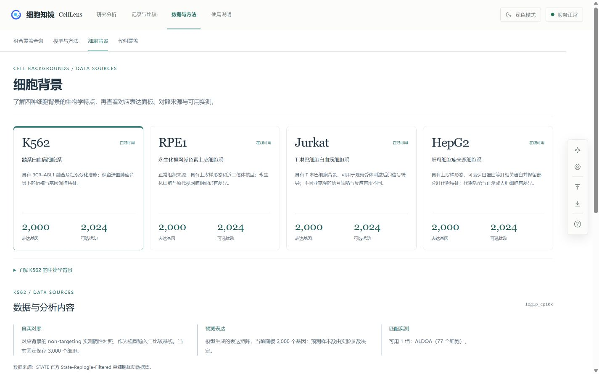

# 四个方法页面统一与覆盖加载优化

## 界面

- 组合覆盖查询、模型与方法、细胞背景、代谢覆盖共用 `MethodsPageHeader`，各自只有一个一级标题；删除后三页外层重复的“数据与方法”总标题。
- 四页标题、简介、字号、边距保持一致。1440 像素桌面实测四个主标题均为 30px，左边距 32px，顶部坐标约 182.45px。
- 细胞背景的四张生物学介绍卡与背景说明不依赖后台请求。等待期间只有核验人数和面板数量显示未知，不再整页等待“目录”。刷新失败不保留旧数量。
- 代谢覆盖标题固定显示，不随请求结果从“输入覆盖”跳到“模型覆盖”；数据加载状态放在内容区域，来源说明在数据核验后显示。

## 加载原因与修改

原背景接口读取模型登记、表达面板和对照观测元数据；它不是标题所必需的信息。已运行服务的两次读取约 0.10–0.12 秒，但初次资产核验可能更慢。现在静态生物学内容先展示。

原覆盖接口每个新 Python 进程首次访问会导入 scCellFie 的科学计算依赖，并执行官方完整性／单基因消融计算。一次带 cProfile 的诊断耗时约 83 秒，其中依赖加载约 28 秒，完整性计算约 52 秒；这个诊断时长包含性能分析开销，不能当作普通请求延迟。

新增模型覆盖响应的持久快照，保存在 `data/derived/catalog-cache`。每次读取仍核对登记文件、实际面板、知识库、身份与注释资源、代码及依赖版本的内容指纹；数据改变会重新生成，失败不会回退到旧结果。缓存内容也校验自身摘要；写缓存失败不影响已核验结果返回。运行结果的覆盖接口仍走原始保存产物核验，不共用模型缓存。

两个独立 Python 进程的本机直接调用测量：首次生成快照 47.4006 秒；后续新进程复用快照 0.7739 秒，且不导入 scCellFie 评分包。两次均为 2000 基因、218 项任务、7 项全关联基因齐全。此为本机服务函数检查，不是现有在线后台的部署后延迟。

与此前运行服务的响应比对，只有三个不展示为主要覆盖指标的 `total_impact_missing_all` 浮点数存在至多 8.9e-16 的差异，来自重新执行官方计算时的浮点求和；其余字段相同。没有修改已有科研结果或评分公式。

## 验收与生效范围

- 新增快照单测：重复读取、源变更、来源选择、内容篡改、错误不回退、登记目录外的面板、翻译资源变化、只读缓存目录。
- 方法页面结构回归 2 项通过；浏览器实际观察到后台元数据仍在读取时，四张生物学介绍卡和主标题已显示。
- 浏览器检查四页主标题均唯一、位置一致，未记录控制台错误。证据见 `docs/evidence/refinement-2026-10-22/methods-header-check.json`。
- 前端类型检查和生产构建通过；Ruff、BasedPyright 通过。原有图网络 chunk 体积警告保留。
- 当前工作区完整后端回归 424 passed、7 warnings（262.25 秒），日志 `reports/methods-pages-pytest.txt`；保存科研输出 95 项哈希全部一致。
- 前端布局刷新后可见。当前 8001 后台进程早于此次后端修改启动，因此持久快照优化需要正常重启后端才生效。没有再次尝试绕过前轮禁止停止进程的策略。

可在自己的后台终端 Ctrl+C 后执行：

```powershell
Set-Location -LiteralPath 'D:\全球校园人工智能精英大赛\celllens-platform'
pwsh -NoProfile -File .\scripts\start_system.ps1 -ApiPort 8001 -StartLocalMysql
```

若找不到原终端，使用 [手动重启指引](2026-10-22-manual-cleanup-restart.md) 中的动态端口／进程身份检查，不能照抄历史 PID。


