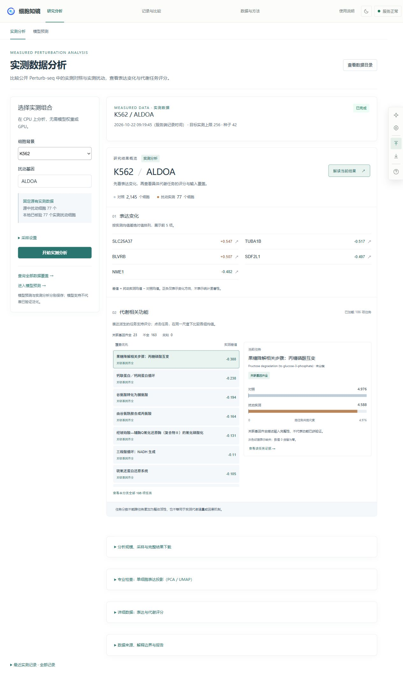

# 2026-10-22 产品收敛与过时内容清理

后续复查及仍需手动执行的清理／重启步骤，见 [手动清理、重启与复查](2026-10-22-manual-cleanup-restart.md)。

## 结论与未完成项

本轮在原有未提交改动上实施收敛，未提交 Git、未建立分支、未替换模型或科研数据。软件主线为“实测分析／模型预测 → 结果概览 → 必要的证据与比较 → 有来源的 AI 解读”。

**清理和运行状态不是全部完成：**8 个过时目录的批量删除被环境策略阻止，已保全但仍存在；后端最后一次重启同样被策略阻止，8001 仍是此前启动的服务进程。最后补强的匹配比较 AI 上下文与实测解读任务限制，需要用户正常停止现有服务后重新启动才会生效。前端对旧版比较上下文明确拒绝，不以旧群体数据冒充新比较解读。

## 已实现

- 主导航由 9 项收敛为“研究分析、记录与比较、数据与方法、使用说明”，首页由品牌进入。实测／预测和各类记录通过栏目导航区分；删除方法页重复子导航。
- `/runs/:runId` 直接显示真实结果页。旧 `/demo?run=...` 只作兼容跳转，不再有独立演示结果组件。
- 实测与预测共享结果概览：前 5 项表达变化、覆盖优先前 8 项任务、中文任务名、同任务共同尺度条形图、展开全部任务。缺失保留为空，零值不丢失，覆盖不当作生物学可靠性。
- 预测概览有匹配观测时，全部均值、人数、差值和基线取自同一匹配群体；不混用原实验均值。目标缺失仅在完整面板可证明时显示。HepG2／ALDOA 的不利基线表现保留。
- 任务点击只更新对比图，独立按钮打开证据；原运行无该任务时打开精确覆盖详情，不跳到其他任务。原运行明细与匹配比较子集之间有明确提示。
- 实测页的采样设置、详细表、PCA／UMAP、来源和报告默认折叠；点击指标展开并定位明细。实测历史复用同一组件，统一进入记录页。
- 功能关联可切换完整知识库关系，保留未变化／缺失成员和 GPR。投影按需加载；关联不表述为实验证明的机制。
- AI 支持实测概览、基因、任务和精确指标行；来源切换清除旧图表状态。仅发送核验后的摘要，保留预览与来源哈希。匹配比较视图不再使用原实验的数值摘要。
- 修复超过 100 字符的真实任务名检索返回 422；接口与检索输入统一上限 500 字符。
- 修复 Vue 可选 Boolean 缺省转 false 导致实测页误报“目标不在面板”；未知状态显式保持 null。

## 清理账本

清理前源代码快照和逐文件校验备份位于：

`C:\Users\zhs14\AppData\Local\Temp\celllens-refinement-before-20261022-202509`

`obsolete-files.zip` 共 4,564 文件、261,374,212 字节原始内容，逐文件大小和 SHA256 已验证。清单为同目录 `obsolete-manifest.json`；备份脚本见 [backup-cleanup.ps1](../evidence/refinement-2026-10-22/backup-cleanup.ps1)。备份不是“删除完成”的证明。

已实际删除 5 个过时文件：

1. `frontend/src/views/DemoView.vue`。
2. `frontend/src/components/response/ResponseWorkspace.vue`。
3. `scripts/build_virtual_response_preview.py`。
4. `docs/plans/2026-10-22-virtual-cell-positioning-proposal.md`。
5. `docs/plans/2026-10-22-interactive-cell-view-design.md`。

研究性质的全覆盖方案迁至 [研究档案](../research/archive/METABOLIC_FULL_COVERAGE_PLAN.md)，退出当前生产方案索引；没有把研究脚本、历史证据或失败案例当垃圾删除。

以下 8 个目录**仍未删除**，未尝试绕过策略：外层 `.tmp_extract`、`.tmp_mysql_check`、`.review-2026-10-19`、`.celllens-cleanup-20261020`、`.frontend-integration-backup-20261020_231120`；仓库内 `celllens-review-pdf-vtawrhqt`、`celllens-review-u09pbrxh`、`frontend/public/assets/virtual-response-preview-20261022`。静态原型增加明显的停用提示并链接新版入口；不能称已从磁盘或构建资源中移除。

模型、原始输入、有效预测和实测输出、数据库、迁移、许可证均保留。95 个保存科研产物核对清单 SHA256，0 不匹配，见 [核验结果](../evidence/refinement-2026-10-22/preserved-results.json)。

## 文档范围

同步仓库与外层 README、架构、运维、模型数据、前端、API、使用／模型／功能／结果／助手指南、脚本索引、材料清单和 PPT 大纲。修正旧三模式、遗漏实测备份、先均值再归一化、旧导航与旧结果入口等说明。专项检查共 18 份文档、200 个本地链接无断链；该数量对应文档子任务检查范围，不表示仓库所有历史文件都无旧路径。

现有 Word、PPTX、PDF 正文未重写；材料清单明确其版本待按本轮软件重新验收，不声称这些二进制材料已经与最新系统一致。

## 验收记录

- 完整后端回归 **394 passed，7 warnings**，最终结果见 `reports/refinement-pytest-final-20261022.txt`；另已通过助手定向 71 项测试。
- `npm run typecheck`、生产构建、Ruff 和 BasedPyright 通过；后者 0 errors / warnings / notes。
- 前端运行概览、共享概览、实测助手（7 项）、函数网络、预测证据、导出和构建缓存的定向脚本通过。新增测试覆盖真实 Vue Boolean 默认值、匹配群体隔离、无值不回填、未知任务精确导航、来源切换与旧版上下文拒绝。
- 浏览器检查真实 K562／ALDOA 实测记录：2,145 个对照、77 个扰动细胞；186 项已评分任务，23 项关联基因齐全；点击钙联蛋白／钙网蛋白任务后，条形图和指标预览数值一致。未点击发送，未调用外部语言模型。
- 浏览器检查真实 HepG2／ALDOA：匹配群体 840／209／96，误差比约 1.553，明确“不优于不变化基线”；保留目标 ALDOA 不在预测面板提示。
- 完整关联开关显示 GPR；实际下载 JSON，解析确认包含 `gene_rule`。旧记录导航兼容，专业投影默认折叠。
- 桌面 1,280 像素宽度下文档宽度为 1,280，无横向溢出。窄于 1,024 像素仍是桌面布局；未声称完成移动端适配。
- 最终浏览器验证旧后台保护：比较解读预览显示“当前后台仍是旧版本，请重启 CellLens 分析服务后再生成解读”，不提供错误群体摘要；见 [实际提示](../evidence/refinement-2026-10-22/backend-restart-required.txt)。
- 当前 8001 的 health、ready 与实测读取均返回 200，但这仅证明此前启动的服务可用，不证明最后的后端修复已热更新。

构建保留原有 Three.js 图网络单块超过 500 kB 的警告；后端有依赖弃用等警告，未通过抑制警告假装消失。未新增预测、未重新估计生物学准确率、未完成独立泛化验证。AI 测试使用受控模型响应，不代表真实模型解释质量评测。

