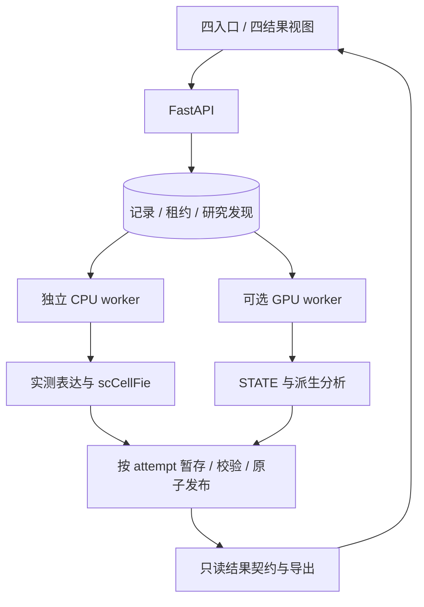

# 交付说明

本版交付 CellLens 的研究门户、统一结果工作台、受控自有数据分析与独立任务执行。软件将实测数据、模型预测和表达推断的功能评分分别标注，并让结果、研究发现与导出包可追溯到具体记录。使用方法见[使用说明](使用说明.md)，演示顺序见[演示流程](演示流程.md)。

## 系统架构

前端采用 Vue 3 与 TypeScript，提供研究概览、研究工作台、数据图谱和实验记录四个入口。新建研究以实测数据分析与基因扰动预测两项任务组织，公开/自有是实测来源。实测与预测共用研究总览、表达响应、功能证据和实验对照四个结果视图。

FastAPI 负责请求校验、访问控制、任务入队和结果读取；SQLAlchemy 与 Alembic 管理记录、租约、attempt、资产引用和研究发现。SQLite 用于单机轻量运行，MySQL 保留既有环境兼容。API 与 worker 必须共享同一数据库及资产目录。

CPU 分析不依赖 GPU；预测 worker 需 CUDA、STATE 与实际心跳就绪，具体任务还需已登记的权重、输入与目标支持。worker 中断后按租约创建新 attempt，完成产物保持不可变；API 重启不会将正在运行的独立任务改为失败。

## 功能范围

| 能力 | 交付行为 |
|---|---|
| 公开实测 | 按背景与目标检索真实覆盖，运行 CPU 表达和功能分析 |
| 自有 H5AD | 在允许根目录内预检单文件，确认表达尺度、组别、背景与资源上限后提交 |
| 模型推演 | 在适用背景、目标和已就绪资源上运行 STATE，保留预测身份 |
| 结果读取 | 标注来源、单位、人数、覆盖、缺失模块与清单指纹；不改写历史输出 |
| 表达响应 | 基因差值、组间分布及核验通过的已有 PCA/UMAP；缺失投影不通过读取接口生成 |
| 功能证据 | 按覆盖与任务元数据检索；实测任务关联冻结知识库反应、GPR 与基因，可保留缺失成员追查 |
| 实验对照 | 展示匹配观测、批次等权敏感性、覆盖分层与参考群体指纹；没有观测时保留不可用状态 |
| 研究发现 | 保存选择对象、研究备注和结果清单指纹，重开页面后从数据库读取 |
| 研究包 | 导出结果与来源引用；本地/私有模式可带研究发现，公共模式剔除私人内容和本机输入路径 |
| 运行管理 | 独立 CPU/GPU worker、取消、超时、租约恢复、attempt 隔离与服务就绪探针 |

任务分类来自本次冻结知识库中可核对的 System/Subsystem；版本或条目缺失时保持未知，不推断细胞器定位。跨任务的原始评分不在同一标尺上，页面按覆盖、分类与名称组织；基因可按绝对表达差浏览。

## 实际验收案例

| 案例 | 已完成的验证 |
|---|---|
| K562 / ALDOA 公开实测 | 754 对照、77 实测、6,546 基因、186 任务；API 重启后独立 CPU 任务继续完成 |
| Jurkat / ALDOA 新预测 | 新 GPU 推演完成，选中 64 个预测细胞；23 个登记文件通过校验，共同对照 PCA 使用 1,024 对照与 64 预测细胞 |
| 受控 H5AD 与恢复 | 使用真实公开数据子集，16 对照、16 实测、6,546 基因；worker 被强制终止后第 2 次 attempt 完成 |
| CPU/GPU 取消 | 均未发布完成目录；实测为 cancelled，预测兼容状态为 failed 并带 RUN_CANCELLED |
| 三条历史预测恢复 | Jurkat / ALDOA、RPE1 / ALDOA、HepG2 / SACM1L；逐文件核验，仅恢复已完成真实记录，不触发新推理 |

案例记录与结果 ID 保存在[验收目录](verification/national-refactor/)，逐项范围见[重构进度](重构进度.md)。用于导入和恢复的子集是软件验收输入，**不是新开展的生物实验**；历史恢复也不能计为新增模型实验。

初轮中断恢复、取消、访问边界和启停验证保留在上述验收目录。此后独立评委审查与修复复核、538 项后端回归、60 项前端检查、类型/构建检查、三条新真实任务及浏览器验收，见[评审改进](评审改进.md)和[本轮验收目录](verification/judge-review/)。旧结果和既有研究笔记保留，新增诊断另行冻结。这些证据说明本地实现与运行链路通过验收，不替代独立科学评价。

## 部署与运行

新部署以[CPU 部署](CPU部署.md)为准。Windows 使用 `ops/run-local.ps1` 启动 SQLite、API 和 CPU worker；`-Gpu` 添加独立预测 worker，`-Install` 仅用于需要安装依赖的专用环境。停止使用 `ops/stop-local.ps1`，按进程身份核对后结束对应服务及子进程，保留数据库和产物。

本地模式仅接受回环访问；私有模式采用工作空间令牌或会话认证；公共模式只读白名单内的已完成冻结结果，禁用任务提交、导入、私人发现和外部解读。公共结果导出不查询或包含私人研究发现。

自有数据仅通过配置根目录下的相对路径导入，必须明确 `raw_counts`、`cp10k` 或 `log1p_cp10k`。原始计数使用完整输入面板的每细胞总量归一化后再裁剪基因；基因标识需唯一，数值需有限，组别与单一背景需一致。默认限制为 256 MiB、20,000 个输入细胞、60,000 个基因及 12,000,000 个矩阵元素，每组最多选择 4,096 个细胞。当前不提供浏览器上传、自有数据 STATE 预测或任意目录浏览。

MySQL 和 Compose 资料保留在[旧部署参考](DEPLOYMENT.md)，便于维护原环境。旧脚本和旧执行器说明不代替当前独立 worker 指南。Linux systemd 与代理配置属于部署模板，尚未在目标 Linux 主机和远程 HTTPS 环境现场验收。

## 包含与排除

源码交付包含前后端代码、测试、依赖锁文件、数据库迁移、Windows 启停脚本、Linux 服务模板、配置示例、使用说明、案例证据和页面截图。自有代码许可见[项目许可](../LICENSE)，第三方使用范围见[第三方说明](THIRD_PARTY_NOTICES.md)。

交付包不含以下运行资产：

- 私有 `.env`、令牌、API Key 和其他本机配置。
- STATE 权重、原始 H5AD、大型公开数据及完整历史运行产物。
- 历史业务数据库、私人研究发现与未授权公开的结果。
- `.venv`、`node_modules`、已安装 Python/Node 环境和 GPU 驱动。

复现指定案例还需取得对应资产权限，准备匹配的冻结输入和知识库，导入数据库记录与完整结果产物，并核对哈希。空安装不会用合成数据填充缺失结果。历史导入工具只接纳符合契约的已完成真实预测；输入源保持只读，目标记录以完成状态和产物引用一并提交。

## 解释与限制

表达均值差是 `mean(log1p(CP10K))` 的组间差，不是 log2FC 或显著性检验。scCellFie 评分由表达推断，不等于代谢通量；结构导航不是形态预测；PCA/UMAP 不表示细胞真实空间或运动。

本版未交付多用户账户隔离、配额、集群调度或自动磁盘清理。尚未完成 Linux 现场部署、远程 HTTPS 和移动设备实机验收，也未进行新的独立科学验证、科研消融或研究者试用。模型背景、输入面板、任务覆盖与缺失观测的边界仍应逐结果核对。
