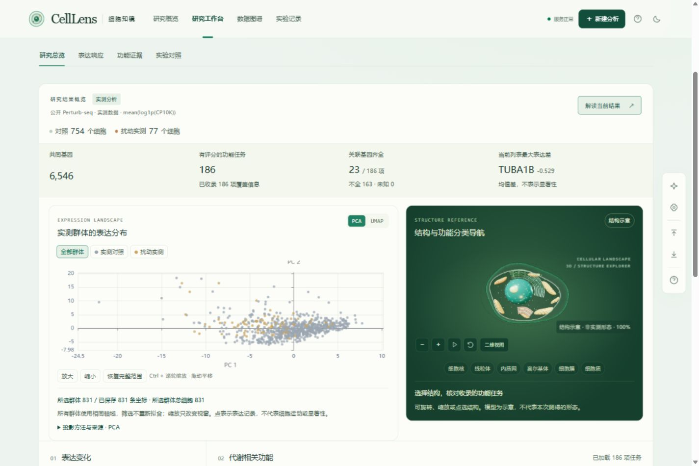
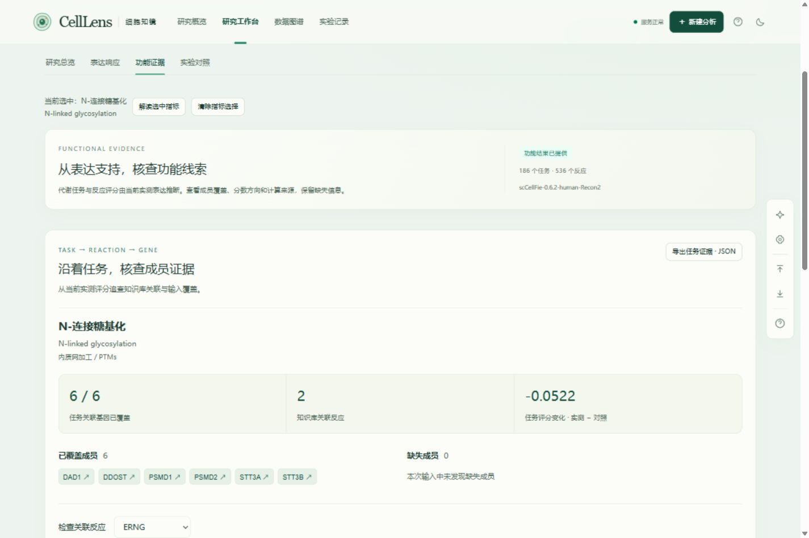

# 评审改进

本轮由三位未继承实现对话的独立评委，分别检查产品体验、科研真实性和细胞展示；实施代理完成修复后，再由独立代理复核，主代理负责取舍、整合、实际计算与浏览器验收。报告保留初始问题，不用修复后的状态倒填评审结论。

当前活动项目为 `D:\全球校园人工智能精英大赛\celllens-national`，本地服务为 <http://127.0.0.1:8028>。原项目与已经完成的计算均保留；C 盘旧工作树不是本次交付源码。

## 本轮改进

| 评审问题 | 交付结果 |
|---|---|
| 三张入口混合了任务和数据来源 | 两项任务：实测数据分析、基因扰动预测；公开/自有 H5AD 作为实测来源 |
| 结果被展示图挤到下方 | 群体数量、表达面板、功能覆盖和主要变化先出现，再看投影与结构导航 |
| 左右布局、工具栏和文字协调性不足 | 保留绿色设计，统一留白；背景页恢复内边距；手机工具栏折叠到页面末尾，指标自动分列 |
| 结构图缺乏研究操作价值 | 支持缩放、复位、暂停、二维替代；内质网/高尔基体连接冻结知识分类中的实际任务 |
| 任务只有分数、没有追查入口 | 实测任务可查看知识库关联反应、GPR、已覆盖/缺失基因及来源哈希，点击基因返回表达证据 |
| 群体筛选改变投影标尺 | 使用全体冻结坐标的固定轴域；保留细胞身份、可见/总数量、PCA/UMAP 参数与复位 |
| 原运行与匹配群体混淆 | 分别记录原群体与匹配诊断群体；原运行投影明确标识，导出两套表各自绑定群体和来源 |
| 指标容易支持过强结论 | 添加批次权重敏感性、覆盖分层、重复评分结构、DE 分母和非留出说明 |
| 自有数据入口不知如何准备 | 展示真实受控目录、字段示例、只读检查代码与尺度说明；输入异常返回明确错误 |
| 编辑与跳转细节易丢失 | 切换公开/自有来源保留编辑条件；兼容旧预测对照链接；中文任务搜索保留原始英文标识 |
| AI 解读遗漏诊断限制 | 本地上下文包含批次结论翻转、覆盖和评价指纹；本轮未向外部 AI 发送数据 |

## 实际运行与验收

本轮重新执行三条完整链路，均返回完成结果，随后验收结果读取、投影、任务证据、CSV、报告与 ZIP。使用的是已有真实数据和模型，以下是工程验收案例，不是新开展的生物学实验。

| 链路 | 记录 | 实际结果 |
|---|---|---|
| STATE GPU 预测 | `run_7413f05770d14a22` | Jurkat/ALDOA，64 条预测，seed=20261108；原群体 1024/64，匹配群体 613/55/50 |
| 已登记自有 H5AD | `measured_beecf1c152044ecaa59df964` | 16 对照、16 实测；来源是公开真实数据的工程验收子集 |
| 公开实测 | `measured_9253d6f68c2e484bb6332bc4` | K562/ALDOA，目标实测上限 16；最终 270 对照、16 实测 |

新预测的相对不变化基线 MSE 为原汇总 **0.954**、批次等权 **1.065**，系统如实提示结论依赖批次权重。此前案例的 **0.936 → 1.143** 也完整保留。批次等权只是敏感性诊断，不自动代表更正确的真值；不同记录的参考细胞也不相同，不能直接据此宣称模型改进。

验证覆盖：

- 后端完整回归 **538 项通过**；前端 **60 项检查通过**。
- 全项目 Python 类型检查 **0 错误、0 警告**；Ruff、前端类型检查和 808 模块生产构建通过。Three.js 懒加载块约 545 kB，构建仍提示体积警告。
- 真实浏览器检查 390、900、1440、1920 像素宽度，包括浅/深色、工具栏 Escape 焦点、结构导航、中文检索、旧链接、来源抽屉与边距；验收期间未记录浏览器控制台错误。
- 138 个已有结果文件哈希不变；原有 1 条研究笔记保留。API、CPU/GPU worker 重启后均就绪，三条新记录可继续读取。

原始证据：[API 验收](verification/judge-review/api-acceptance.md)、[浏览器记录](verification/judge-review/browser-acceptance.json)、[最终运行检查](verification/judge-review/final-runtime.json)、[后端测试 XML](verification/judge-review/backend-tests.xml)。评审及修复闭环见[产品评审](verification/judge-review/product-review.md)、[科研评审](verification/judge-review/science-review.md)、[细胞评审](verification/judge-review/cell-review.md)、[产品复核](verification/judge-review/product-verification.md)、[科研复核](verification/judge-review/research-verification.md)。

## 运行与演示

保持当前服务开启即可浏览。关闭后，在活动目录执行 `powershell -File ops/run-local.ps1 -Gpu -Port 8028`；停止使用 `ops/stop-local.ps1`。不要对当前共享环境使用 `-Install`。更换电脑需按照[部署说明](CPU部署.md)准备专用环境、真实数据、知识库和模型资产。

建议按[演示流程](演示流程.md)展示：研究问题 → 实测表达 → 任务成员证据 → 模型与实测诊断 → 来源与导出。固定完整案例用于主线，新任务可在后台执行。详细操作见[使用说明](使用说明.md)。

## 明确的交付范围

本版完成了本地完整运行和可部署源码。Linux/systemd、反向代理与 HTTPS 提供部署模板，尚未在目标远程主机现场验收。浏览器窄屏检查不等于手机实机测试；PDF/HTML 报告本轮核验了格式与内容身份，没有逐页重新做视觉验收。

三维细胞仍是结构与知识导航，不是从 RNA 重建出的真实形态、药物形变或 4D 动力学。PCA/UMAP 是表达空间，scCellFie 是表达派生支持评分。独立留出泛化、真实代谢通量、实验验证和研究者试用仍需另行开展；当前软件不把这些未完成工作包装成已有成果。
